[back to index](../README.md)

# 5. Building Block View

## 5.1 Level 1: Container View

Factory Flow Control produces usage evidence and distributes the opt-in Usage
Analysis system. The two systems share only the Factory-owned record contract
and local JSONL spool.

| Container                  | Responsibility                                                                                                                                                                                                                                                                                                                  | Technology                        |
| -------------------------- | ------------------------------------------------------------------------------------------------------------------------------------------------------------------------------------------------------------------------------------------------------------------------------------------------------------------------------- | --------------------------------- |
| **Eligibility Engine**     | Evaluates agent preconditions against the repository, derives per-agent readiness, and classifies agents by eligibility                                                                                                                                                                                                         | Python 3.10+                      |
| **Validator**              | Enforces gates, permissions, project-declared test gate presence, agent-context structure, and semantic quality checks                                                                                                                                                                                                          | Bash, Python                      |
| **Dispatcher**             | Resolves agents/models from catalog, spawns CLI sessions with scoped permits                                                                                                                                                                                                                                                    | Bash, Python                      |
| **Usage Capture**          | Normalizes CLI transcripts and appends canonical runtime usage records with optional workstream context                                                                                                                                                                                                                         | Python, shell, TypeScript         |
| **Distribution**           | Installs, updates, removes, and reports opt-in components without coupling them to Factory core                                                                                                                                                                                                                                 | Bash, Python                      |
| Workstream State           | Immutable workstream identity records under `.agent-factory/workstreams/`; each records schema_version, workstream_id, topic, and origin_ref                                                                                                                                                                                    | YAML (storage)                    |
| Session Bindings           | Session-to-workstream mapping under `.agent-factory/workstreams/sessions/<session-id>.yaml`; records session_id, workstream_id, and bound_at                                                                                                                                                                                    | YAML (storage)                    |
| State Files                | Local git-ignored run state under `.current-work/`: the ledger of each run, the gate result files, the `premerge-check-ok` and `verify-base-ok` markers, the briefs, and the step manifests. `dispatch close` removes the state of its run                                                                                      | YAML/JSON (storage)               |
| Run Worktrees              | git worktrees under `.current-work/<feature-branch>/` of the primary checkout: the worktree of the feature branch and the story worktrees of an orchestrated run, and the temporary detached worktrees of `premerge-check` in both ways: `premerge/<id>` for a story or a finding, and `premerge/feature` for the feature merge | git worktrees (storage)           |
| Catalog                    | Generated `.agent-factory/factory/INDEX.yaml` from agent/skill/playbook/rulebook frontmatter, with token counts                                                                                                                                                                                                                 | YAML (storage)                    |
| Usage Record Contract      | Factory-owned record schema and producer-consumer compatibility policy; v1 schema includes optional workstream and origin fields                                                                                                                                                                                                | JSON Schema, YAML                 |
| Raw Usage Spool            | Authoritative append-only records under `.agent-factory/usage/`                                                                                                                                                                                                                                                                 | JSONL (storage)                   |
| Install Manifest           | Records installed CLI integrations and opt-in components                                                                                                                                                                                                                                                                        | JSON (storage)                    |
| Project Filesystem         | Project-controlled source, configuration, documentation, and transient onboarding paths; Factory changes them only through defined contracts and consent gates                                                                                                                                                                  | Filesystem (storage)              |
| **OpenCode Plugin**        | V2 plugin adapter mapping Factory safety controls to OpenCode session hooks, tool restrictions, and worktree isolation                                                                                                                                                                                                          | TypeScript/OpenCode V2 Plugin API |
| OpenCode Catalog           | OpenCode-visible agent definitions under `.opencode/agents/` and index at `.opencode/INDEX.yaml`, generated by init-factory                                                                                                                                                                                                     | YAML/Markdown (storage)           |
| **Usage Analysis Runtime** | Reads a snapshotted input set and publishes versioned local DuckDB views                                                                                                                                                                                                                                                        | Python, DuckDB, PyArrow           |
| DuckDB UI                  | Optional ephemeral localhost exploration of the published views                                                                                                                                                                                                                                                                 | DuckDB bundled UI                 |
| Installed Analysis Module  | Locked executable package, SQL, registry, and contract copy under `.agent-factory/usage-analysis/`                                                                                                                                                                                                                              | Files (storage)                   |
| **Factory Agents**         | Agent definitions under `packages/factory/agents/`; a CLI session runs one definition and writes only the outputs it declares                                                                                                                                                                                                   | Markdown with YAML frontmatter    |
| Core Artifacts             | The core files under `docs/spec/` and the seam files `docs/agent-context.md` and `docs/testing.yaml`; each has exactly one producer and a declared review                                                                                                                                                                       | Markdown, DSL, YAML (storage)     |
| Working Output             | Files under `docs/spec/work/`, `docs/reviews/`, and `docs/findings/`; several declared writers, each changing only its part                                                                                                                                                                                                     | Markdown (storage)                |
| Core List                  | `rulebooks/core-artifacts.yaml` under the Factory root (`packages/factory/` in this repository, `.agent-factory/factory/` in an installed project): every core and seam artifact with its path pattern, sample path, family, and whether a project may lack it                                                                  | YAML (storage)                    |
| **ID Allocation**          | Claims the number of every new story, finding, todo entry, and ADR on the project's git remote; leaves no ref and no object in the clone                                                                                                                                                                                        | Script, git CLI                   |
| Finding Registers          | The folders `docs/findings/register/<class>/`, one per review class: one JSON register file `<ID>.json` per `minor` finding, with status `open`, `resolved`, or `waived`                                                                                                                                                        | JSON (storage)                    |
| Finding Schemas            | `packages/factory/rulebooks/schemas/finding-register-<class>.schema.json`, one per review class, each with the basis shape of its class                                                                                                                                                                                         | JSON Schema (storage)             |
| Factory Settings           | `docs/factory-settings.yaml`, tracked: `release_tag_patterns` names the git tags that count as releases for the `in_use` check. The project writes it; `init-factory` and `update-factory` never do                                                                                                                             | YAML (storage)                    |

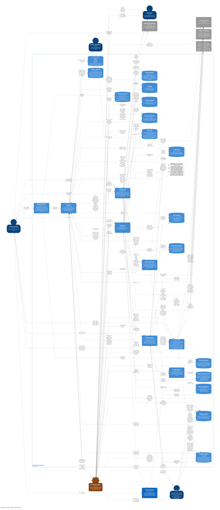

## 5.2 Level 2: Component View -- Validator

The **Validator** container enforces deterministic gates. Two are hook-triggered -- they fire mechanically on a git or CLI event, so an agent cannot skip them:

| Component                  | Trigger Point                                                                                | What it validates                                                                                                                                                                                                                                                                     | Exit codes          |
| -------------------------- | -------------------------------------------------------------------------------------------- | ------------------------------------------------------------------------------------------------------------------------------------------------------------------------------------------------------------------------------------------------------------------------------------- | ------------------- |
| **block-dangerous-git.sh** | Native hook of Claude Code, Codex, and Copilot CLI; called by the entries of pi and OpenCode | The one git guardrail: destructive and remote commands, gate bypasses, test commands outside `docs/testing.yaml`, merges without a current `premerge-check-ok` marker, and `dispatch return-story` and `dispatch close --drop` ([5.13](#513-level-2-component-view----run-lifecycle)) | 0 (allow), 2 (deny) |

One is a structural validator for project knowledge files, running both as a pre-commit hook and on demand:

| Component        | Trigger Point              | What it validates                                                                                                                                              | Exit codes              |
| ---------------- | -------------------------- | -------------------------------------------------------------------------------------------------------------------------------------------------------------- | ----------------------- |
| **concern-lint** | Pre-commit hook, on-demand | Concern-oriented agent context: category headings, `Read:`/`Boundary:` path resolution, story concern vocabulary, absence of legacy YAML files (`CTX-*` codes) | 0 (pass), 1+ (findings) |

Two more -- `schema-validate` and `policy-validate` -- are on-demand validators invoked by the research skills and agents (and from the CLI) rather than by a hook. They are described in [section 5.2.2](#522-research-artifact-validators-schema-validate-policy-validate).

Four gates enforce semantic code quality. The implementation agent runs them in the gate-check step, and `premerge-check` runs them again at the merge; [section 5.2.3](#523-semantic-quality-gates-crap-score-mutation-testing-dependency-check-test-design-verify) describes them. `gate-setup-proof` in the table below is no gate: it is the setup check of `crap-score`, which runs once before a person enables the gate. Further validators check architecture routing, agent outputs, proposals, and ownership:

| Component                   | Trigger Point                                                                                         | What it validates                                                                         | Exit codes                                                      |
| --------------------------- | ----------------------------------------------------------------------------------------------------- | ----------------------------------------------------------------------------------------- | --------------------------------------------------------------- |
| **crap-score**              | Gate-check step; `premerge-check` at the merge                                                        | CRAP score per changed function, from the rows of the project's measuring commands        | 0 (pass), 1 (fail), 2 (cannot measure)                          |
| **gate-setup-proof**        | Skill `setup-crap-score`, before a person enables the CRAP gate                                       | A measuring command reports true coverage of its folder and reports a failed test run     | 0 (all checks pass), 1 (a check fails), 2 (wrong call or plant) |
| **dependency-check**        | Gate-check step; `premerge-check` at the merge; pre-commit hook `agent_factory_hook-dependency-check` | Imports conform to the `dependency-rules.dsl` rules                                       | 0 (pass), 1 (violations), 2 (rules file or source root missing) |
| **test-design-verify**      | Gate-check step and `premerge-check`, when the story has a Test Design or a Prior Tests section       | Every owned contract in the story's traces has a test assertion                           | 0 (pass), 1 (fail)                                              |
| **mutation-testing**        | Gate-check step; `premerge-check` reads its result file                                               | Runs `gates.mutation-testing.command` within its time limit                               | 0 (pass), 1 (fail or could not run), 2 (usage)                  |
| **module-graph-check**      | Orchestrating session, at architecture boundary                                                       | Feature touches no new modules or inverted dependencies                                   | 0 (result on stdout), 2 (input missing)                         |
| **Fence Runner**            | After agent activity completion                                                                       | Agent declared outputs exist and pass applicable validators                               | 0 (pass), 1 (violations)                                        |
| **Proposal Validator**      | `intent assess`, on-demand                                                                            | Proposal file existence, markdown format, required fields                                 | 0 (pass), 1 (violations)                                        |
| **Ownership Contract Test** | Factory test suite                                                                                    | Each core list entry has exactly one producer, and its declaration carries `reviewed_by:` | 0 (pass), 1 (fail)                                              |

### 5.2.1 Project-Owned Test Gates via Charter Declaration

**Purpose**: Factory ensures test gates exist; the project decides what runs inside them. Testing is project-owned infrastructure declared in `testing.yaml` (at `docs/testing.yaml`). Factory's guardrails and eligibility preconditions read that declaration. Factory does not own test execution, framework detection, or structured test output.

**Test configuration** (`testing.yaml`, resolved via format detection):

- `test_command` (required) -- full test suite command, used by precondition evaluation
- `test_staged_command` (optional) -- command for TDD iteration on staged files, allowlisted for agents
- `test_changed_command` (optional) -- command that runs the tests of the changed files; the story merge of premerge-check appends the changed paths and runs it instead of `test_command`
- `layers` (optional) -- layer bindings mapping Factory layer names to project-specific tooling, infrastructure, entry points, anti-patterns, and fidelity declarations

**Gate contract**: exit-code-only. Zero means pass, nonzero means fail. Factory does not parse structured test output (BR-027).

**Integration Points**:

- **Precondition evaluation**: The Eligibility Engine's precondition evaluator checks agent `inputs.required` declarations against the filesystem. Agents that require passing tests declare `testing.yaml` as a required input. Blocks when the test configuration is absent or `test_command` is missing.
- **Agent allowlist** (BR-024): `block-dangerous-git.sh` reads all declared command fields from `testing.yaml` (via format detection) and allowlists them with exact-string matching. Bare test commands remain blocked for agents.
- **Onboarding**: The test-strategy agent scans for existing test entrypoints with the `detect-test-regime` skill and populates `testing.yaml`. When multiple entrypoints are detected, it asks for disambiguation. The stakeholder confirms every change to the file. In step 2b of the fitting, the session takes the test-strategy agent's role.
- **Project hooks**: Factory does not inject test hooks into `.pre-commit-config.yaml`. Test hooks are project-owned infrastructure.

**Referenced Specifications**:

- `UC-09 -- Ensure Project-Owned Test Gates Exist`
- [ADR-0003 -- Test execution via mechanically triggered gates](../adr/0003-test-execution-via-hooks.md)
- [test-gate-presence.feature](../spec/features/test-gate-presence.feature)
- [validation-rules.md section Test execution (BR-023..BR-029)](../spec/validation-rules.md#project-owned-test-gates-testingyaml-br-023-br-024-br-025-br-026-br-027-br-028-br-029)

### 5.2.2 Research artifact validators (schema-validate, policy-validate)

The falsification-driven research feature validates its JSON artifacts through a fixed three-stage order -- **schema, policy, semantic** -- that splits validation by whether a machine can decide it. The first two stages are deterministic scripts in this container; the third is human or agent judgment, outside it. Unlike the hook gates above, these are invoked on demand by the research skills and agents, and from the CLI.

| Component           | Stage       | What it validates                                                                                                                        | Exit codes                                        |
| ------------------- | ----------- | ---------------------------------------------------------------------------------------------------------------------------------------- | ------------------------------------------------- |
| **schema-validate** | 1 -- schema | One JSON artifact against one JSON Schema: required fields, types, enums, identifier patterns, timestamps, array minimums                | 0 (conforms), 1 (violations), 2 (operational)     |
| **policy-validate** | 2 -- policy | The enforceable half of the four research policies across related artifacts: role separation, references, quorum, current claim versions | 0 (pass), 1 (policy/schema fail), 2 (operational) |

**Behavior**:

- Both are stdlib-only Python (3.8+), no third-party dependencies -- the same zero-install pattern as `spec-lint` and `arch-lint`.
- `schema-validate <artifact-file> <schema-file>` is stage 1, the load-bearing gate every later stage assumes. It implements only the JSON-Schema keyword subset the research schemas need, not a full Draft implementation.
- `policy-validate <artifact-or-dir>...` is stage 2. Its `--pipeline` mode runs stage 1 then stage 2 in order and stops at the first failing stage.
- Semantic judgment -- evidence support, source independence in substance, test severity, claim atomicity -- is stage 3, deliberately left to a qualified human or agent reviewer. No script decides it.
- The schemas the validators read live in `.agent-factory/factory/rulebooks/schemas/research-*.schema.json`, a rulebook category of JSON-Schema data contracts that is intentionally absent from `INDEX.yaml` (which catalogs Markdown only).

**Referenced Specifications**:

- [ADR-0006 -- Research: flat storage and validation pipeline](../adr/0006-research-flat-storage-and-validation-pipeline.md)
- [factory/playbooks/research-topic.md section The Validation Gate](../../.agent-factory/factory/playbooks/research-topic.md)

### 5.2.3 Semantic quality gates (crap-score, mutation-testing, dependency-check, test-design-verify)

The gates check code meaning in the gate-check step: complexity, dependency direction, test design, and surviving mutants. The implementation agent runs them in the gate-check step in both ways of driving a run, and `premerge-check` runs them again at the merge. [ADR-0012](../adr/0012-dispatcher-owned-semantic-gate-loop.md) records why the developer agent never runs them, and [ADR-0038](../adr/0038-premerge-check-reruns-the-gates-in-a-temporary-worktree.md) records the rerun.

| Component              | What it checks                                                                                                                          | Inputs                                                                                                                                                                  | Outputs                                                                 |
| ---------------------- | --------------------------------------------------------------------------------------------------------------------------------------- | ----------------------------------------------------------------------------------------------------------------------------------------------------------------------- | ----------------------------------------------------------------------- |
| **crap-score**         | CRAP score per changed function: `comp(m)^2 x (1 - cov(m)/100)^3 + comp(m)`, against `gates.crap-score.threshold`, which has no default | `gates.crap-score` in `docs/testing.yaml`; the rows of the measuring commands; `threshold`, `files`, `exclude`, and the exceptions register from the integration branch | JSON report per judged function in the folder that `--report-dir` names |
| **dependency-check**   | Module import directions match the rules in `dependency-rules.dsl`; each failing entry carries `owner: architecture-agent`              | `docs/spec/dependency-rules.dsl`, Python source files                                                                                                                   | JSON report per rule in `.current-work/dependency-check/`               |
| **test-design-verify** | Every owned contract in the story's traces has a test assertion                                                                         | The story file                                                                                                                                                          | JSON result in `.current-work/test-design-verify/`                      |
| **mutation-testing**   | The project's mutation command passes within `gates.mutation-testing.timeout_minutes`; the gate-check step adds the list `mutants`      | `gates.mutation-testing.command`                                                                                                                                        | JSON result in `.current-work/mutation-testing/`                        |

The gates of a unit of work are `dependency-check` when `docs/spec/dependency-rules.dsl` exists, `test-design-verify` when the story has a Test Design or a Prior Tests section, and every entry under `gates` in `docs/testing.yaml` with `enabled: true` and a command. `premerge-check` builds the calls of `crap-score` and `mutation-testing` itself. A story's `quality-gates` field can only add gates ([BR-066](../spec/validation-rules.md#ownership-and-spec-feedback-reports-core-artifact-ownership-br-056br-066)). The test-strategy agent owns the test guardrails, their thresholds, and their commands. `dependency-check` stays with the architecture agent, because that agent owns the rules ([ADR-0027](../adr/0027-split-the-requirements-agent-by-artifact-family.md)).

A failing gate gets a fresh developer agent with only the gate's output and the affected files. A unit of work gets `gates.attempts` counted attempts on its tier and then `gates.attempts_escalated` attempts on the next tier, and is `failed` when they are used up. [6.4](06_runtime_view.md#64-gate-check-step) shows the step.

#### The CRAP gate

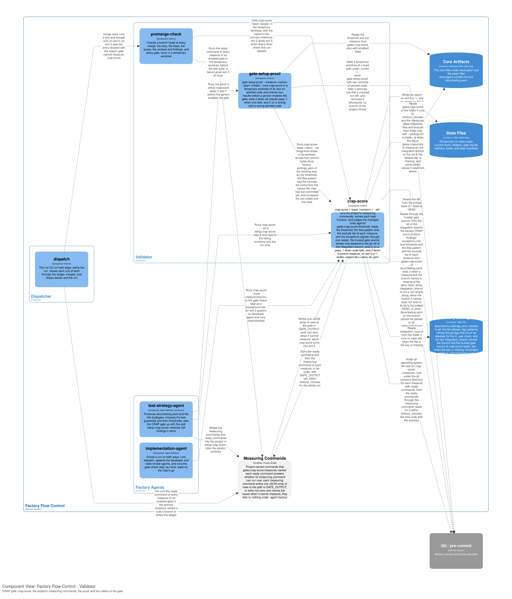

The project measures, and the Factory judges. `crap-score` holds no language-specific code. For each measure under `gates.crap-score.measures`, it runs the project's `ready` command, if the measure has one, and then the measuring command. Both are Measuring Commands, scripts that the project owns. The measuring command writes one JSON array of rows to the path in `GATE_OUTPUT`: per function its file, qualified name, line range, complexity, and coverage. `crap-score` computes the scores and judges only the functions whose line range holds a changed line. [Interface contracts](../spec/interface-contracts.md#agent-factoryfactoryscriptscrap-score) define the call, the row format, and the report. BR-127 to BR-139 hold the rules.

Three callers start the gate, and each passes the revision that decides which lines changed:

| Caller                                    | Call                                                                                   | Folder the gate runs in                                        |
| ----------------------------------------- | -------------------------------------------------------------------------------------- | -------------------------------------------------------------- |
| Implementation agent, gate-check step     | `crap-score --base <feature-branch>`, as a background job                              | The story's worktree, or the primary checkout in a run by hand |
| `premerge-check`, at the merge of a story | `crap-score --base <target> --report-dir <primary checkout>/.current-work/crap-score/` | Its temporary worktree at the branch head                      |
| `gate-setup-proof`, during setup          | `crap-score --base <start> --settings-from-folder`, once per run of a check            | Its own temporary worktree                                     |

The test-strategy agent also runs `crap-score --all` once in setup step 6, to count the functions that would fail and to measure the run time.

A story must not decide what counts as accepted for its own code. So `crap-score` reads three kinds of values from outside the story: the `threshold`, the `files` pattern and the `exclude` list of each measure, and the section CRAP score of the exceptions register `docs/findings/exceptions.md`. One reader inside `crap-score`, the trusted gate source, returns them, with notices that say where each value came from. Its only backend is the git ref of the integration branch. The key `integration_branch` of `docs/factory-settings.yaml` names that branch, and `dev` applies when the file or the key is missing. `crap-score` reads the key from the tree of the `--base` revision, which a story cannot change. It reads the key from the folder only with `--all` or `--settings-from-folder`, that is in the setup and in the proof, and the merge path passes neither. The value must be a local branch name, so a tag, a remote ref, or a revision such as `story/ST-0350~1` makes `crap-score` exit `2`. `crap-score` resolves `--base` once, and a local branch wins over a tag of the same name. The diff and the reading of the key both use that commit, so a tag named like the feature branch cannot move the base. The reader then reads every trusted value from the tip commit of `refs/heads/<integration_branch>`. The `command` and `ready` of each measure still come from the story head, because the measuring command measures the story's code (BR-136).

The reader also has to work where the branch holds no trusted values yet. Without `docs/testing.yaml` on the branch, or without `gates.crap-score` there, the reader takes `threshold`, `files` and `exclude` from the folder and prints why. A missing ref of the default `dev` falls back the same way only with `--all` or `--settings-from-folder`, in the setup and the proof, and the reader then reads no register. With `--base` alone, a missing `dev` makes `crap-score` exit `2`, because a story agent could otherwise delete `dev` and be judged by its own values. A measure that the integration branch does not name yet takes its `files` pattern and its `exclude` list from the story head, and the output marks it as not yet trusted. A measure that the branch names and the story head lacks makes `crap-score` exit `2`, because a story could otherwise drop a measure and pass every function it judged. Only the default `dev` may be missing: when `docs/factory-settings.yaml` names a branch, a story could otherwise point the key at a missing branch or at its own branch and judge itself by its own values. So `crap-score` also exits `2` when the named branch does not exist, or, with `--base`, when its tip is the judged `HEAD`. With `--all`, setup step 6 runs on the checked-out integration branch, whose tip is `HEAD` by design. A broken source does not fall back either: `crap-score` exits `2` when `integration_branch` is not a non-empty string, or when `docs/testing.yaml` on the branch cannot be parsed or its `gates.crap-score` has no `threshold`.

`gate-setup-proof` checks values that the User has not committed, so it passes `--settings-from-folder`. Then `threshold`, `files` and `exclude` come from the folder, and the register still comes from the integration branch. The first commit of the proof worktree holds `docs/factory-settings.yaml` of the working tree, so `crap-score` there reads the same integration branch. With the option, `crap-score` skips the check for a missing measure, because the proof lists only the chosen measure. `premerge-check`, `dispatch`, and the gate-check step never pass the option. A later backend, such as a knowledge-graph store or Jira, is a new class behind the same reader, and the gate logic stays unchanged. [ADR-0041](../adr/0041-crap-score-reads-trusted-values-through-one-reader.md) records the decision.

`crap-score` has three exit codes. `0` means that every judged function passes or is accepted in the exceptions register. `1` means that a changed function fails, so a fresh developer agent fixes the code. `2` means that the gate cannot measure, for example because a measuring command failed or the time limit expired. Then nobody judged the code, so no developer agent starts and no attempt counts, and the unit of work stops as `blocked`. [8.7](08_crosscutting_concepts.md#gate-exit-codes) describes this path. `premerge-check` turns exit `2` into its own exit `3`, and `dispatch merge-story` turns exit `3` into `blocked`.

`gate-setup-proof` is the setup check of `crap-score`, not a gate: no story and no merge runs it. It checks one measure before a person enables the gate. It plants an untested function and a tested one in a temporary worktree and runs `crap-score` there. The gate must give the same result twice, fail the untested function, pass the tested one at full coverage, and exit `2` on a planted failing test. So a measuring command that reports false coverage, measures another folder, or hides a failed test run does not pass the proof (BR-138).

`dependency-check` also runs as the pre-commit hook `agent_factory_hook-dependency-check` when a commit stages a `.py` file under the source root. Without `docs/spec/dependency-rules.dsl`, the hook prints a notice and passes. The other gates take minutes, so they run only in the gate-check step and at the merge, never in a commit hook.

### 5.2.4 Module-graph check

A deterministic script that replaces manual architecture-change declarations with mechanical detection. It reads the current module map from `architecture.dsl` and compares it against concept outputs (`interface-contracts.md`, `entity-model.md`) to determine whether the feature changes module boundaries, dependency directions, or public interfaces.

**Interfaces:**

- **IN:** `docs/spec/architecture.dsl`, `docs/spec/interface-contracts.md`, `docs/spec/entity-model.md`
- **OUT (exit code):** 0 (no module-graph change, skip architecture), 1 (module-graph change detected, enter architecture)
- **OUT (side effect):** Updates the proposal's `impact.architecture_change` field in frontmatter

**Override semantics:**

- Prior `false`, machine says `true`: machine wins, field updated and annotated `# mechanical detection`.
- Prior `true`, machine says `false`: human declaration respected conservatively; machine result logged but field unchanged.
- Human explicit override: recorded as a comment on the field.

**Referenced Specifications:**

- [ADR-0012 -- Dispatcher-owned semantic gate loop](../adr/0012-dispatcher-owned-semantic-gate-loop.md)
- [Proposal: Agentic Quality Gates and Requirements Consolidation](../proposals/implemented/agentic-quality-gates-and-specification-consolidation.md)

### 5.2.5 Agent context validation (concern-lint)

`concern-lint` validates the concern-oriented agent context (`docs/agent-context.md`). It replaced the four-file YAML `context-lint` (`CX-*` codes) in 0.9.0. All findings are errors.

| Code           | Condition                                                                                                                                                  |
| -------------- | ---------------------------------------------------------------------------------------------------------------------------------------------------------- |
| `CTX-SECTIONS` | A required category heading is absent, or a concern section lacks a description or `Read:` path                                                            |
| `CTX-PATHS`    | A repository-relative path or glob on a `Read:` or `Boundary:` line has no match                                                                           |
| `CTX-REFS`     | A technical or domain concern name in a story's `concerns:` frontmatter has no matching heading in `docs/agent-context.md`                                 |
| `CTX-LEGACY`   | `docs/agent-context.md` exists beside legacy YAML agent-context files or `docs/charter/`; `docs/testing.yaml` is the only accepted test-configuration path |

The three required category headings are `## Always (cross-cutting)`, `## Technical concerns`, and `## Domain concerns`. Cross-cutting concerns are always active; technical and domain concern names form a controlled vocabulary confirmed by the planning maintainer.

**Concern routing** is shared across all factory consumers: agents discover project knowledge through concern sections in `docs/agent-context.md`, each carrying `Read:` paths to the relevant documents. `testing.yaml` path resolution is independent (`docs/testing.yaml`). See [section 8.11](08_crosscutting_concepts.md#811-agent-context-as-cross-cutting-concern).

**Referenced Specifications:**

- [agent-context.feature](../spec/features/agent-context.feature)
- [interface-contracts.md section concern-lint](../spec/interface-contracts.md#agent-factoryfactoryscriptsconcern-lint)
- [validation-rules.md section Concern registry validation](../spec/validation-rules.md#concern-registry-validation-concern-lint-ctx--codes)

## 5.3 Level 2: Component View -- Eligibility Engine

The **Eligibility Engine** is a pure domain-logic container. It evaluates agent preconditions against the repository, derives per-agent readiness, and classifies agents by eligibility. It never writes state, acquires locks, or imports scripts, configuration, or agent definitions. The dependency direction is inward: adapters call the engine, never the reverse.

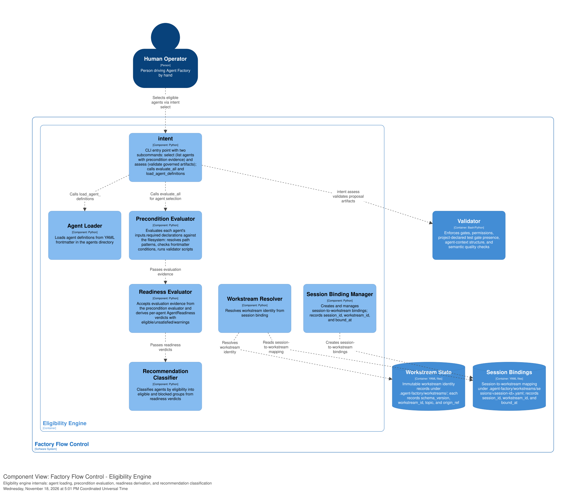

| Component                     | What it does                                                                                                                                                | Reads                             | Returns                                   |
| ----------------------------- | ----------------------------------------------------------------------------------------------------------------------------------------------------------- | --------------------------------- | ----------------------------------------- |
| **intent**                    | CLI entry point with two subcommands: `select` (list agents with precondition evidence) and `assess` (validate governed artifacts); calls `evaluate_all`    | CLI arguments                     | Formatted agent list or assessment report |
| **Agent Loader**              | Loads agent definitions from YAML frontmatter in the agents directory                                                                                       | Agent definition files            | Parsed agent definitions                  |
| **Precondition Evaluator**    | Evaluates each agent's `inputs.required` declarations against the filesystem: resolves path patterns, checks frontmatter conditions, runs validator scripts | Agent definitions, filesystem     | Per-agent evaluation evidence             |
| **Readiness Evaluator**       | Accepts evaluation evidence from the Precondition Evaluator and derives per-agent readiness verdicts with eligible/unsatisfied/warnings                     | Evaluation evidence               | AgentReadiness verdicts                   |
| **Recommendation Classifier** | Classifies agents by eligibility into eligible and blocked groups from readiness verdicts                                                                   | Readiness verdicts                | Eligible and blocked agent groups         |
| **Workstream Resolver**       | Resolves workstream identity from session binding                                                                                                           | Session binding, workstream state | Resolved workstream identity              |
| **Session Binding Manager**   | Creates and manages session-to-workstream bindings; records session_id, workstream_id, and bound_at                                                         | CLI session context               | Session binding file                      |

All components are stateless functions. The engine receives its inputs and returns results; it has no side effects. This separation ensures the engine can be tested in isolation with no filesystem or lock dependencies.

## 5.4 Level 2: Component View -- Dispatcher

| Component                        | What it does                                                                                                                                                                                                                                                                                                     | Reads                                                                                            | Writes                                     |
| -------------------------------- | ---------------------------------------------------------------------------------------------------------------------------------------------------------------------------------------------------------------------------------------------------------------------------------------------------------------- | ------------------------------------------------------------------------------------------------ | ------------------------------------------ |
| **trigger**                      | Resolves agent/model, spawns CLI session with scoped permits                                                                                                                                                                                                                                                     | INDEX.yaml                                                                                       | (none)                                     |
| **index-lint**                   | Generates INDEX.yaml from frontmatter with token budget counts and carries `reviewed_by:` and `edits:`; `--check` validates drift and fails on a reviewer that is unknown or lacks the artifact as an input                                                                                                      | source .md, core list                                                                            | INDEX.yaml                                 |
| **dispatch**                     | Runs the lifecycle of a run in both ways: `init`, `plan`, `prepare-wave`, `prepare-story`, `add`, the `mark-*` subcommands, `escalate`, `re-dispatch`, `refresh-story`, `merge-story`, `return-story`, `close-wave`, and `close`. [5.13](#513-level-2-component-view----run-lifecycle) describes the subcommands | ledger, backlog, finding files, spec-feedback reports, core list, `docs/testing.yaml`, git state | ledger, branches, worktrees, merge commits |
| **Ledger**                       | The classes `Ledger` and `StoryEntry` in `dispatch_lib.py` and the transition table of the Ledger Entry Lifecycle; decides HasStopped                                                                                                                                                                            | ledger                                                                                           | ledger                                     |
| **run-agent** (Pi extension)     | Pi model-callable tool: spawns a separate `pi` session to run one factory agent                                                                                                                                                                                                                                  | agent .md, model.conf                                                                            | (none)                                     |
| **dispatch-wave** (Pi extension) | Pi model-callable tool: runs a parallel wave of agents, each in its own git worktree, integrating `premerge-check` before merging                                                                                                                                                                                | agent .md, model.conf                                                                            | git worktrees, merges                      |
| **openrouter-discover**          | Curation tool: queries the OpenRouter catalog to curate/validate `pi.*` tier rows in model.conf, offline of the runtime path                                                                                                                                                                                     | OpenRouter API                                                                                   | (none)                                     |

## 5.5 Interfaces Summary

Every building block's entry point, invoked how, and by whom:

| Script / Component           | Invoked by                                                                      | Entry point                                                                                                                                 | Exit codes                                                                                                                   |
| ---------------------------- | ------------------------------------------------------------------------------- | ------------------------------------------------------------------------------------------------------------------------------------------- | ---------------------------------------------------------------------------------------------------------------------------- |
| intent                       | Human                                                                           | `.agent-factory/factory/scripts/intent select\|assess`                                                                                      | 0 (result), 1+ (error)                                                                                                       |
| block-dangerous-git.sh       | Native hook of Claude Code, Copilot CLI, and Codex; entries of pi and OpenCode  | stdin: CLI-specific command JSON, stdout: deny decision on refusal                                                                          | 0 (allow), 2 (deny)                                                                                                          |
| trigger                      | Human                                                                           | `.agent-factory/factory/scripts/trigger agent <name> [--background]`                                                                        | 0 (dispatched), 1+ (error)                                                                                                   |
| usage-capture                | Native CLI hooks and Pi extensions                                              | `.agent-factory/factory/scripts/usage-capture --cli ... --transcript ...`                                                                   | 0 (captured or best-effort no-op)                                                                                            |
| index-lint                   | Pre-commit hook, CI                                                             | `.agent-factory/factory/scripts/index-lint [--check]`                                                                                       | 0 (fresh), 1 (stale or reviewer finding)                                                                                     |
| dispatch                     | Implementation agent; the User for `return-story`, `close`, and `close --drop`  | `.agent-factory/factory/scripts/dispatch <subcommand>`                                                                                      | 0 (done or no-op), non-zero (refusal, failed check, or invalid transition)                                                   |
| dispatch close-wave          | Implementation agent                                                            | `.agent-factory/factory/scripts/dispatch close-wave <N>`                                                                                    | 0 (closed), non-zero (open or unconfirmed row, a unit of work that can still go on, unreadable report, or missing core list) |
| premerge-check               | `dispatch merge-story`; implementation agent for the feature merge              | `.agent-factory/factory/scripts/premerge-check <target> <branch> [--scope PATH ...] [--scope-glob GLOB ...] [--max-files N]`                | 0 (pass), 1 (a check fails), 2 (usage or git error), 3 (only a gate could not measure)                                       |
| Ownership Contract Test      | Factory test suite                                                              | `tests/factory/test_index_lint.py`                                                                                                          | 0 (pass), 1 (fail)                                                                                                           |
| run-agent (Pi extension)     | Pi session (via `run_agent` tool call)                                          | `.pi/extensions/run-agent.ts` spawns `pi ... -p <task>`                                                                                     | (tool result: text + usage, or error)                                                                                        |
| dispatch-wave (Pi extension) | Pi session (via `dispatch_wave` call)                                           | `.pi/extensions/dispatch-wave.ts` spawns worktree + merge/item                                                                              | (tool result: per-item status, or error)                                                                                     |
| openrouter-discover          | User, CI (`--check`)                                                            | `.agent-factory/factory/scripts/openrouter-discover [--list\|--suggest\|--check]`                                                           | 0 (ok), 1 (drift)                                                                                                            |
| schema-validate              | Research skills/agents, CLI                                                     | `.agent-factory/factory/scripts/schema-validate <artifact-file> <schema-file>`                                                              | 0 (conforms), 1 (violations), 2 (operational)                                                                                |
| policy-validate              | Research skills/agents, CLI                                                     | `.agent-factory/factory/scripts/policy-validate [--pipeline] <artifact-or-dir>...`                                                          | 0 (pass), 1 (fail), 2 (operational)                                                                                          |
| crap-score                   | Implementation agent, `premerge-check`, `gate-setup-proof`, test-strategy agent | `.agent-factory/factory/scripts/crap-score (--base <revision> \| --all) [--story-id <id>] [--report-dir <folder>] [--settings-from-folder]` | 0 (pass), 1 (fail), 2 (cannot measure)                                                                                       |
| gate-setup-proof             | Test-strategy agent in `setup-crap-score`                                       | `.agent-factory/factory/scripts/gate-setup-proof --measure <name> --plant <folder>`                                                         | 0 (all checks pass), 1 (a check fails), 2 (wrong call or wrong planted code)                                                 |
| dependency-check             | Implementation agent, `premerge-check`, pre-commit hook                         | `.agent-factory/factory/scripts/dependency-check [--story-id <id>]`                                                                         | 0 (pass), 1 (violations), 2 (input missing)                                                                                  |
| test-design-verify           | Implementation agent, `premerge-check`                                          | `.agent-factory/factory/scripts/test-design-verify <story-file> --story-id <id>`                                                            | 0 (pass), 1 (fail)                                                                                                           |
| mutation-testing             | Implementation agent                                                            | `.agent-factory/factory/scripts/mutation-testing --story-id <id> [--testing-yaml PATH] [--report-dir DIR]`                                  | 0 (pass), 1 (fail or could not run), 2 (usage)                                                                               |
| concern-lint                 | Pre-commit hook, validate skill                                                 | `.agent-factory/factory/scripts/concern-lint [--root DIR] [--format text\|json]`                                                            | 0 (pass), 1+ (CTX-\* findings)                                                                                               |
| module-graph-check           | Orchestrating session                                                           | `.agent-factory/factory/scripts/module-graph-check [--proposal PATH]`                                                                       | 0 (result on stdout), 2 (input missing)                                                                                      |
| Fence Runner                 | Post-agent-activity validation                                                  | Python module (`packages/factory/engine/fence.py`)                                                                                          | 0 (pass), 1 (violations)                                                                                                     |
| Proposal Validator           | `intent assess`, on-demand                                                      | Python module (`packages/factory/engine/validators/proposal.py`)                                                                            | 0 (pass), 1 (violations)                                                                                                     |
| Session Binding Manager      | Session start, workstream binding                                               | Python module (`packages/factory/engine/session_binding.py`)                                                                                | (internal)                                                                                                                   |
| install-agent-factory        | Newcomer                                                                        | `install-agent-factory --from-local\|--from-remote <src> --target <path>`                                                                   | 0 (installed), 1+ (error)                                                                                                    |
| build-release                | Release Maintainer                                                              | `factory/scripts/build-release --version <ver>`                                                                                             | 0 (published), 1+ (error)                                                                                                    |
| hook-demo                    | Newcomer (via onboarding)                                                       | `factory/scripts/hook-demo`                                                                                                                 | 0 (passed), 1+ (error)                                                                                                       |
| init-factory                 | install-agent-factory, Human                                                    | `factory/scripts/init-factory [--update] <path>`                                                                                            | 0 (installed/updated), 1+ (error)                                                                                            |
| update-factory               | Project Maintainer                                                              | `factory/scripts/update-factory [--check]`                                                                                                  | 0 (updated), 1+ (error)                                                                                                      |
| migrate-spec-layout          | init-factory on an update, Human                                                | `factory/scripts/migrate-spec-layout [--dry-run]`                                                                                           | 0 (moved or no work), non-zero (undone)                                                                                      |
| remove-factory               | Human                                                                           | `factory/scripts/remove-factory`                                                                                                            | 0 (removed), 1+ (error)                                                                                                      |
| usage-query                  | Human (operator)                                                                | `uv run --project .agent-factory/usage-analysis usage-query <view>`                                                                         | 0 (result), 1+ (preflight/error)                                                                                             |
| Input Snapshot               | usage-query (internal)                                                          | Python module                                                                                                                               | (internal)                                                                                                                   |
| Contract Check               | usage-query (internal)                                                          | Python module                                                                                                                               | (internal)                                                                                                                   |
| Operational Preflight        | usage-query (internal)                                                          | Python module                                                                                                                               | (internal)                                                                                                                   |
| Accounting Registry          | usage-query (internal)                                                          | Python module                                                                                                                               | (internal)                                                                                                                   |
| Query Model v1               | usage-query (internal)                                                          | DuckDB SQL views                                                                                                                            | (internal)                                                                                                                   |
| Result Adapters              | usage-query (internal)                                                          | Python module                                                                                                                               | (internal)                                                                                                                   |
| Parquet Exporter             | usage-query (internal)                                                          | Python module                                                                                                                               | (internal)                                                                                                                   |
| OpenCode Plugin              | OpenCode V2 plugin lifecycle                                                    | `packages/factory/config/plugins/agent-factory.ts` via `Plugin.define()`                                                                    | (plugin hooks)                                                                                                               |
| next-id                      | Producer steps of agents, Human (`--seed`)                                      | `.agent-factory/factory/scripts/next-id <PREFIX> [--remote <url>]`, `next-id --seed <number> [<PREFIX>=<n> …] [--remote <url>]`             | 0 (ID or seed lines on stdout), non-zero (reason on stderr, nothing on stdout)                                               |

## 5.6 Level 2: Component View -- Usage Capture

| Component         | Responsibility                                                                                                              |
| ----------------- | --------------------------------------------------------------------------------------------------------------------------- |
| **usage-capture** | Normalize one CLI-native transcript and append a canonical usage record to the raw spool, with optional workstream context. |

`usage-capture` is a CLI-agnostic pipeline with two adapter seams. A
CLI-specific normalizer maps Claude Code, Copilot, Codex, Pi, or OpenCode events into
ordered input/output text and nullable provider usage. The fixed
`cl100k_base` tokenizer produces comparable `normalized_*` counts. A JSONL
logging adapter appends the canonical record beneath `.agent-factory/usage/`
and persists the exact tokenized transcript copy referenced by the record.

When a session binding exists for the current CLI and session, the
workstream adapter reads the workstream identifier and workstream origin
from it and includes them in the usage record. These fields are optional
and nullable. Usage capture does not import the Eligibility Engine.

Native lifecycle adapters own invocation: Claude `Stop`/`SubagentStop`,
Copilot `agentStop`/`subagentStop`, Codex `Stop`/`SubagentStop`, Pi
`session_shutdown` plus inline child capture, and OpenCode `execute.after`
hooks via the Factory plugin. Each adapter fires exactly once per session.
See [ADR-0007](../adr/0007-normalize-runtime-usage-through-cli-adapters.md).

## 5.7 Level 2: Component View -- Usage Analysis Runtime

Usage Analysis is a separate bounded context and depends on Factory's published
usage-record contract. Factory capture has no dependency on analysis.

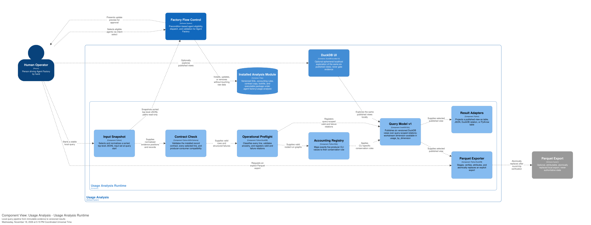

| Component                 | Responsibility                                                                                                                          |
| ------------------------- | --------------------------------------------------------------------------------------------------------------------------------------- |
| **Input Snapshot**        | Select and normalize a sorted list of top-level JSONL files once at query start.                                                        |
| **Contract Check**        | Validate the installed contract, every selected line, cross-field invariants, and version compatibility.                                |
| **Operational Preflight** | Classify every line, validate the rooted run graph, and register query-scoped valid and failure relations.                              |
| **Accounting Registry**   | Map exactly `claude-code`, `copilot`, `codex`, `pi`, and `opencode` to their conservation rule.                                         |
| **Query Model v1**        | Publish `raw_usage_snapshots`, `latest_run_snapshots`, `session_usage`, `usage_by_dimension`, `cache_efficiency`, and `capture_health`. |
| **Result Adapters**       | Project one published view as a table, JSON, DuckDB relation, or PyArrow table without reimplementing accounting.                       |
| **Parquet Exporter**      | Stage, verify, attribute, and atomically replace an explicit Parquet export.                                                            |

The valid and failure relations live only for the query process. When preflight
finds a failure, `capture_health` remains available while the other five stable
views refuse partial results. Raw JSONL remains authoritative; DuckDB state,
Parquet files, and UI state are disposable.

## 5.8 Level 2: Component View -- Distribution

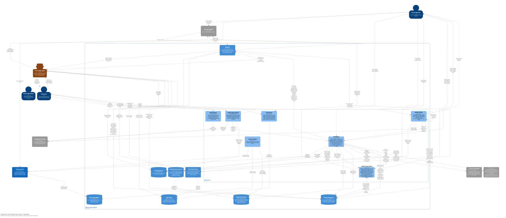

| Component                 | Responsibility                                                                                                                                                                                                                                                                                                                                                                                                                                                                           |
| ------------------------- | ---------------------------------------------------------------------------------------------------------------------------------------------------------------------------------------------------------------------------------------------------------------------------------------------------------------------------------------------------------------------------------------------------------------------------------------------------------------------------------------- |
| **install-agent-factory** | Bootstrap script for first-time installation: read-only preflight diagnosis, confirmed prerequisite fixes, release verification against SHA-256 digest, installation preview with consent, and receipt with one next command.                                                                                                                                                                                                                                                            |
| **build-release**         | Deterministic release builder: produces `install-agent-factory`, `agent-factory.tar.gz`, and `SHA256SUMS` from a versioned source tree. Repeated builds from the same source and version produce the same archive digest.                                                                                                                                                                                                                                                                |
| **hook-demo**             | Gate demonstration for newcomer onboarding: runs a real Factory gate against a disposable fixture, shows one failure-to-pass cycle, and removes the fixture without changing the target project.                                                                                                                                                                                                                                                                                         |
| **init-factory**          | Install, update, or remove the usage component and maintain the install manifest. Also generates OpenCode agent definitions, index, and plugin configuration under `.opencode/` and skills under `.agents/skills/`. On an update from a version before the layout release, runs `migrate-spec-layout` as its last step.                                                                                                                                                                  |
| **update-factory**        | Full update transaction: check mode, approval, verified staging, atomic application with rollback, local-change policy, source-boundary consent, and receipt. Reads the install manifest for source selector and installed version. See [ADR-0023](../adr/0023-update-transaction-with-approval-staging-and-rollback.md).                                                                                                                                                                |
| **migrate-spec-layout**   | Move an installed project into the core artifact layout. Moves and removes tracked files with `git mv` and `git rm` and all other files with a plain file move, rewrites Markdown links, the factory hook block, and the DSL `theme` line, and moves glossary terms into `docs/spec/glossary.md`. Lists old paths it does not rewrite and duplicate terms. Undoes its own changes when it fails partway. See [ADR-0026](../adr/0026-layout-migration-runs-inside-the-factory-update.md). |
| **remove-factory**        | Perform complete Factory removal, including analysis and raw usage data.                                                                                                                                                                                                                                                                                                                                                                                                                 |

The bootstrap (`install-agent-factory`) wraps `init-factory` rather than replacing it. The bootstrap owns the newcomer-facing journey: preflight, prerequisites, consent, and release verification. After approval, it delegates the actual file operations to `init-factory`, which retains its existing interface for direct consumers and tests. See [ADR-0022](../adr/0022-layered-installation-bootstrap-wraps-init-factory.md) (superseded by [ADR-0023](../adr/0023-update-transaction-with-approval-staging-and-rollback.md); the layered first-install design is preserved).

`update-factory` owns the full update transaction: check mode, approval, download and verification, staging, atomic application with rollback, and receipt. After application, it runs the new version's `init-factory`, which re-derives the per-CLI wiring. A non-zero exit of `init-factory` triggers the rollback. See [ADR-0023](../adr/0023-update-transaction-with-approval-staging-and-rollback.md) and its amendment in [ADR-0026](../adr/0026-layout-migration-runs-inside-the-factory-update.md).

`migrate-spec-layout` runs inside that `init-factory` step, so the approval of the update covers the move into the core artifact layout. `init-factory` reads the prior `factory_version` from the install manifest and runs the script only when that version is older than the layout release by Semantic Versioning 2.0.0 precedence. It writes the new `factory_version` only after the script exits 0, so a failed migration is retried on the next update. The script commits nothing. The developer reviews the moves with `git status` and commits them. The script undoes its own changes on failure, because the update rollback restores the factory tree but not the project's files under `docs/`.

## 5.9 Level 2: Component View -- OpenCode Plugin

The **OpenCode Plugin** is a V2 plugin adapter that maps Factory safety controls to OpenCode session hooks, tool restrictions, and worktree isolation. It sits between the OpenCode runtime and Factory's domain containers.

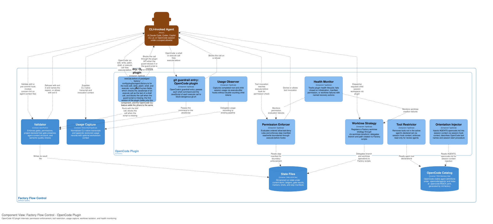

| Component                | Responsibility                                                                                                                                                          | Reads                      | Writes      |
| ------------------------ | ----------------------------------------------------------------------------------------------------------------------------------------------------------------------- | -------------------------- | ----------- |
| **Permission Enforcer**  | Evaluates ordered allow/ask/deny rules and enforces step-manifest read/write boundaries through `execute.before` hooks                                                  | Step manifest, state files | (none)      |
| **Tool Restrictor**      | Removes tools not in the active agent's declared set via `session.hook("context")`; enforces read-only for review agents                                                | OpenCode Catalog           | (none)      |
| **Usage Observer**       | Captures completed root and child session usage via `execute.after` hooks without double-counting child tokens                                                          | (none)                     | Usage spool |
| **Worktree Strategy**    | Registers a Factory worktree strategy through `ctx.worktree.transform()`; delegates branch and path creation to Factory scripts                                         | State files                | Worktrees   |
| **Orientation Injector** | Injects `AGENTS.opencode.md` into session context via `session.hook("context")`; describes OpenCode tool names and session-start procedure                              | OpenCode Catalog           | (none)      |
| **Health Monitor**       | Tracks plugin health lifecycle (UNLOADED → HEALTHY → UNHEALTHY); fails closed on initialization, manifest, permission, or worktree failures with named recovery actions | (none)                     | (none)      |

The component **guard entry: OpenCode plugin** runs the hook `guard-human-fields` from `execute.before`. The finding-classification feature writes it as the first and only component of the plugin file, and the OpenCode CLI feature adds the six components above to the same file. [5.12](#512-level-2-component-view----finding-classification) describes it.

The plugin implements a fail-closed trust model: any failure in initialization, manifest loading, permission evaluation, or worktree creation denies the operation and reports the specific failed control with a recovery action. The health lifecycle state machine is documented in [state-machines.md](../spec/state-machines.md).

## 5.10 Level 2: Component View -- Factory Agents

A CLI session runs one agent definition. The definition's frontmatter declares the agent's tier, skills, inputs, and outputs. Each output declaration of a core or seam artifact also names its reviewers in `reviewed_by:`. So the definitions are the place where ownership is declared, and [8.17](08_crosscutting_concepts.md#817-artifact-ownership-one-producer-one-declared-review) describes the mechanism that checks it.

The view shows the agents that produce, review, or report on core artifacts, and the agents of a run. The code-review agent and the QA agent write no core file, so their findings reach the owners through the review loop.

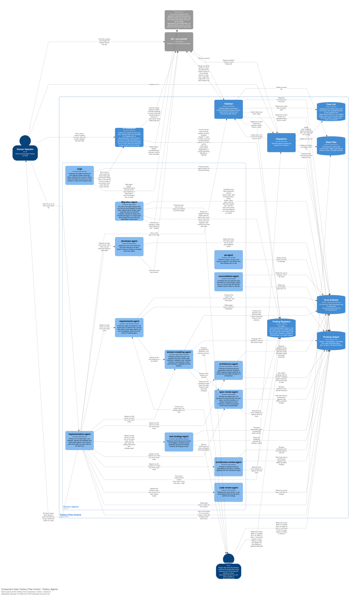

The producers own one artifact family each. [ADR-0027](../adr/0027-split-the-requirements-agent-by-artifact-family.md) records the split.

| Component                 | Family                                  | Produces                                                                                                            | Reviewed by                                                          |
| ------------------------- | --------------------------------------- | ------------------------------------------------------------------------------------------------------------------- | -------------------------------------------------------------------- |
| **requirements-agent**    | Scope and behaviour                     | `scope-map.md`, `features/*.feature`, `areas/*.md`                                                                  | stakeholder (scope map), spec-review agent                           |
| **domain-modeling-agent** | Domain structure                        | `glossary.md`, `entity-model.md`, `state-machines.md`, `validation-rules.md`, `interface-contracts.md`, `schemas/*` | spec-review agent; the stakeholder also confirms every glossary term |
| **architecture-agent**    | Architecture                            | `architecture.dsl`, `dependency-rules.dsl`                                                                          | architecture-review agent                                            |
| **test-strategy-agent**   | Test practice (seam and working output) | `docs/testing.yaml`, `docs/spec/work/*-qa-strategy.md`                                                              | stakeholder (`testing.yaml`)                                         |
| **virgil**                | Seam                                    | `docs/agent-context.md`                                                                                             | stakeholder                                                          |

The other agents review the core or report drift in it. None of them writes a core file.

| Component                     | Role in the ownership mechanism                                                                                                                                                                                                 | Writes                                                                    |
| ----------------------------- | ------------------------------------------------------------------------------------------------------------------------------------------------------------------------------------------------------------------------------- | ------------------------------------------------------------------------- |
| **spec-review-agent**         | Reviews behaviour and domain structure; files a finding for every `proposed` term candidate. Shares the glossary review with the stakeholder                                                                                    | `SPEC` and `BUG` findings, row statuses                                   |
| **architecture-review-agent** | Reviews `architecture.dsl` and `dependency-rules.dsl`                                                                                                                                                                           | `ATAM` and `BUG` findings, row statuses                                   |
| **developer-agent**           | Writes each drift it finds as an `open` row of its story's spec-feedback report; commits the review report and the findings of its story's review                                                                               | `docs/spec/work/spec-feedback-<story-id>.md`                              |
| **implementation-agent**      | At each wave close, spawns the owner and then the reviewer of each listed row, one session at a time on the feature branch, then routes the open `QA` findings of the wave by owner; runs `dispatch close-wave` until it passes | ledger, `QA` findings                                                     |
| **code-review-agent**         | Reviews each story branch and the whole feature; each finding names its story or its run                                                                                                                                        | `docs/reviews/code-review-*.md`, `IMPL` findings                          |
| **qa-agent**                  | Explores the feature after the review of the whole feature                                                                                                                                                                      | Fagan, security, and bug-hunt reports; `FAGAN`, `SEC`, and `BUG` findings |
| **reconciliation-agent**      | Compares the core with the code and names each drifted artifact's owner                                                                                                                                                         | `docs/reviews/reconciliation-<date>.md`                                   |

Three rules hold for every agent in the table:

- **Readers raise findings.** An agent that reads an artifact it does not own writes a row or a finding with the owner's name. It does not edit the artifact.
- **The architecture agent only reads domain structure.** It takes `entity-model.md` and `state-machines.md` as context inputs. On a contradiction it files an `ARCH` finding with the domain-modeling agent as owner.
- **The lector agent is no producer.** It declares `docs/**/*.md` with `edits: wording`, because it changes wording and never meaning. The contract test skips that declaration.

## 5.11 Level 2: Component View -- ID Allocation

An agent that files a finding needs a number that no other branch takes. So
the agent runs `next-id FAGAN` and uses the ID that the script prints. The
number comes from one ref, `refs/ids/counters`, on the project's git remote
([ADR-0031](../adr/0031-ids-come-from-one-git-ref-with-leased-pushes.md)).
A project without `origin` keeps that ref in its own repository, the Local
Counter, until VIRGIL moves it to `origin`
([ADR-0033](../adr/0033-the-projects-own-repository-holds-the-counter-until-origin-exists.md)).
[8.18](08_crosscutting_concepts.md#818-id-allocation) describes the concept.

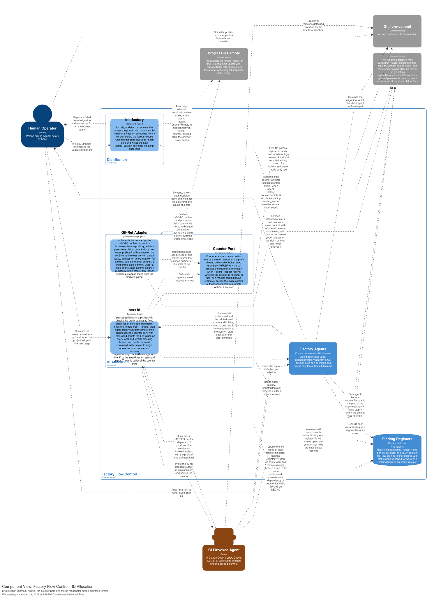

| Component           | Responsibility                                                                                                                                                                                                                                                                                                                                                                                                                                                                                                                            |
| ------------------- | ----------------------------------------------------------------------------------------------------------------------------------------------------------------------------------------------------------------------------------------------------------------------------------------------------------------------------------------------------------------------------------------------------------------------------------------------------------------------------------------------------------------------------------------- |
| **next-id**         | Checks the prefix against its fixed list, or the seed arguments, before it contacts the remote. Finds the remote from `--remote <url>`, then the git setting `agent-factory.counterRemote`, then `git remote get-url origin`. Calls the counter port, and prints the ID or the seed lines. With `--plan-seed`, it counts the IDs in use on every local and remote-tracking branch and prints the seed command. With `--move-to-origin`, it moves the Local Counter to `origin` and removes the setting. It is the only caller of the port |
| **Counter Port**    | Offers four operations. `claim <prefix>` returns the next number of the prefix that no other caller holds. `seed <number> [<PREFIX>=<n> …]` creates the counter and refuses when it exists. `inspect` reports whether the counter is missing, in use, or a marker commit. `move <remote>` carries the claim commit of the Local Counter to a remote without a counter                                                                                                                                                                     |
| **Git-Ref Adapter** | Implements the port on `refs/ids/counters`, on the Project Git Remote or the Local Counter alike. It works in a throwaway bare repository, writes a parentless claim commit with a new token, and pushes it with a lease on the old SHA. It retries only on a stale lease, at most ten times in a row. For a move, it sets the marker commit under a lease on the claim commit before it pushes with the create-only lease                                                                                                                |

The callers sit outside the container:

- **ID producers.** A CLI session runs `next-id <PREFIX>` at the step of an ID
  producer that creates an indexed artifact, such as `next-id FAGAN` in
  `fagan-review`. The kind of artifact decides the prefix, and
  `id-prefixes.md` lists each prefix with its producers (BR-107, BR-108). The
  session reads the ID from standard output, because a shell variable does
  not survive from one agent command to the next.
- **virgil** seeds the counter in fitting step 4, "Seed the ID counter".
  Without `origin`, it first sets `agent-factory.counterRemote` to the path of
  the main repository. It runs `next-id --plan-seed`, shows the printed seed
  command, and runs it after the User confirms. At the session start, it
  offers the move to `origin` when the setting is set and `origin` exists, and
  runs `next-id --move-to-origin` after the User confirms (BR-104, BR-106).
- **The Human Operator** runs `next-id --seed` by hand only when the project
  skipped the seed step.
- **init-factory** asks the counter's remote whether `refs/ids/counters`
  exists: the Local Counter when `agent-factory.counterRemote` is set, else
  `origin`. It derives `fitting.counter_seeded` from the answer and never
  seeds (BR-105).

The adapter performs every transition of the
[Claim Lifecycle](../spec/state-machines.md#claim-lifecycle): the fetch in
`READING`, the leased push in `PUSHING`, and the wait in `WAITING`. `next-id`
reports the terminal state. The adapter also performs every transition of the
[Move Lifecycle](../spec/state-machines.md#move-lifecycle): the read in
`READING`, the marker in `MARKING`, the check of `origin` in `RESUMING`, and
the create-only push in `PUSHING`. The three components ship as one script, so
`dependency-rules.dsl` holds no rule for them.

## 5.12 Level 2: Component View -- Finding Classification

A reviewer records each finding with its basis, the yes-or-no answers and
choices that the rule of its review class turns into a severity. A
`critical` or `major` finding becomes a finding file `docs/findings/<ID>.md`
in Working Output. A `minor` finding becomes one register file in the Finding
Registers ([ADR-0034](../adr/0034-one-register-file-per-minor-finding.md)).
Four mechanisms then act on the files: the stop, the guard, the lint, and the
one-time migration. [8.19](08_crosscutting_concepts.md#819-finding-classification)
describes the concept. The view spans four containers, so it shows the
components of each mechanism together.

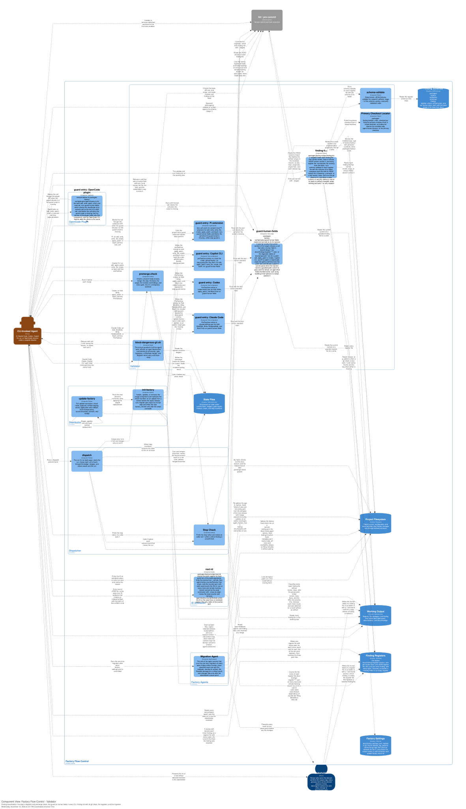

The stop keeps a run from dispatching or merging while a `critical` finding
is unconfirmed:

| Component          | Container  | Responsibility                                                                                                                                                                                                                                                                                                                     |
| ------------------ | ---------- | ---------------------------------------------------------------------------------------------------------------------------------------------------------------------------------------------------------------------------------------------------------------------------------------------------------------------------------- |
| **Stop Check**     | Dispatcher | Reads each `docs/findings/*.md` in the working tree and its `HEAD` version. A finding stops the run when one version is critical and neither holds text in both `stop_confirmed_by` and `stop_confirmed_reason`. Prints the stop notice and changes no file                                                                        |
| **dispatch**       | Dispatcher | Calls the stop check before `init`, `prepare-wave`, `prepare-story`, `add`, `mark-dispatching`, `mark-dispatched`, `re-dispatch`, `escalate`, `refresh-story`, `merge-story`, and `close-wave`, and exits `1` during a stop. `return-story` and the three forms of `close` start and merge nothing, so a stop allows them (RL-G18) |
| **premerge-check** | Validator  | Calls the stop check before any other check. During a stop it writes no `.current-work/premerge-check-ok` marker, so `block-dangerous-git.sh` denies `git merge`                                                                                                                                                                   |

The guard keeps agents from writing human fields. One script holds the rule,
and each CLI calls it from its own entry point
([ADR-0035](../adr/0035-guard-human-fields-in-every-cli.md)):

| Component                        | Container       | Responsibility                                                                                                                                                                                                                                                                                                                                                                                                                                                                                                               |
| -------------------------------- | --------------- | ---------------------------------------------------------------------------------------------------------------------------------------------------------------------------------------------------------------------------------------------------------------------------------------------------------------------------------------------------------------------------------------------------------------------------------------------------------------------------------------------------------------------------- |
| **guard-human-fields**           | Validator       | Reads one tool call and, for a write, the current target file. Refuses a call that sets a human field in `docs/findings/*.md`, `docs/findings/register/**/*.json`, or the Appendix tables of `docs/proposals/*.md`, and every call that writes the exceptions register `docs/findings/exceptions.md`, with exit `2`. For a patch call, `apply_patch` in Codex, Copilot CLI, and Pi or `patch` in OpenCode, it reads the paths from the patch text and refuses a patch it cannot parse when the raw text names a guarded path |
| **guard entry: Claude Code**     | Validator       | `PreToolUse` entries for `Edit`, `MultiEdit`, `Write`, `NotebookEdit`, and `Bash`                                                                                                                                                                                                                                                                                                                                                                                                                                            |
| **guard entry: Codex**           | Validator       | `PreToolUse` entries for `Edit`, `Write`, `apply_patch`, and `Bash`                                                                                                                                                                                                                                                                                                                                                                                                                                                          |
| **guard entry: Copilot CLI**     | Validator       | `preToolUse` entries in a hook file under `.github/hooks/` for `edit`, `apply_patch`, `write_file`, `create`, and `bash`                                                                                                                                                                                                                                                                                                                                                                                                     |
| **guard entry: Pi extension**    | Validator       | The `tool_call` event of a project-local extension. Blocks the call when the guard script is missing                                                                                                                                                                                                                                                                                                                                                                                                                         |
| **guard entry: OpenCode plugin** | OpenCode Plugin | `execute.before` of `agent-factory.ts` for the tools `edit`, `write`, `patch`, `shell`, and `execute`. The guard checks the JavaScript of an `execute` call as the text of a shell call. Blocks the call when the guard script is missing. The first version of the plugin holds only this component                                                                                                                                                                                                                         |

`init-factory` writes the entries of Claude Code, Codex, Copilot CLI, and Pi
beside the `step-guard` entries. `update-factory` runs `init-factory` of the
new release after each update, so a project installed earlier gets the
missing entries.

The lint checks every finding file and register file at each commit and each
`validate` run:

| Component                    | Container | Responsibility                                                                                                                                                                                                                                                                                                                                                                                                                   |
| ---------------------------- | --------- | -------------------------------------------------------------------------------------------------------------------------------------------------------------------------------------------------------------------------------------------------------------------------------------------------------------------------------------------------------------------------------------------------------------------------------- |
| **finding-lint**             | Validator | Recomputes the severity from the basis, runs `schema-validate` on each register file, compares each file with its `HEAD` version for a lowering, a removal, or a lost `review_class`, and runs the git check of `in_use` when a code, runtime, or security finding is new or its basis or artifact changed. Writes nothing. Runs as the pre-commit hook `agent_factory_hook-finding-lint`, which fitting includes without asking |
| **Primary Checkout Locator** | Validator | The helper `packages/factory/scripts/_main_checkout.py`. Finds the primary checkout from a linked worktree, so `finding-lint` blames the installed copy there                                                                                                                                                                                                                                                                    |
| **schema-validate**          | Validator | Validates a register file against the schema of its class                                                                                                                                                                                                                                                                                                                                                                        |

The migration runs once:

| Component           | Container      | Responsibility                                                                                                                                                                                                                      |
| ------------------- | -------------- | ----------------------------------------------------------------------------------------------------------------------------------------------------------------------------------------------------------------------------------- |
| **Migration Agent** | Factory Agents | The role of the session that classifies every open finding without `review_class`, shows every result at one pause point, and then rewrites the files and moves each `minor` result and each old `.jsonl` line into a register file |

Two dependencies cross into other features:

- **`next-id --plan-seed`** of counter-ids-fitting must count the file names
  of the register files on every local and remote-tracking branch as IDs in
  use. BR-099 of that feature still counts `.jsonl` lines, and its stories,
  such as ST-0376, are done. So the finding-classification backlog plans the
  change as a cross-feature story, and the story lands before the migration
  commit ([6.20](06_runtime_view.md#620-migration-of-open-findings)).
- **The OpenCode CLI feature** extends the plugin file that this feature
  writes. `init-factory` already accepts `--cli opencode` and links the plugin
  into `.opencode/plugins/`.

The components perform the guarded and rejected transitions of the
[Finding Lifecycle](../spec/state-machines.md#finding-lifecycle). A reviewer
agent performs **Recorded**, **FixVerified**, and **Raised**. For a finding that runs as a unit of work, `dispatch merge-story` performs **FixVerified** in the merge commit (BR-118); [ARCH-0403](../findings/register/document/ARCH-0403.json) asks the domain-modeling agent to name that performer in the state machine. The commit that
fixes a `minor` finding performs **Fixed**. The Migration Agent performs
**NoArtifact** and the migration's **Recorded**. The stakeholder performs
**StopConfirmed**, **Waived**, **Lowered**, and **AnswerChanged**.
`finding-lint` rejects the forbidden events, such as **Removed**,
**ClassRemoved**, and **AgentLowers**. `guard-human-fields` refuses
**AgentConfirms** and **AgentWaives**. The stop check reads
**STOPPING** each time it runs, because the stop is no state of its own.

## 5.13 Level 2: Component View -- Run Lifecycle

A run is everything the Factory does for one feature branch, from `dispatch init` to `dispatch close`. The User drives it in one of two ways. In an orchestrated run, the implementation agent starts stories in waves, each in its own worktree. In a run by hand, stories run one at a time in the primary checkout, each on the User's go. Both ways share the components below ([ADR-0037](../adr/0037-one-lifecycle-for-runs-orchestrated-and-by-hand.md)). A unit of work is a story or a blocking finding that `dispatch add` put into the run.

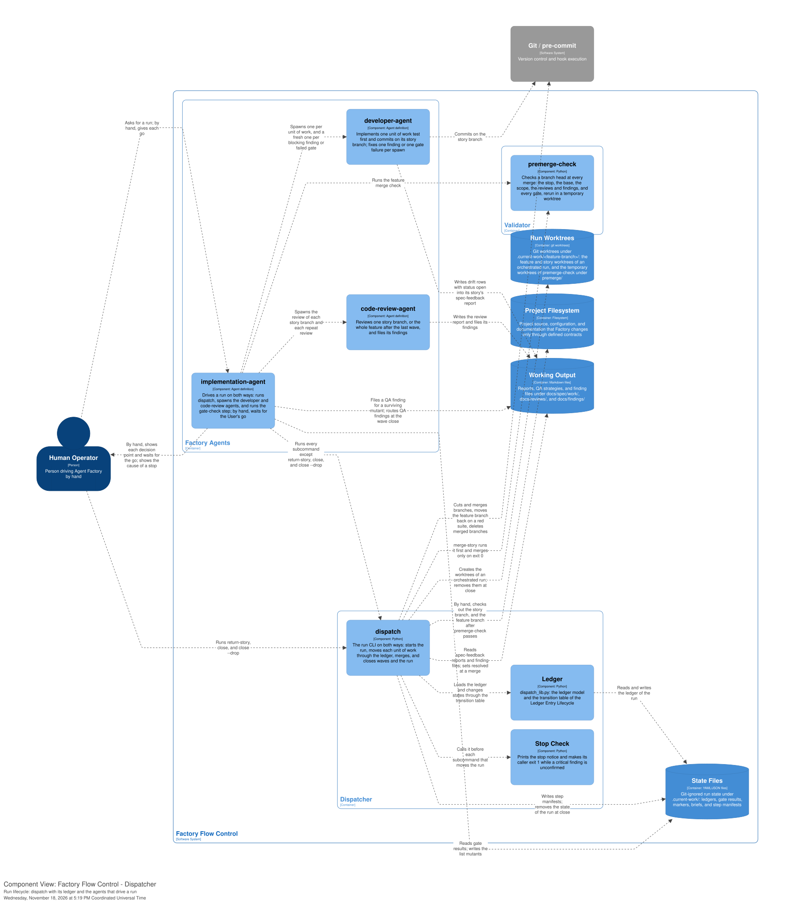

`dispatch` keeps the run. Its subcommands fall into four groups:

| Component    | Group         | Subcommands and what they do                                                                                                                                                                                                                                                                                                                                                                                                                                                                                                                                                                                                                                                                                                                                                                                                                                                                       |
| ------------ | ------------- | -------------------------------------------------------------------------------------------------------------------------------------------------------------------------------------------------------------------------------------------------------------------------------------------------------------------------------------------------------------------------------------------------------------------------------------------------------------------------------------------------------------------------------------------------------------------------------------------------------------------------------------------------------------------------------------------------------------------------------------------------------------------------------------------------------------------------------------------------------------------------------------------------- |
| **dispatch** | Start         | `init --mode orchestrated\|by-hand` cuts the feature branch from `dev` and writes the ledger. An orchestrated run also gets a worktree for the feature branch. `init` refuses a second run by hand, because both would need the primary checkout. Before it cuts a branch, `init` runs the `ready` command of every measure of an enabled gate in the primary checkout, and it refuses when one fails                                                                                                                                                                                                                                                                                                                                                                                                                                                                                              |
| **dispatch** | Units of work | `plan`, `prepare-wave`, `prepare-story`, `add`, `mark-dispatching`, `mark-dispatched`, `mark-failed`, `mark-blocked`, `escalate`, `re-dispatch`, `resume-gates`, and `refresh-story` move an entry through the [Ledger Entry Lifecycle](../spec/state-machines.md#ledger-entry-lifecycle). `resume-gates` sets an entry that is `blocked` with the reason `gate cannot measure: crap-score` back to `dispatched`, so it returns to the gate-check step without a developer agent. By hand, `prepare-story` checks out the story branch in the primary checkout                                                                                                                                                                                                                                                                                                                                     |
| **dispatch** | Merge         | `merge-story` runs `premerge-check`, merges, sets `done` or `resolved` in the merge commit, and runs the test suite. On a red suite it moves the feature branch back and sets `blocked`. On exit `3` of `premerge-check` it merges nothing and sets `blocked` with the reason `gate cannot measure: crap-score`. By hand, it checks out the feature branch only after `premerge-check` exits `0`, so a refusal leaves the story branch checked out. In an orchestrated run, it works in the worktree of the feature branch and refuses before the merge when that worktree holds an uncommitted change to a tracked file; `dispatch.refuse_dirty_feature_worktree: false` in `docs/testing.yaml` turns this off. `merge-story --dry-run` runs `premerge-check` and merges nothing. It copies nothing into the installed copy ([ADR-0040](../adr/0040-the-factory-tests-run-against-the-source.md)) |
| **dispatch** | End           | `close-wave` closes a wave. `return-story`, `close`, `close --drop`, and `close --orphans` end units of work and runs. `close` stashes the uncommitted files of each worktree under a name and removes the ledger, the worktrees, the gate results, the markers, the briefs, and the merged branches                                                                                                                                                                                                                                                                                                                                                                                                                                                                                                                                                                                               |
| **Ledger**   | Ledger model  | Loads and saves the ledger, allows only the transitions of the state machine, and decides HasStopped from the fields of an entry and the attempt limits in `docs/testing.yaml`. Reads the old names `invocation_branch` and `mode: automated`, and writes only the new ones                                                                                                                                                                                                                                                                                                                                                                                                                                                                                                                                                                                                                        |

`premerge-check` checks the branch head at every merge ([ADR-0038](../adr/0038-premerge-check-reruns-the-gates-in-a-temporary-worktree.md)). It reruns the gates that the implementation agent runs in the gate-check step:

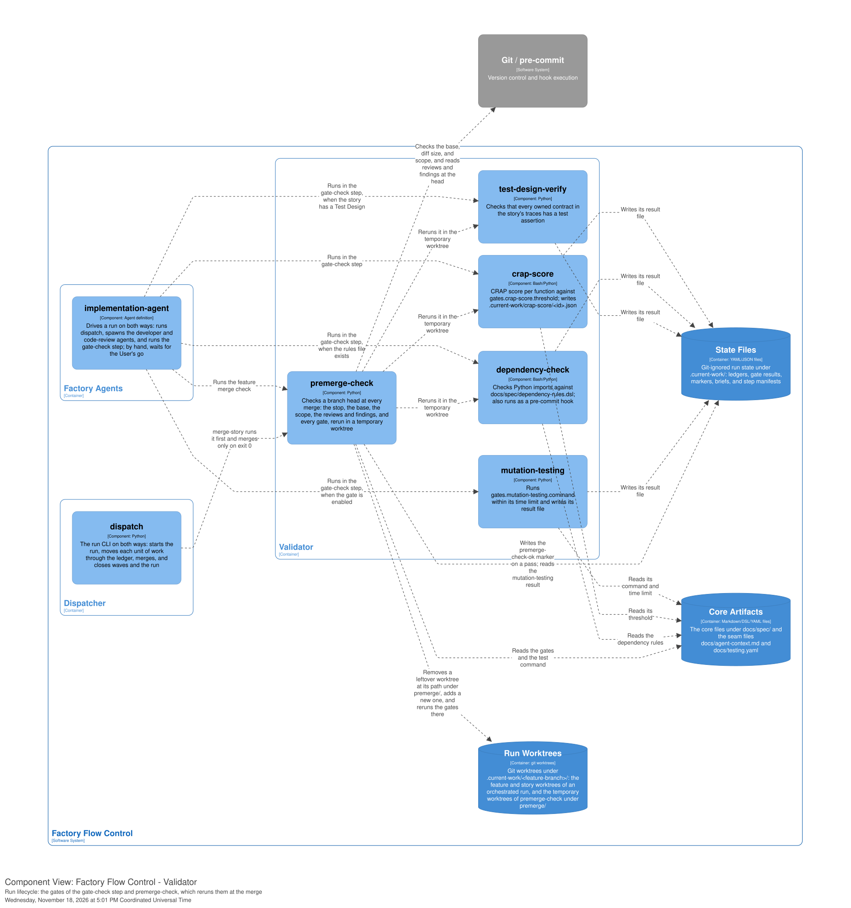

| Component          | Merge                                                | What it checks                                                                                                                                                                                                                                                                                                                                                                                             |
| ------------------ | ---------------------------------------------------- | ---------------------------------------------------------------------------------------------------------------------------------------------------------------------------------------------------------------------------------------------------------------------------------------------------------------------------------------------------------------------------------------------------------- |
| **premerge-check** | Story merge, `story/<id>`                            | The stop, the base, the diff size, and the scope. A code-review report with `story` set to the ID whose `branch_head` is an ancestor of the branch head. No open blocking finding with `story` set to the ID. Every gate and the test suite, rerun in a temporary detached worktree at the branch head. Before it adds the worktree at `premerge/<id>`, it removes any worktree left at that path (BR-123) |
| **premerge-check** | Feature merge, `premerge-check dev <feature-branch>` | Every unit of work is `done` or `pending`, and every wave has a wave record. The review of the whole feature and the Fagan, security, and bug-hunt reports have `run` set to the feature branch and a current `branch_head`. No blocking finding of the run is open. The full test suite passes in a temporary worktree at `premerge/feature`                                                              |

The git guardrail has one script and five entries ([ADR-0039](../adr/0039-one-git-guardrail-script-for-all-five-agent-tools.md)):

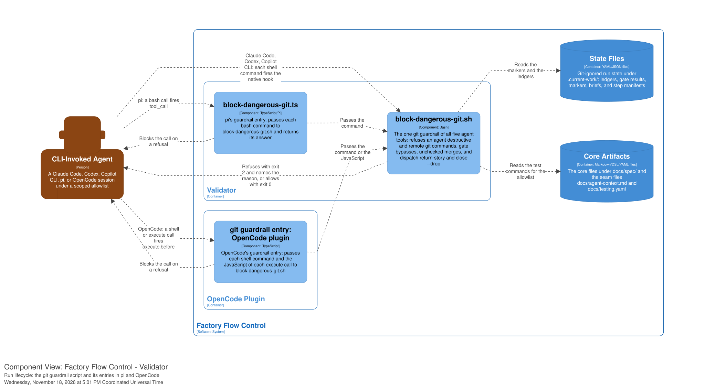

| Component                                | Container       | Responsibility                                                                                                                                                                                                         |
| ---------------------------------------- | --------------- | ---------------------------------------------------------------------------------------------------------------------------------------------------------------------------------------------------------------------- |
| **block-dangerous-git.sh**               | Validator       | Holds every rule. Refuses an agent `dispatch return-story` and `dispatch close --drop` in every form that names them in the command text, besides its other checks. Finds the run of a folder from the folder's branch |
| **block-dangerous-git.ts**               | Validator       | pi's entry. Passes each bash command to the script and returns the answer                                                                                                                                              |
| **git guardrail entry: OpenCode plugin** | OpenCode Plugin | OpenCode's entry in `execute.before` of `agent-factory.ts`. Passes the command of each `shell` call and the JavaScript of each `execute` call to the script, and blocks the call on a refusal                          |

Claude Code, Codex, and Copilot CLI run the script from their native `PreToolUse` hook, so they need no entry component.

Two agents review the work of a run. Neither writes a core file:

| Component             | When it runs                                                                                                          | Writes                                                                                                                                                             |
| --------------------- | --------------------------------------------------------------------------------------------------------------------- | ------------------------------------------------------------------------------------------------------------------------------------------------------------------ |
| **code-review-agent** | For each story branch, again after each fix of a blocking finding, and once for the whole feature after the last wave | `docs/reviews/code-review-<story-id>-YYYY-MM-DD.md` with `story`, or `docs/reviews/code-review-<feature-branch>-YYYY-MM-DD.md` with `run`; each with `branch_head` |
| **qa-agent**          | After the review of the whole feature                                                                                 | The Fagan, security, and bug-hunt reports with `run` and `branch_head`, and findings with `run`                                                                    |

The components perform every transition of the [Ledger Entry Lifecycle](../spec/state-machines.md#ledger-entry-lifecycle). `dispatch` performs each one through the Ledger. The implementation agent runs the subcommands of every transition except **Return**. The User runs **Return** with `dispatch return-story`, because the guardrail refuses it to agents. **MarkDone** has no subcommand, so no component performs it. `dispatch close-wave` decides HasStopped from the ledger alone.

## Referenced from

- [06_runtime_view.md section 6.3](06_runtime_view.md#63-test-gate-presence)
- [07_deployment_view.md](07_deployment_view.md)
- [09_architecture_decisions.md](09_architecture_decisions.md)
- [ADR-0015 -- Query authoritative JSONL with ephemeral DuckDB views](../adr/0015-query-authoritative-jsonl-with-ephemeral-duckdb-views.md)
