[back to index](../README.md)

# 6. Runtime View

## 6.1 Overview

This chapter describes key interaction sequences for Factory gates,
eligibility evaluation, local usage analysis, core artifact ownership, and the
run lifecycle. Dynamic views in
[`architecture.dsl`](../spec/architecture.dsl) own the canonical step order.

## 6.2 Agent Selection

Derived from dynamic view `AgentSelection` in [`architecture.dsl`](../spec/architecture.dsl).

Agent selection is the primary routing operation. The `intent select` command loads agent definitions, evaluates each agent's declared preconditions against the repository, and presents per-agent eligibility evidence. The eligibility engine never writes state.

### 6.2.1 Sequence: Human Runs `intent select`

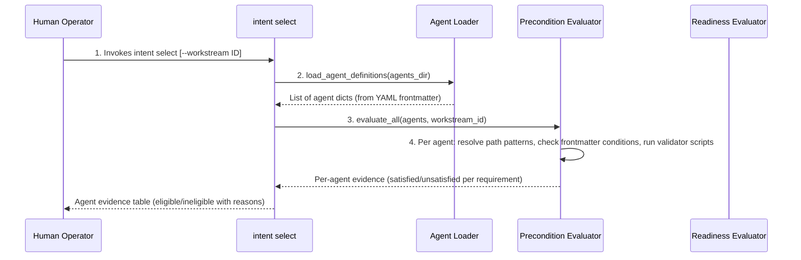

**Key Points**:

- **Precondition-based**: Each agent declares `inputs.required` in its YAML frontmatter. The evaluator resolves each requirement's `path_pattern` against the filesystem, optionally filtering by workstream scope and checking frontmatter conditions or validator scripts.
- **Engine is read-only**: The eligibility engine reads agent definitions and the repository. It returns immutable evidence. It does not write state, acquire locks, or produce side effects.
- **Workstream scoping**: When `--workstream` is passed, candidates are filtered by the `scope` field in their frontmatter (matching the workstream ID or `"global"`). Files without a scope declaration are included.
- **Readiness derivation**: `derive_readiness()` accepts evaluation results and produces `AgentReadiness` dataclasses with `eligible`, `unsatisfied`, and `warnings` fields.

## 6.3 Test Gate Presence

Factory ensures test gates exist; the project decides what runs inside them. Testing is project-owned infrastructure declared in `docs/testing.yaml`. Factory's guardrails and eligibility preconditions read that declaration. Factory does not own test execution, framework detection, or structured test output.

### 6.3.1 Sequence: Precondition Evaluation with Test Gate

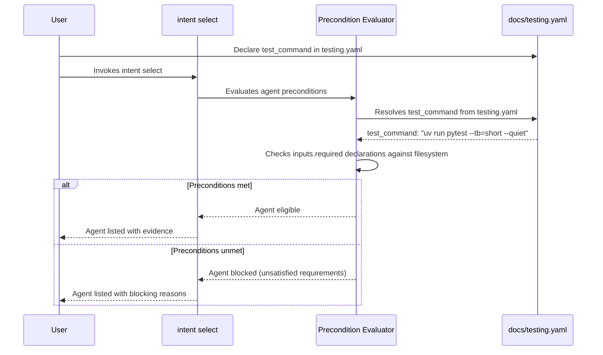

### 6.3.2 Sequence: Agent Uses Charter-Declared Test Command

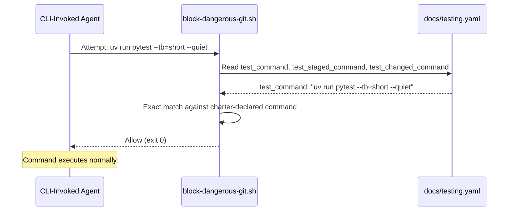

### 6.3.3 Sequence: Agent Blocked from Bare Test Command

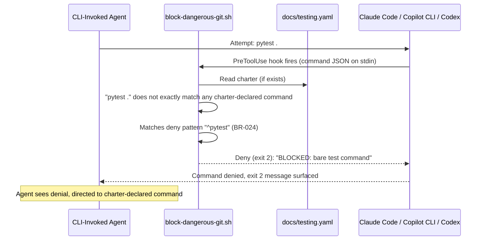

**Key Points**:

- **Preventive**: Command blocked *before* execution (PreToolUse hook, not post-facto)
- **Exact match only**: Charter-declared commands are allowlisted with exact-string matching; no prefix matching (BR-024)
- **Three native-hook CLIs**: Claude Code, Copilot CLI, and Codex invoke the shared shell guardrail; Pi enforces the same deny list through its project-local extension
- **No charter means no agent test commands**: When `testing.yaml` does not exist, no agent test commands are allowlisted; bare test commands remain blocked
- **Deny patterns (BR-024)**: The canonical list is maintained in `.agent-factory/factory/config/hooks/block-dangerous-git.sh`; representative entries include `pytest`, package-manager test scripts, `jest`, `vitest`, `go test`, `cargo test`, and Python/uv pytest invocations

## 6.4 Gate-Check Step

Derived from dynamic view `GateCheckStep` in [`architecture.dsl`](../spec/architecture.dsl).

The gate-check step runs after the review of a story leaves no blocking finding open, and before `dispatch merge-story`. The implementation agent runs it in both ways of driving a run. The developer agent never runs a gate. It only gets the output of a failing gate when a fresh developer agent fixes it ([ADR-0012](../adr/0012-dispatcher-owned-semantic-gate-loop.md), [ADR-0037](../adr/0037-one-lifecycle-for-runs-orchestrated-and-by-hand.md)).

Take ST-0350 on `story/ST-0350`. Its function `login()` fails `crap-score`, and one mutant in `src/login.py:42` survives a test the step cannot write.

### 6.4.1 Sequence: A Failing Gate and a Surviving Mutant

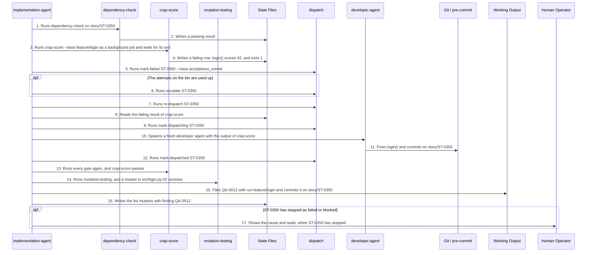

**Key Points:**

- The gates of a unit of work are `dependency-check` when `docs/spec/dependency-rules.dsl` exists, `test-design-verify` when the story has a Test Design or a Prior Tests section, and every entry under `gates` in `docs/testing.yaml` with `enabled: true` and a command. A story's `quality-gates` field can only add gates ([5.2.3](05_building_block_view.md#523-semantic-quality-gates-crap-score-mutation-testing-dependency-check-test-design-verify)).
- Each failed attempt spawns a fresh developer agent with only the gate's output and the affected files. The attempt moves the entry through the [Ledger Entry Lifecycle](../spec/state-machines.md#ledger-entry-lifecycle): `mark-failed` sets `failed`, `re-dispatch` sets `prepared`, `mark-dispatching` comes before the spawn, and `mark-dispatched` after the fix commit. So the entry is `dispatched` again when `merge-story` runs.
- `escalate` raises the tier and leaves the entry `failed`. So `re-dispatch` follows it in every case.
- A failing gate records the failure class `acceptance_unmet`, which counts. A unit of work gets `gates.attempts` counted attempts on its tier, the first included, and then `gates.attempts_escalated` attempts on the next tier. Both default to `3`, and `gates.attempts_escalated: 0` turns escalation off. `dispatch` enforces both limits (BR-114, BR-115).
- When the attempts are used up and no promotion is left, the unit of work is `failed` and has stopped. It waits for the User, in both ways. The User fixes the cause and tells the implementation agent to continue, or runs `dispatch return-story` (BR-116).
- A surviving mutant that the step cannot kill or remove as dead code becomes a `QA` finding with `run` set to the feature branch. It does not block the story merge. It blocks the merge of the feature branch into `dev` until it is resolved (BR-066).
- The implementation agent runs `crap-score` as a background job, because a foreground command call of an agent CLI can end before `timeout_minutes` runs out (BR-134). When `crap-score` exits `2`, the gate cannot measure. The agent then runs `dispatch mark-blocked` with the reason `gate cannot measure: crap-score`, starts no developer agent, and counts no attempt. After the User fixes the setup, `dispatch resume-gates` returns the story to this step ([8.7](08_crosscutting_concepts.md#gate-exit-codes)).
- Each gate writes its result to `.current-work/<gate>/<id>.json`. `premerge-check` runs the gates again at the merge and reads only the result of `mutation-testing` ([6.24](#624-the-merge-check-of-a-story)).

### 6.4.2 Sequence: Module-Graph Check (Architecture Routing)

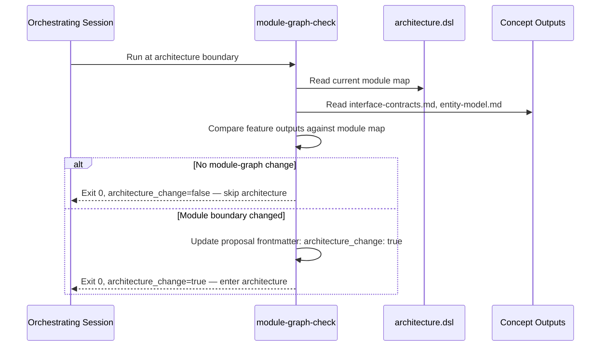

**Key Points:**

- Runs once per feature, at the architecture boundary. Not per story, not per commit.
- Tests module-graph topology only: new modules, changed public interfaces, inverted dependency directions. A new entity in an existing module does not trigger the architecture check.
- The orchestrating session owns the check. It is not a hook or a dispatcher gate.

## 6.5 Agent Context Validation

The concern-oriented agent context (`docs/agent-context.md`) is a single markdown file that replaced the four-file YAML model in 0.9.0. The team maintains the file directly; `update-context` is retired. See [section 8.11](08_crosscutting_concepts.md#811-agent-context-as-cross-cutting-concern).

### 6.5.1 Sequence: concern-lint Validates Agent Context

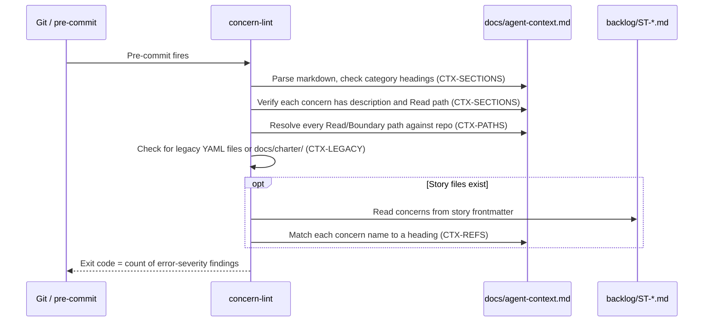

**Key Points:**

- All `CTX-*` findings are errors. A single finding fails the gate.
- The three required categories are `## Always (cross-cutting)`, `## Technical concerns`, and `## Domain concerns`.
- `docs/testing.yaml` is the only accepted test-configuration path and is not validated by `concern-lint`.
- `CTX-LEGACY` rejects mixed formats: the concern-oriented file must not coexist with YAML agent-context files or a `docs/charter/` directory.

## 6.6 Local Usage Query

Derived from dynamic view `UsageQuery` in
[`architecture.dsl`](../spec/architecture.dsl).

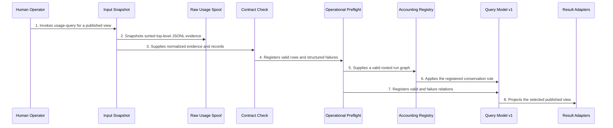

The query snapshots its input once. Every selected line becomes either a valid
row or a structured failure. `capture_health` remains queryable when failures
exist; all other stable views refuse partial output. Empty input is valid and
returns each view's declared typed empty result.

## 6.7 Explicit Parquet Export

Derived from dynamic view `UsageParquetExport` in
[`architecture.dsl`](../spec/architecture.dsl).

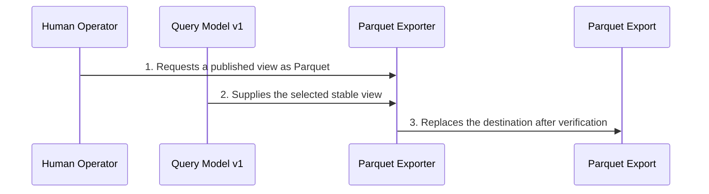

The exporter writes a temporary sibling, verifies logical rows and schema, and
records query-model and input-set provenance before replacement. Any failure
leaves an existing destination unchanged. No scheduled refresh exists.

## 6.8 OpenCode Permission Enforcement

Derived from dynamic view `OpenCodePermissionEnforcement` in [`architecture.dsl`](../spec/architecture.dsl).

The Factory plugin enforces permissions and step boundaries for every tool invocation in an OpenCode session. The permission enforcer evaluates ordered allow, ask, and deny rules. Explicit denials are final and cannot be broadened by the plugin's permission hook.

### 6.8.1 Sequence: Plugin Evaluates a Tool Invocation

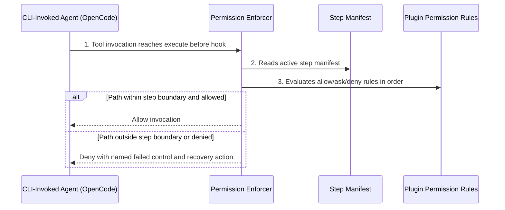

**Key Points:**

- The plugin reads `.current-work/current-step.yml` to determine the active step boundary.
- Reads outside declared inputs are denied before tool execution.
- Writes outside declared outputs are denied before tool execution.
- Shell commands matching denied Git patterns are denied before execution.
- Review agents whose definitions declare no write outputs receive read-only tool sets. The Tool Restrictor removes write tools from the agent's available set.
- Permission hooks may narrow an OpenCode decision but never broaden a configured denial.

## 6.9 OpenCode Worktree Isolation

Derived from dynamic view `OpenCodeWorktreeIsolation` in [`architecture.dsl`](../spec/architecture.dsl).

The plugin isolates each dispatched child session in a Factory-managed worktree. The worktree strategy delegates branch and path creation to Factory scripts so that the Factory's naming, base, path, and verification rules remain authoritative.

### 6.9.1 Sequence: Plugin Isolates a Child Session

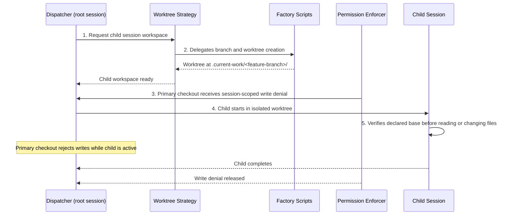

**Key Points:**

- Each child receives its own Factory branch and Git worktree under `.current-work/<feature-branch>/`.
- Each child verifies its declared base commit before reading or changing files.
- The primary checkout rejects writes through a session-scoped write denial while any child is active.
- Worktree creation failure fails closed: the dispatch is denied with a named recovery action.
- The Factory's naming, base, path, and verification rules remain authoritative. OpenCode tracks the resulting location and starts each child session there.

## 6.10 Value-First Onboarding

The value-first onboarding journey guides a newcomer from diagnosis to one safe result before asking for advanced configuration. Seven runtime sequences cover the key interactions: installation, release build, first-session insight, the first-task sandbox lifecycle, the update transaction, and the layout migration inside an update with its rollback.

### 6.10.1 Sequence: Newcomer Installs a Verified Factory Release

Derived from dynamic view `OnboardingInstallation` in [`architecture.dsl`](../spec/architecture.dsl).

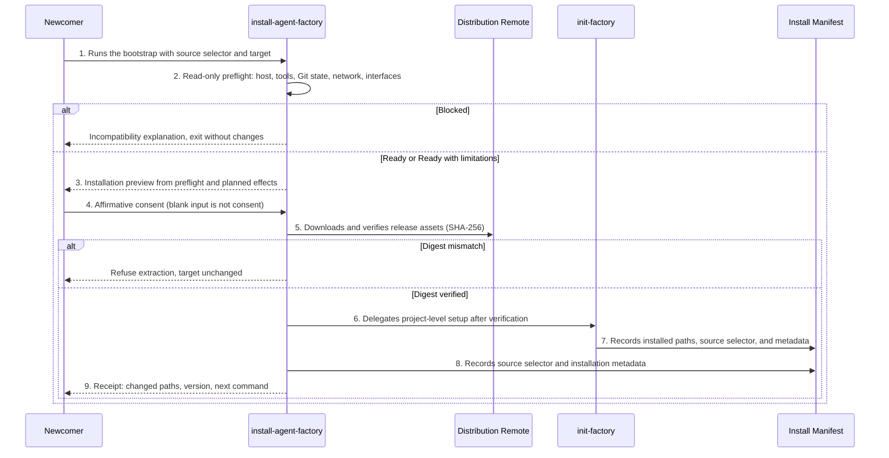

**Key Points:**

- Preflight is read-only. No software is installed, no files are edited, and no configuration is changed during diagnosis.
- The installation preview derives from preflight results and the source selector. No install manifest exists before first installation.
- The installation preview precedes download. No remote assets are fetched until the newcomer gives affirmative consent. This satisfies the consent-before-mutation rule.
- Each prerequisite fix requires separate affirmative consent, shows its scope and reversal, and passes verification before the next fix. Blank input stops the sequence.
- The bootstrap delegates to `init-factory` for the actual file operations. See [ADR-0022](../adr/0022-layered-installation-bootstrap-wraps-init-factory.md) (superseded by [ADR-0023](../adr/0023-update-transaction-with-approval-staging-and-rollback.md); the layered first-install design is preserved).
- The receipt names one exact command that opens the first Factory session.

### 6.10.2 Sequence: Release Maintainer Builds Reproducible Assets

Derived from dynamic view `ReleaseBuild` in [`architecture.dsl`](../spec/architecture.dsl).

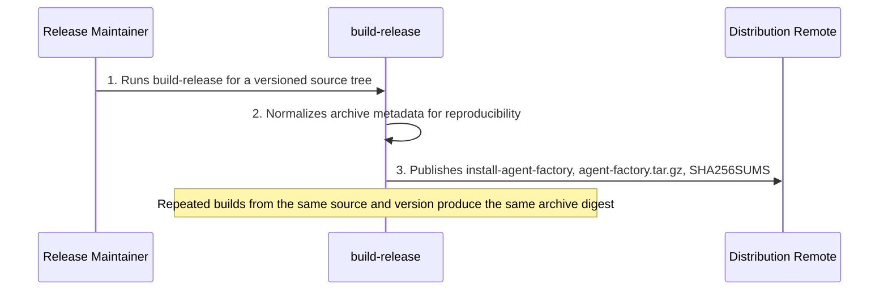

### 6.10.3 Sequence: First Session Delivers Project Insight

Derived from dynamic view `FirstSessionInsight` in [`architecture.dsl`](../spec/architecture.dsl).

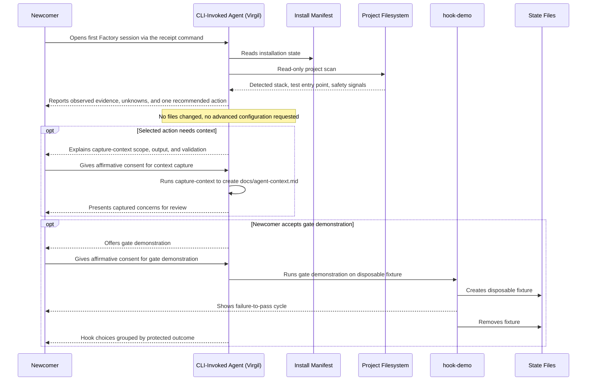

**Component ownership:**

| Behavior                       | Owner                                                                                                                                       |
| ------------------------------ | ------------------------------------------------------------------------------------------------------------------------------------------- |
| Read-only project insight      | Virgil reads the install manifest and scans the project filesystem without side effects                                                     |
| Deferred configuration routing | Virgil delays model-tier, hook, and context decisions until the selected action requires them                                               |
| Context capture                | `capture-context` skill creates `docs/agent-context.md` after the newcomer gives affirmative consent; Virgil presents captured concerns     |
| Gate demonstration             | `hook-demo` (Distribution) creates a disposable fixture, runs a real gate, and removes the fixture after newcomer gives affirmative consent |

**Key Points:**

- The first session reads installation state and scans the project, then reports what the Factory found, what remains unknown, and one recommended action without changing project files.
- Model-tier selection, hook decisions, and extended context capture wait until the chosen action requires them.
- Before context capture, onboarding explains the scan, the output (`docs/agent-context.md`), validation (`concern-lint`), and defines `concern` as a routing topic. Context capture requires affirmative consent before scanning. The capture invocation follows consent, and the captured concerns are presented for review.
- The gate demonstration requires affirmative consent before running. It uses a disposable fixture and leaves the target project unchanged.

### 6.10.4 Sequence: First Task Runs in an Isolated Sandbox

The shared execution paths are derived from dynamic views `FirstTaskLifecycle`
and `FirstTaskLifecycleNoHead` in [`architecture.dsl`](../spec/architecture.dsl). The
first-task state machine owns the mutually exclusive discard, reference
retention, and production-handoff branches.

The first-task sandbox lifecycle follows the state machine at [`state-machines.md`](../spec/state-machines.md#first-task-sandbox-lifecycle) and the contract at [`interface-contracts.md`](../spec/interface-contracts.md#first-task-sandbox).

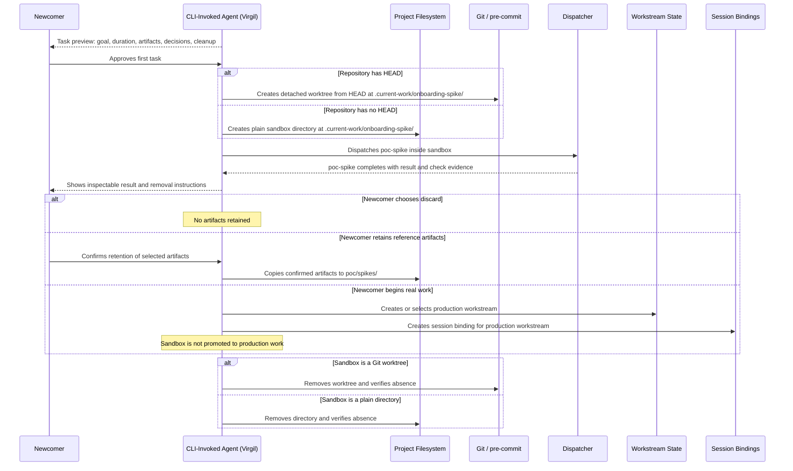

**Component ownership:**

| Behavior                        | Owner                                                                                                                        |
| ------------------------------- | ---------------------------------------------------------------------------------------------------------------------------- |
| First-task preview and approval | Virgil presents goal, duration, artifacts, decisions, and cleanup; blank or declined approval creates no sandbox             |
| Sandbox creation                | Virgil creates a detached worktree via Git (HEAD exists) or a plain sandbox directory under `.current-work/` (no HEAD)       |
| Task execution and checking     | Dispatcher resolves and dispatches `poc-spike` playbook inside the sandbox                                                   |
| Discard and cleanup             | Virgil removes the sandbox via Git (worktree) or filesystem and verifies the sandbox path no longer exists                   |
| Reference-artifact retention    | Newcomer confirms retention of selected artifacts; Virgil copies confirmed artifacts to `poc/spikes/` before sandbox removal |
| Production-workstream handoff   | Virgil creates or selects a workstream identity and binds the session to it; the sandbox is never promoted                   |

**Key Points:**

- The sandbox creates no branch or commit. Uncommitted active-working-tree changes are absent from the sandbox.
- When the repository has no HEAD, Virgil creates a plain directory instead of a Git worktree. This is not a Git operation.
- The `poc-spike` workflow runs only inside the sandbox. Its result is directly inspectable by the newcomer.
- Retention requires separate consent per artifact. The newcomer confirms before Virgil copies. Retained files are reference copies, not production state.
- Production handoff creates a normal workstream through the existing workstream creation path. The sandbox does not become production work.
- The ready-host budget is an inspectable result within ten minutes and five decisions after installation approval.

### 6.10.5 Sequence: Project Maintainer Updates an Installation

Derived from dynamic views `UpdateTransaction` and `UpdateTransactionCheck` in [`architecture.dsl`](../spec/architecture.dsl).

The update transaction follows [ADR-0023](../adr/0023-update-transaction-with-approval-staging-and-rollback.md), which supersedes ADR-0010 and ADR-0022 for the update path while preserving the layered first-install design.

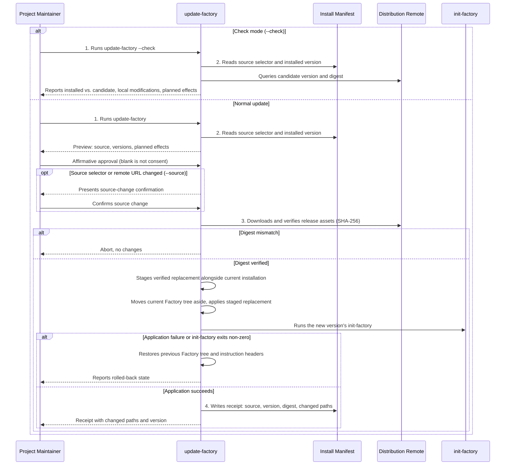

**Key Points:**

- Check mode is read-only. It reports the same information as the approval preview without downloading or mutating.
- Modified Factory-owned files stop the update before staging. The user may select the existing preservation flow to proceed.
- A different source selector or remote URL requires a separate `--source` option and its own confirmation step. No automatic fallback crosses the source boundary.
- The previous Factory tree is moved aside, not deleted, before application. Rollback restores it if application fails.
- `update-factory` owns the full transaction. After application, it runs the new version's `init-factory`, and a non-zero exit of `init-factory` triggers the rollback ([ADR-0026](../adr/0026-layout-migration-runs-inside-the-factory-update.md)).

### 6.10.6 Sequence: Update Moves the Project into the Core Artifact Layout

Derived from dynamic view `UpdateLayoutMigration` in [`architecture.dsl`](../spec/architecture.dsl).

An update from a factory version before the layout release moves the project's files into the core artifact layout described in [8.16](08_crosscutting_concepts.md#816-where-specification-artifacts-live). The developer approves the update, not the move, and declining the update means no update.

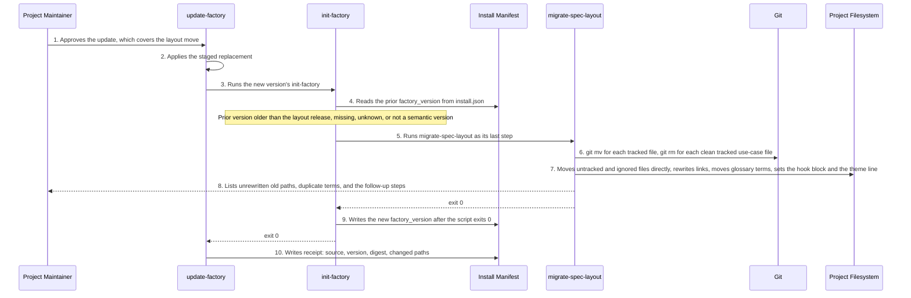

**Key Points:**

- The version test compares versions by Semantic Versioning 2.0.0 precedence, so `1.4.0` is older than `1.10.0` and `1.4.0-rc` is older than `1.4.0`. The layout release is `1.4.0`, the constant `LAYOUT_RELEASE` of `init-factory` (CAL-G02).
- Only a project without `install.json` is a first install. `init-factory` moves nothing there, lists each old path it finds, and names `migrate-spec-layout` as a command the developer can run.
- No git state blocks the script. Tracked files move with `git mv`, also with uncommitted changes. Untracked and ignored files move with a plain file move. A file of the removal set that is untracked, ignored, or tracked with uncommitted changes stays in place, and the script lists it for the developer to delete. The script never runs `git rm -f`.
- A later run of `init-factory` at the same version moves nothing. On a project without old paths, the script prints nothing and exits 0.
- The script commits nothing. It stages the new glossary and chapter 12. The developer reviews the moves with `git status` and commits them.
- After `init-factory`, `update-factory` brings the factory hook block to the new template. After a layout migration it writes the block without a question; every other update asks first (DEC-17).
- The two follow-up steps run later, in a session with the developer present: `capture-context --fold-context-map` folds `CONTEXT-MAP.md` and routing-only `CONTEXT.md` files into domain concerns of `docs/agent-context.md`, and `domain-modeling` cleans up the duplicate terms.

### 6.10.7 Sequence: Failed Layout Migration Rolls Back the Update

Derived from dynamic view `UpdateLayoutMigrationRollback` in [`architecture.dsl`](../spec/architecture.dsl).

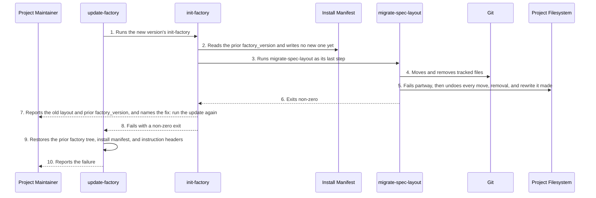

**Key Points:**

- The script's own undo restores the project's files: moves, removals, link rewrites, `docs/spec/glossary.md` and chapter 12, the removed `## Language` sections, the hook block, and the `theme` line. `git status` then shows no change against the state before the run.
- `install.json` keeps the prior `factory_version`, because `init-factory` writes the new version only after the script exits 0. So the next update retries the migration.
- `update-factory` restores the factory tree, the install manifest, and the instruction headers. The project keeps its old layout and its old factory version, so its scripts and hooks match its layout.
- The layout release supports only an installed `update-factory` `v1.1.0-rc` or later, the first release with this rollback. A project on an older release updates to 1.3.x first, as the release notes say ([ADR-0026](../adr/0026-layout-migration-runs-inside-the-factory-update.md)).

## 6.11 Specification Handoff Between Producers

Derived from dynamic view `SpecificationHandoff` in [`architecture.dsl`](../spec/architecture.dsl).

The specification has three producers, and each hands off to the next in its handoff text. `run-step` still counts an agent as eligible when the files of its required inputs exist, so the declared inputs set the order. [8.17](08_crosscutting_concepts.md#817-artifact-ownership-one-producer-one-declared-review) names the owner of each file.

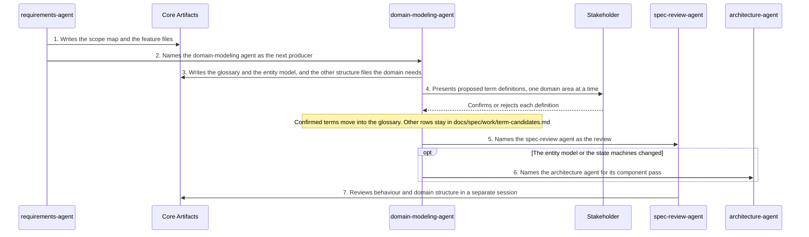

**Key Points:**

- The domain-modeling agent always writes `glossary.md` and `entity-model.md`, even when the glossary holds no term yet. The spec-review agent requires both, so its review can always run.
- The architecture agent requires only a feature file or the scope map, so it can build the baseline before the domain structure exists. `run-step` does not start it again when the domain structure changes. The handoff in step 6 does.
- An unattended run leaves its term definitions at `proposed`. The spec review files a finding for each of them. The [Term Candidate Lifecycle](../spec/state-machines.md#term-candidate-lifecycle) holds the statuses.
- The test-strategy agent can become eligible while the spec review still runs. The user then chooses the order. A contract that the review changes needs a revised QA strategy.

## 6.12 Spec Feedback and Wave Close

Derived from dynamic view `WaveClose` in [`architecture.dsl`](../spec/architecture.dsl).

The developer agent and the implementation agent edit no specification file. A drift that a story reveals goes to the artifact's owner as a row of the story's spec-feedback report. The implementation agent handles the rows at the wave close, after the last unit of work of the wave stops. So a story merge and a drift session never commit on the feature branch at the same time, and the stories of a wave, which start from the same base, are not held back by each other's drift. The next wave starts only after the close, so the specification lags the code by one wave at most ([ADR-0029](../adr/0029-per-story-drift-reports-block-the-wave-close.md), [ADR-0037](../adr/0037-one-lifecycle-for-runs-orchestrated-and-by-hand.md)).

Take ST-0318 in wave 1 of `feature/login`. The developer agent finds that the migration script must refuse a repository with uncommitted changes, and `validation-rules.md` has no such rule.

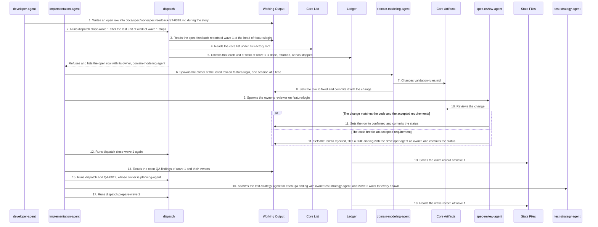

**Key Points:**

- Each story has its own report, `docs/spec/work/spec-feedback-<story-id>.md`, because the developer agents of a wave run in parallel. A story without a report counts as a story without rows.
- A row carries the columns Artifact, Drift, Evidence, Owner, and Status. The [Report Row Lifecycle](../spec/state-machines.md#report-row-lifecycle) holds the four statuses, and [BR-061](../spec/validation-rules.md#ownership-and-spec-feedback-reports-core-artifact-ownership-br-056br-066) names who sets each one.
- `close-wave` refuses while a row is `open`, or `fixed` on an artifact of the core list, and lists each such row with its owner. A row about an artifact without a declared review, such as a QA strategy or an ADR, closes at `fixed`. `close-wave` reads the reports at the head of the feature branch, not from a working tree.
- `close-wave` also refuses while a unit of work of the wave can still go on. A unit of work lets its wave close when it is `done`, `blocked`, `failed` with HasStopped, returned, or `pending` behind a returned story. `close-wave` decides HasStopped from the ledger alone ([Ledger Entry Lifecycle](../spec/state-machines.md#ledger-entry-lifecycle)).
- `close-wave` fails closed. A report with wrong column headers, a row with an unknown status, an unreadable report, or a missing core list each fails, and the message names the file. It reads `rulebooks/core-artifacts.yaml` under the Factory root it runs from: `packages/factory/` in this repository and `.agent-factory/factory/` in an installed project.
- Owner and reviewer sessions run one at a time on the feature branch, because two owners of one wave may change the same core file. Each session commits its core-file change and its row status together. The implementation agent does not wait for the User's go here, because the wave close starts, merges, and destroys nothing.
- After the close, the implementation agent routes the open `QA` findings of the wave. A finding with `owner: planning-agent` needs a missing test, so `dispatch add` puts it into the next wave as a unit of work. A finding with `owner: test-strategy-agent` goes to the test-strategy agent, and the next wave waits until every such spawn returns (RL-G11).
- `prepare-wave` and `prepare-story` refuse until the previous wave has a wave record. By hand, each story is a wave of its own, so its report is handled before the next story starts (BR-064).
- A drift row on the glossary has two reviewers, as the core list declares. When the reviewer is the stakeholder, the agent that ran the session with the stakeholder sets the status.
- The reconciliation agent uses the same row shape and statuses in `docs/reviews/reconciliation-<date>.md`, one report per run, after the merge into `dev` ([6.13](#613-reconciliation-backfeed)).

## 6.13 Reconciliation Backfeed

Derived from dynamic view `ReconciliationBackfeed` in [`architecture.dsl`](../spec/architecture.dsl).

A reconciliation run finds drift after implementation, outside any wave. So no implementation agent picks up its rows. The orchestrator of the `documentation-update` playbook does instead. The orchestrator is the session that runs the playbook. After the run, its backfeed step brings each row back to the artifact's owner and then to the owner's reviewer. [ADR-0030](../adr/0030-reconciliation-rows-return-through-the-documentation-update-playbook.md) records the decision.

Take the run of 2026-11-03. The code adds a component that the slice view of `docs/spec/architecture.dsl` does not show. The report `docs/reviews/reconciliation-2026-11-03.md` gets an `open` row with the architecture agent as owner.

```mermaid
sequenceDiagram
    participant O as CLI-Invoked Agent (orchestrator)
    participant RA as reconciliation-agent
    participant CA as Core Artifacts
    participant CL as Core List
    participant WO as Working Output
    participant AA as architecture-agent
    participant ARA as architecture-review-agent
    participant SH as Stakeholder

    O->>RA: 1. Dispatches the reconciliation run
    RA->>CA: 2. Reads the core to compare it with the code
    RA->>WO: 3. Writes the run's report, one open row per new drift with the artifact's owner
    O->>WO: 4. Reads every reconciliation report, not only the new one
    O->>CL: 5. Reads the core list to tell rows on core artifacts from the others
    loop Each open row, one session at a time
        O->>AA: 6. Dispatches the owner of an open row, naming the row and the report and no skill
        AA->>CA: 7. Changes architecture.dsl with the skill its own definition names for it
        AA->>WO: 8. Sets the row to fixed in the same commit as the change
    end
    loop Each fixed row on an artifact of the core list
        opt reviewed_by names an agent
            O->>ARA: 9. Dispatches the reviewer that reviewed_by names, one session at a time
            ARA->>CA: 10. Reviews the change
            alt The change matches the code and the accepted requirements
                ARA->>WO: 11. Sets the row to confirmed
            else The code breaks an accepted requirement
                ARA->>WO: 11. Sets the row to rejected and files a BUG finding with the developer agent as owner
            end
        end
        opt reviewed_by names the stakeholder
            O->>SH: 12. Presents the fix, after any agent reviewer confirmed it
            O->>WO: 13. Sets the row to confirmed or rejected as the stakeholder decides
        end
    end
    O->>WO: 14. Checks the DONE list: no row of any report is open, or fixed on a core artifact
    alt A row is open, or fixed on a core artifact
        WO-->>O: The playbook stays open and names the row
    else Every row is handled
        WO-->>O: The playbook is done
    end
```

**Key Points:**

- The owner, the skill, and the reviewer each come from one place. The row names the owner. The owner's agent definition names the skill for the artifact, so the dispatch names only the row and the report. The architecture agent, for example, chooses between `maintain-architecture` and `model-structurizr-slice`. The owner's output declaration names the reviewer in `reviewed_by:`. The core list keeps its four fields.
- The backfeed step reads every reconciliation report, not only the new one. So a session that stopped after the owner's fix leaves a `fixed` row, and the next backfeed step dispatches its reviewer.
- A row stays in the report that first wrote it, and only its status changes. A later run checks the row against the code but writes no row for the same drift. It writes a new row only when the drift of a closed row appears again: a `confirmed` row, or a `fixed` row outside the core list. A row that still waits needs no record, because the backfeed step picks it up.
- When `reviewed_by:` names an agent and `stakeholder`, the agent reviews first. The stakeholder sees the fix only after the agent confirmed it. For the stakeholder, the orchestrator sets the status itself, as for a fixed row on `docs/agent-context.md` with Virgil as owner.
- The orchestrator reads the core list, as `dispatch close-wave` does, to tell a row on a core artifact from the others. A `fixed` row on an artifact outside the core list, such as an ADR, closes at `fixed`, because the artifact has no declared review (DEC-35).
- The owner and the reviewer commit on the branch that holds the reconciliation report, normally the feature branch before its merge into `dev`. So the fixes reach `dev` with the code they describe.
- Only the playbook's DONE list waits for the rows. No script reads the reconciliation reports. So an unhandled row blocks neither `premerge-check`, nor `dispatch close-wave`, nor the next reconciliation run.
- [BR-067](../spec/validation-rules.md#ownership-and-spec-feedback-reports-core-artifact-ownership-br-056br-066) holds the rule, and the [Report Row Lifecycle](../spec/state-machines.md#report-row-lifecycle) holds the statuses.

## 6.14 Other Runtime Scenarios (Summary)

Full sequences for these flows are in their respective use cases:

- **Agent dispatch (interactive vs. background)** -- `UC-04`

## 6.15 ID Claim with a Stale Lease

Derived from dynamic view `IdClaimStaleLeaseRetry` in [`architecture.dsl`](../spec/architecture.dsl).

Two sessions claim at the same moment. The planning agent runs `next-id ST`
for a new story, and a code review in another clone runs `next-id FAGAN`. Both
read the claim commit with `ST=1012` and `FAGAN=1003`. The review pushes
first, so the planning agent's push meets a stale lease. The one ref holds
every prefix, so claims of different prefixes collide too.

```mermaid
sequenceDiagram
    participant CA as CLI-Invoked Agent
    participant NI as next-id
    participant CP as Counter Port
    participant GA as Git-Ref Adapter
    participant PR as Project Git Remote

    CA->>NI: 1. Runs next-id ST from create-backlog-stories
    NI->>CP: 2. Calls claim ST on the URL of origin
    GA->>PR: 3. Fetches refs/ids/counters into a throwaway bare repository and reads ST=1012
    GA->>PR: 4. Pushes a claim commit with ST=1013 under the lease on the old SHA
    PR-->>GA: stale lease, because another caller claimed FAGAN-1004 first
    Note over GA: Waits a random 0.1 to 1 second
    GA->>PR: 5. Fetches again and reads ST=1012 and FAGAN=1004
    GA->>PR: 6. Pushes a claim commit with ST=1013 under the lease on the new SHA
    PR-->>GA: accepted
    GA->>CP: 7. Returns 1013 and deletes the throwaway repository
    NI->>CA: 8. Prints ST-1013 and exits 0
```

**Key Points:**

- The adapter reads the claim commit again after every stale lease, so the
  next try sees the number that the other caller took.
- Only the two git messages for a stale lease, `stale info` and
  `cannot lock ref … is at <sha> but expected <sha>`, lead to a retry.
  `next-id` runs git with `LC_ALL=C`, so git prints them in English. Any other
  refusal ends the claim after one push with git's message.
- After ten stale leases in a row, `next-id` exits non-zero and names the
  prefix and the last number it tried. It prints no ID.
- The claim leaves no ref and no object in the clone, because it runs in a
  throwaway repository that `next-id` deletes at exit.
- The [Claim Lifecycle](../spec/state-machines.md#claim-lifecycle) holds the
  states, and BR-071 and BR-072 in
  [validation-rules.md](../spec/validation-rules.md#counter-ids-next-id-br-068br-078)
  hold the rules.

## 6.16 Move of a Local Counter to Origin

Derived from dynamic view `IdMoveToOrigin` in [`architecture.dsl`](../spec/architecture.dsl).

A project started without `origin`, so its Local Counter holds `ST=0012`. The
human then adds `origin`. At the next session start, VIRGIL sees that
`agent-factory.counterRemote` is set and that `origin` exists, and it offers
the move. The User confirms
([ADR-0033](../adr/0033-the-projects-own-repository-holds-the-counter-until-origin-exists.md)).

```mermaid
sequenceDiagram
    participant VI as virgil
    participant NI as next-id
    participant CP as Counter Port
    participant GA as Git-Ref Adapter
    participant LC as Local Counter
    participant PR as Project Git Remote

    VI->>NI: 1. Runs next-id --move-to-origin at the session start, after the User confirms the move
    NI->>LC: 2. Reads agent-factory.counterRemote, the path of the main repository
    NI->>CP: 3. Calls move to the URL of origin
    GA->>LC: 4. Fetches refs/ids/counters and reads the claim commit C with ST=0012
    GA->>LC: 5. Replaces refs/ids/counters with the marker commit moved=<origin>, whose parent is C, under the lease on C
    LC-->>GA: accepted
    GA->>PR: 6. Pushes C from a throwaway bare repository to refs/ids/counters with --force-with-lease=refs/ids/counters:
    PR-->>GA: accepted, because origin holds no counter
    GA->>CP: 7. Returns moved
    NI->>LC: 8. Removes agent-factory.counterRemote and exits 0
    NI-->>VI: reports that the counter is on origin
```

**Key Points:**

- The marker goes in before the push. A claim from another worktree that
  lands before step 5 makes the lease on `C` stale, so the move waits a random
  0.1 to 1 second, starts again at step 4, and carries the new number to
  `origin`. After ten stale leases in a row, the move ends, changes nothing,
  and keeps the setting. A claim after step 5 reads the marker and fails
  (BR-103).
- The push runs from a throwaway bare repository, so no hook of the project
  runs.
- When the push in step 6 fails, the Local Counter keeps the marker, the
  setting stays, and `next-id` exits non-zero and names the cause. It never
  puts `C` back, so the Local Counter hands out no number after step 5
  (DEC-16). A second move resumes, as 6.16.1 shows. When `origin` already
  holds a counter, the create-only lease refuses the push, `next-id` names
  both counters, and VIRGIL reports the collision (BR-102, BR-106).
- A claim or a `--plan-seed` that reads the marker names `origin` as the
  holder of the counter and never mentions `--seed`, so a local clone gets no
  advice to start a second counter (BR-097).
- The marker has `C` as its parent, so `C` stays reachable in the main
  repository when the move stops before the push (DEC-14).

### 6.16.1 Interrupted Move

Derived from dynamic view `IdMoveToOriginResume` in [`architecture.dsl`](../spec/architecture.dsl).

The move of 6.16 stops after step 5, for example because the shell kills
`next-id` while git waits for credentials, or the push in step 6 fails. The Local Counter holds the
marker, `origin` holds no counter, and `agent-factory.counterRemote` is still
set. Every claim now reads the marker and fails. At the next session start,
VIRGIL sees the setting and `origin` and offers the move again.

```mermaid
sequenceDiagram
    participant VI as virgil
    participant NI as next-id
    participant CP as Counter Port
    participant GA as Git-Ref Adapter
    participant LC as Local Counter
    participant PR as Project Git Remote

    VI->>NI: 1. Runs next-id --move-to-origin again at the next session start, after the User confirms the move
    NI->>LC: 2. Reads agent-factory.counterRemote, which the stopped move left set
    NI->>CP: 3. Calls move to the URL of origin
    GA->>LC: 4. Fetches refs/ids/counters, reads the marker commit moved=<origin>, and takes C with ST=0012 from its parent
    GA->>PR: 5. Asks origin for refs/ids/counters with git ls-remote
    PR-->>GA: origin holds no counter
    GA->>PR: 6. Pushes C from a throwaway bare repository to refs/ids/counters with --force-with-lease=refs/ids/counters:
    PR-->>GA: accepted
    GA->>CP: 7. Returns moved
    NI->>LC: 8. Removes agent-factory.counterRemote and exits 0
    NI-->>VI: reports that the counter is on origin
```

**Key Points:**

- The second run finds the marker at its read, so it sets no new marker and
  meets no stale lease. It takes `C` from the marker's parent and asks
  `origin` with `git ls-remote` before it pushes, as the `RESUMING` state of
  the Move Lifecycle says. Step 5 decides among the three cases below.
- When `origin` holds no counter, the move pushes `C`, as in 6.16.
- When `origin` already holds `C`, the earlier push went through before the
  stop. The move then skips the push, keeps the marker, and removes the
  setting, so the Local Counter never comes back beside the counter on
  `origin`.
- When `origin` holds a claim commit other than `C`, the move cannot tell
  whether that counter grew from `C`, because a claim commit has no parent.
  So it treats the case as a collision, names both counters, and changes
  nothing. The Local Counter keeps the marker and the setting stays, so no
  claim lands on `C` again. A counter that someone else seeded ends the same
  way.
- No step needs a new seed, so no claimed number goes out twice.
- The [Move Lifecycle](../spec/state-machines.md#move-lifecycle) holds the
  states, and BR-102 and BR-103 in
  [validation-rules.md](../spec/validation-rules.md#next-id---move-to-origin)
  hold the rules.

## 6.17 A Critical Finding Stops the Run

Derived from dynamic view `CriticalStop` in [`architecture.dsl`](../spec/architecture.dsl).

A bug hunt files BUG-0037 as `critical`: the defective lines of `dispatch`
exist unchanged in the installed copy, so real runs may already have lost
merges. The orchestrator then runs the next step of the wave.

```mermaid
sequenceDiagram
    participant CA as CLI-Invoked Agent
    participant DC as dispatch
    participant SC as Stop Check
    participant WO as Working Output
    participant G as Git
    participant PC as premerge-check
    participant BG as block-dangerous-git.sh
    participant SF as State Files
    actor SH as Stakeholder

    CA->>DC: 1. Runs dispatch prepare-wave
    DC->>SC: 2. Calls the stop check before the subcommand
    SC->>WO: 3. Reads BUG-0037.md, severity critical, stop_confirmed_by empty
    SC->>G: 4. Reads the HEAD version of BUG-0037.md, which is not confirmed either
    SC->>CA: 5. Prints the stop notice, dispatch writes nothing and exits 1
    CA->>PC: 6. Runs premerge-check for a story branch
    PC->>SC: 7. Calls the stop check before any other check
    SC->>CA: 8. Prints the same stop notice, premerge-check writes no marker and exits 1
    CA->>BG: 9. Runs git merge
    BG->>SF: 10. Finds no premerge-check-ok marker
    BG->>CA: 11. Denies the merge
    SH->>WO: 12. Runs each damage check, then writes stop_confirmed_by and stop_confirmed_reason in an editor
    CA->>DC: 13. Runs dispatch prepare-wave again
    DC->>SC: 14. Calls the stop check
    SC->>WO: 15. Finds both confirmation fields with text
    Note over SC: The stop ends, and BUG-0037 loops like a major finding
```

**Key Points:**

- The stop check reads the working tree and `HEAD` (DEC-57). A status change,
  a lower severity, or a removed file in the working tree keeps the `HEAD`
  version critical, so it does not end the stop. Only a confirmation in
  either version ends it.
- During a stop, `dispatch` still runs `status`, `plan`, `suggest-merge-args`,
  `verify-story`, `mark-blocked`, `mark-failed`, and `clear-manifest`, so
  the orchestrator can report and record. It also runs `return-story`,
  `close`, `close --drop`, and `close --orphans`, because they start and
  merge no work (BR-091).
- In an interactive session, the orchestrator explains each stopping finding
  with `explain-review-finding`. A headless run ends and carries the stop
  notice in its final summary.
- The stop check reads only the worktree it runs in. A critical finding on
  another branch stops no run until that branch merges (FC-G06).
- BR-091 holds the rule, and **STOPPING** of the
  [Finding Lifecycle](../spec/state-machines.md#finding-lifecycle) holds the
  state.

## 6.18 The Guard Refuses a Human Field

Derived from dynamic views `GuardRefusesHumanField` and `GuardFailsClosed` in [`architecture.dsl`](../spec/architecture.dsl).

A headless run meets the stop of 6.17. Its orchestrator tries to finish the
run by confirming the stop itself.

```mermaid
sequenceDiagram
    participant CA as CLI-Invoked Agent
    participant GC as guard entry - Claude Code
    participant GH as guard-human-fields

    CA->>GC: 1. Edit call adds stop_confirmed_by human to docs/findings/BUG-0037.md
    GC->>GH: 2. Runs guard-human-fields with the call
    GH->>CA: 3. Finds stop_confirmed_by in new_string and not in old_string, exits 2
    Note over CA: The run ends with the stop notice
```

In OpenCode and Pi, a broken install refuses the edit instead of letting it
through. Take an OpenCode install whose guard script is missing:

```mermaid
sequenceDiagram
    participant CA as CLI-Invoked Agent
    participant GO as guard entry - OpenCode plugin
    participant GH as guard-human-fields

    CA->>GO: 1. A write call on docs/findings/FAGAN-0042.md fires execute.before
    GO->>GH: 2. Looks for the guard script and finds none
    GO->>CA: 3. Blocks the call and names the missing script
```

**Key Points:**

- The refusal names the file, the field, and that the stakeholder writes it
  in an editor or with a `!` command. A `!` command runs outside the tool
  hooks.
- An edit that leaves an existing human field unchanged passes, so an agent
  can fix a typo in a waived finding. A new finding from the template carries
  only `null` and passes too.
- The guard reads the text of each call. A field name built from pieces in a
  script passes it (DEC-42).
- BR-092 holds the rule.
  [ADR-0035](../adr/0035-guard-human-fields-in-every-cli.md) records the entry
  point of each CLI.

## 6.19 finding-lint at a Commit

Derived from dynamic view `FindingLintCommit` in [`architecture.dsl`](../spec/architecture.dsl).

A Fagan review on a feature branch, in a linked worktree, commits FAGAN-0042
with `in_use: false` and a `minor` security finding as the register file
`docs/findings/register/security/SEC-0012.json`. The defective lines of
FAGAN-0042 were never changed on the feature branch, so `dev` carries them.

```mermaid
sequenceDiagram
    participant G as Git
    participant FL as finding-lint
    participant FR as Finding Registers
    participant SV as schema-validate
    participant FS as Finding Schemas
    participant WO as Working Output
    participant ST as Factory Settings
    participant MC as Primary Checkout Locator
    participant PF as Project Filesystem

    G->>FL: 1. Runs finding-lint --staged for the commit
    FL->>FR: 2. Reads the staged SEC-0012.json
    FL->>SV: 3. Runs schema-validate on SEC-0012.json with the security schema
    SV->>FS: 4. Reads finding-register-security.schema.json
    FL->>WO: 5. Reads the staged FAGAN-0042.md, review_class code, in_use false
    FL->>G: 6. Reads the HEAD versions, neither file exists there, so the git check is due for both
    FL->>ST: 7. Reads release_tag_patterns
    FL->>G: 8. Blames the artifact range on the reviewed branch, then on dev, main, origin/dev, origin/main, and each release tag
    FL->>MC: 9. Finds the primary checkout, because the commit runs in a linked worktree
    FL->>PF: 10. Blames the installed copy in the primary checkout with --contents
    FL->>G: 11. Finds every line identity of FAGAN-0042 on dev
    Note over FL: Exits 1 with "artifact lines exist unchanged on dev"
```

**Key Points:**

- The reviewer corrects the answer to `in_use: true`. The rule then computes
  `critical`, the file gains `## Possible damage`, and the run stops as 6.17
  shows.
- The lint compares line identities from `git blame -M -C --porcelain`, not
  text, so a range that moved within the file or to another file still
  matches (BR-088).
- The git check runs only for a code, runtime, or security finding that is new
  or whose `basis` or `artifact` changed. A change to a status or a human
  field triggers no git check (DEC-43).
- Without `docs/factory-settings.yaml` or its key, the lint exits `1` and
  names both, but only when a git check is due.
- The pre-commit hook reads the staged files, and `validate` reads the working
  tree. Both compare with `HEAD`, so both give the same answer.

## 6.20 Migration of Open Findings

Derived from dynamic view `FindingMigration` in [`architecture.dsl`](../spec/architecture.dsl).

The migration runs once, after two preconditions. The project has committed
`docs/factory-settings.yaml`, because the migration commit triggers the git
check. The cross-feature story that makes `next-id --plan-seed` count the
register files has landed, because the migration turns `.jsonl` lines into
register files
([5.12](05_building_block_view.md#512-level-2-component-view----finding-classification)).

```mermaid
sequenceDiagram
    participant CA as CLI-Invoked Agent
    participant MA as Migration Agent
    participant WO as Working Output
    actor SH as Stakeholder
    participant FR as Finding Registers
    participant G as Git
    participant FL as finding-lint
    participant ST as Factory Settings

    CA->>MA: 1. Runs the migration after docs/factory-settings.yaml is committed
    MA->>WO: 2. Classifies each open finding file without review_class with the rulebook
    MA->>SH: 3. Presents every result at one pause point
    SH->>WO: 4. Confirms the stop of each critical result
    MA->>WO: 5. Writes review_class, basis, and Why this severity, removes BUG-0067.md, sets deferred on RETRO-0002.md
    MA->>FR: 6. Writes code/BUG-0067.json and document/RECON-0027.json with status open, removes the three .jsonl files
    MA->>G: 7. Commits the migration
    G->>FL: 8. Fires pre-commit with --staged
    FL->>ST: 9. Reads release_tag_patterns for the git check of each migrated code, runtime, or security finding
```

**Key Points:**

- No file changes before the pause point. So the migration commit holds no
  unconfirmed `critical` finding, and no later run stops on a finding it did
  not produce.
- The removed finding files carry no `review_class` at `HEAD`, so
  `finding-lint` does not compare them, and the register files need no
  override fields (BR-095).
- The migration counts the open findings again when it runs. The proposal
  counted 47 by 2026-11-06.

## 6.21 What the Review Loop Reads

Every playbook with a review loop decides the next pass with a grep, such as
`grep -l "status: open" docs/findings/SPEC-*.md` at Decision Point 1.3 of
`feature-addition`. The grep reads the working tree only. Take an agent that
sets `deferred` on a `major` finding, lowers it, or removes its file, and
does not commit. The grep then misses the finding, and the loop ends.
`finding-lint` rejects each of these changes, but only when it runs.

The loop steps do not close this gap. Each step was checked for a commit or a
`validate` run before the decision point:

| Step                                             | Ends with a commit                                      | Ends with a `validate` run |
| ------------------------------------------------ | ------------------------------------------------------- | -------------------------- |
| Fix step of a requirements or architecture agent | Yes, one commit per repeat pass                         | No                         |
| Spec review, architecture review, code review    | No commit step in the agent definitions                 | No                         |
| Developer agent                                  | Yes, on the story branch, in both ways of driving a run | No                         |
| Decision points 1.3, 2.3, 4.3, 4.5, and 5.2      | No                                                      | No                         |

So the gap stays open. A review pass ends without a commit, so the decision
point greps files that no lint has checked. A run of `finding-lint`
or `validate` at each decision point, before the grep, would close it. That
is a change to the playbooks, so this chapter records it as an open item and
changes no rule. The stop itself is not affected, because the stop check
also reads `HEAD` (6.17).

## 6.22 A Run from Init to Close

A run starts with `dispatch init` and ends with `dispatch close`. Both ways of driving it share the branches, the ledger states, the story workflow ([6.23](#623-the-story-workflow)), the checks at the merge ([6.24](#624-the-merge-check-of-a-story)), and the close. They differ in who starts a story, whether stories run in parallel, and where they run ([ADR-0037](../adr/0037-one-lifecycle-for-runs-orchestrated-and-by-hand.md)).

| Point                                            | Orchestrated                                                | By hand                                        |
| ------------------------------------------------ | ----------------------------------------------------------- | ---------------------------------------------- |
| Who starts a story                               | The implementation agent, wave by wave                      | The implementation agent, after the User's go  |
| How stories run                                  | In parallel where they do not overlap                       | One at a time; each story is a wave of its own |
| Where a story runs                               | In its own worktree under `.current-work/<feature-branch>/` | In the primary checkout                        |
| Who runs the gate-check step                     | The implementation agent                                    | The implementation agent                       |
| Who runs `return-story`, `close`, `close --drop` | The User                                                    | The User                                       |
| Who merges into `dev`                            | The User                                                    | The User                                       |

### 6.22.1 Sequence: An Orchestrated Run

Derived from dynamic view `RunOrchestrated` in [`architecture.dsl`](../spec/architecture.dsl).

Take ST-0350 and ST-0351, which do not overlap, in one wave on `feature/login`.

```mermaid
sequenceDiagram
    participant U as Human Operator
    participant IA as implementation-agent
    participant D as dispatch
    participant G as Git / pre-commit
    participant RW as Run Worktrees
    participant L as Ledger
    participant SF as State Files
    participant DA as developer-agent
    participant S as CLI-Invoked Agent
    participant CRA as code-review-agent
    participant QA as qa-agent
    participant PC as premerge-check
    participant RA as reconciliation-agent

    U->>IA: 1. Asks for an orchestrated run of ST-0350 and ST-0351
    IA->>D: 2. Runs init --mode orchestrated --stories ST-0350,ST-0351
    D->>G: 3. Cuts feature/login from dev
    D->>RW: 4. Creates the worktree of feature/login
    D->>L: 5. Writes a ledger with both stories pending
    L->>SF: 6. Saves the ledger of feature/login
    IA->>D: 7. Runs plan and prepare-wave 1
    D->>RW: 8. Creates one story worktree per story
    IA->>DA: 9. Spawns one developer agent per story, and both run the story workflow
    IA->>D: 10. Runs merge-story for each story whose workflow passed
    IA->>D: 11. Runs close-wave 1 after the last story of wave 1 stops
    S->>CRA: 12. Runs the review of the whole feature
    S->>QA: 13. Runs QA on feature/login
    IA->>PC: 14. Runs premerge-check dev feature/login and shows the result
    U->>G: 15. Merges feature/login into dev
    U->>D: 16. Runs dispatch close
    D->>RW: 17. Stashes each worktree's uncommitted files under a name, then removes it
    D->>SF: 18. Removes the state of the run
    D->>G: 19. Deletes the merged branches and lists each stash and each unmerged branch
    S->>RA: 20. Runs the reconciliation on dev, outside the run
```

### 6.22.2 Sequence: A Run by Hand

Derived from dynamic view `RunByHand` in [`architecture.dsl`](../spec/architecture.dsl).

The implementation agent leads the User through the run. It stops before a story starts, before `dispatch add`, before a story merges, when a story stops as `failed` or `blocked`, and before the merge into `dev`. At each stop it shows what the decision needs and names the command it will run.

```mermaid
sequenceDiagram
    participant U as Human Operator
    participant IA as implementation-agent
    participant D as dispatch
    participant G as Git / pre-commit
    participant L as Ledger
    participant PF as Project Filesystem
    participant DA as developer-agent
    participant S as CLI-Invoked Agent
    participant CRA as code-review-agent
    participant QA as qa-agent
    participant PC as premerge-check

    U->>IA: 1. Asks for a run by hand of ST-0350
    IA->>D: 2. Runs init --mode by-hand --stories ST-0350
    D->>G: 3. Cuts feature/login from dev and checks nothing out
    D->>L: 4. Writes a ledger with mode by-hand
    IA->>U: 5. Names prepare-story ST-0350 and waits
    U->>IA: 6. Gives the go
    IA->>D: 7. Runs prepare-story ST-0350
    D->>PF: 8. Checks out story/ST-0350 in the primary checkout
    IA->>DA: 9. Spawns the developer agent, and ST-0350 runs the story workflow
    IA->>D: 10. Runs merge-story ST-0350 --dry-run, which merges nothing
    D->>PC: 11. Runs premerge-check on story/ST-0350
    IA->>U: 12. Shows the branch head, the findings, and the merge-check output, then names merge-story and waits
    U->>IA: 13. Gives the go
    IA->>D: 14. Runs merge-story ST-0350
    D->>PC: 15. Runs premerge-check again, while story/ST-0350 stays checked out
    D->>PF: 16. After exit 0, checks out feature/login and merges
    IA->>D: 17. Runs close-wave 1 before the next story starts
    S->>CRA: 18. Runs the review of the whole feature
    S->>QA: 19. Runs QA on feature/login
    IA->>PC: 20. Runs premerge-check dev feature/login
    IA->>U: 21. Shows the result and stops before the merge into dev
    U->>G: 22. Merges feature/login into dev
    U->>D: 23. Runs dispatch close with ! in Claude Code
```

**Key Points:**

- One run may be active per feature branch, and several runs may be active at once. Only one run by hand may be active, because it needs the primary checkout (BR-112).
- By hand, `init` creates no worktree. Git cannot check out a branch that another worktree holds, and the run works in the primary checkout.
- Before the go for a merge, the implementation agent runs `dispatch merge-story --dry-run`. The dry run runs `premerge-check` and merges nothing, so the User sees the merge-check output before deciding.
- By hand, `merge-story` runs `premerge-check` while the story branch is still checked out, and checks out the feature branch only after exit `0`. So a refused merge leaves the primary checkout on the story branch, and a changed tracked file cannot make the checkout fail before the check decides. [6.24.1](#6241-sequence-a-refused-story-merge) shows what follows a refusal.
- The User runs only `dispatch return-story`, `dispatch close --drop`, and `dispatch close`, with `!` in Claude Code or in a terminal of their own. The guardrail refuses the first two to agents ([6.25](#625-the-git-guardrail-in-every-agent-tool)).
- A run by hand needs no `refresh-story`, because only one story runs, so the feature branch does not move under it.
- `dispatch close` refuses while a unit of work is `failed` or `blocked`, and while the feature branch is not merged into `dev`; then it names `--drop`. It stashes the untracked files and the uncommitted changes of each worktree in one named stash, such as `run feature/login ST-0350 2026-11-24`, and does not apply it. It lists each stash and each unmerged branch, because only the human deletes an unmerged branch (BR-119).
- After the close, the record of the run is the merge commits in `dev` and the status in each story file. `dispatch close --orphans` cleans up worktrees, branches, and ledgers that no active run owns (BR-120).
- Every `dispatch` command reads the ledger and the branch state before it acts, so a new session continues an interrupted run where it stopped (QS-30).

## 6.23 The Story Workflow

Derived from dynamic view `StoryWorkflow` in [`architecture.dsl`](../spec/architecture.dsl).

Every unit of work goes through the same steps on its branch `story/<id>`, in both ways. A blocking finding from the feature checks, such as `BUG-0090`, runs the same way after `dispatch add` ([6.12](#612-spec-feedback-and-wave-close)).

```mermaid
sequenceDiagram
    participant IA as implementation-agent
    participant D as dispatch
    participant DA as developer-agent
    participant G as Git / pre-commit
    participant CRA as code-review-agent
    participant WO as Working Output
    participant CS as crap-score
    participant PC as premerge-check
    participant L as Ledger

    IA->>D: 1. Runs mark-dispatching ST-0350
    IA->>DA: 2. Spawns the developer agent for ST-0350
    DA->>G: 3. Implements ST-0350 test first and commits
    IA->>D: 4. Runs mark-dispatched ST-0350
    IA->>CRA: 5. Spawns the review of story/ST-0350
    CRA->>WO: 6. Writes code-review-ST-0350-2026-11-24.md and files IMPL-0091
    DA->>G: 7. Commits the report and the finding
    loop Until no blocking finding with story ST-0350 is open
        IA->>DA: 8. Spawns a fresh developer agent for IMPL-0091
        DA->>G: 9. Fixes IMPL-0091 and commits
        IA->>CRA: 10. Spawns a repeat review, which sets IMPL-0091 to resolved
    end
    IA->>CS: 11. Runs the gate-check step: every gate of ST-0350
    IA->>D: 12. Runs merge-story ST-0350
    D->>PC: 13. Runs premerge-check feature/login story/ST-0350
    D->>G: 14. Merges and sets status done in backlog/ST-0350.md in the merge commit
    D->>G: 15. Runs the test suite and moves feature/login back on a red suite
    D->>L: 16. Sets ST-0350 done, or blocked after a red suite
```

**Key Points:**

- The developer agent commits on both ways, so the review and the gates always see committed work. It never runs a gate script and never sets `status: done`. The pre-commit hooks give it early feedback on every commit.
- A second review of the same story on the same day writes `-2` into the report name, and a third `-3`, so two stories reviewed on one day do not collide at the merge.
- The review report of step 6 carries `story: ST-0350` and `branch_head`, and IMPL-0091 carries `story: ST-0350`.
- Each finding of a story's review sets `story` to the story ID. A finding of the feature checks leaves `story` empty and sets `run` to the feature branch. `finding-lint` refuses a finding that sets both (BR-121).
- Step 11 is the gate-check step of [6.4](#64-gate-check-step).
- Only `merge-story` sets `done` for a story, or `resolved` for a finding, in the merge commit (BR-118). `dispatch` has no `mark-done` subcommand.
- On a red test suite, `merge-story` moves the feature branch back instead of making a revert commit. A revert would make git treat the story's commits as merged, so a second attempt would bring in nothing.

## 6.24 The Merge Check of a Story

Derived from dynamic view `PremergeStoryCheck` in [`architecture.dsl`](../spec/architecture.dsl).

`premerge-check` checks the result at the branch head, not the order of the steps that led there. It reruns every gate and the test suite in a temporary worktree at the head of the branch, so no stored result decides the merge and no file in the story's checkout or the primary checkout changes ([ADR-0038](../adr/0038-premerge-check-reruns-the-gates-in-a-temporary-worktree.md)).

```mermaid
sequenceDiagram
    participant D as dispatch
    participant PC as premerge-check
    participant SC as Stop Check
    participant G as Git / pre-commit
    participant RW as Run Worktrees
    participant DC as dependency-check
    participant MC as Measuring Commands
    participant CS as crap-score
    participant SF as State Files
    participant PF as Project Filesystem

    D->>PC: 1. merge-story runs premerge-check feature/login story/ST-0350
    PC->>SC: 2. Calls the stop check first
    PC->>G: 3. Checks the base, diff size, and scope, and reads reviews and findings at the head
    PC->>RW: 4. Removes any worktree left at premerge/ST-0350, then prunes
    PC->>RW: 5. Adds a detached worktree at the head of story/ST-0350
    PC->>MC: 6. Runs the ready command of each measure of crap-score in the worktree
    PC->>DC: 7. Reruns dependency-check in the worktree
    PC->>CS: 8. Calls crap-score --base feature/login, whose measuring commands measure the code of the worktree
    PC->>SF: 9. Reads the mutation-testing result, the one stored result
    PC->>RW: 10. Runs the test suite and the other gates, then removes the worktree
    alt Every check passes
        PC->>SF: 11. Writes premerge-check-ok for the head and exits 0
        opt A run by hand
            D->>PF: 12. By hand, checks out feature/login only now
        end
        D->>G: 13. Merges story/ST-0350 into feature/login
    else A check fails
        PC-->>D: Exits 1 and names each failure, and 6.24.1 shows what follows
    else Only a gate could not measure
        PC-->>D: Exits 3 with GATE CANNOT MEASURE: crap-score, and merge-story sets blocked
    end
```

**Key Points:**

- `premerge-check` reads the ID of the unit of work from the branch name `story/<id>`, which holds a story ID or a finding ID.
- It reads the review reports, the finding files, and the register files from the branch head with git. A finding that is open only in the folder where the check runs does not count, and one that is open at the branch head does.
- Step 4 removes a worktree that a crashed earlier check left at `.current-work/feature/login/premerge/ST-0350`, with `git worktree remove --force` and then `git worktree prune` (BR-123). The path belongs to one unit of work, so no other check uses it, and a retry after a crash does not fail on the leftover.
- The temporary worktree is detached at the head commit, because the branch is checked out in the story worktree or the primary checkout already. Git ignores `.agent-factory/`, so the gate scripts come from the installed copy of the calling checkout (OI-10). The worktree builds its own `uv` environment, so the first rerun takes longer.
- An untracked file of a checkout takes no part in the rerun.
- Step 6 runs before the test suite. When a `ready` command fails, `premerge-check` exits `3` at once and runs neither the test suite nor the gates (BR-136). Step 8 passes `--report-dir` set to `.current-work/crap-score/` of the primary checkout, so the report of a refused merge outlives the temporary worktree.
- `merge-story` declares the scope of a story: its declared outputs, its backlog file, its spec-feedback report, and its review reports, finding files, and register files. These files do not count toward the file limit. A finding declares no scope, and `--max-files` still limits its diff (RL-G20).
- The merge of the feature branch into `dev` runs `premerge-check dev <feature-branch>`. It checks that every unit of work is `done` or `pending`, that every wave has a wave record, that the review of the whole feature and the three QA reports name the run and a current `branch_head`, and that no blocking finding of the run is open. It runs the full test suite in a temporary worktree at the head of the feature branch, at `.current-work/<feature-branch>/premerge/feature`, such as `.current-work/feature/login/premerge/feature`. Story and finding checks keep `premerge/<id>`. The implementation agent shows the result, and the User merges.

### 6.24.1 Sequence: A Refused Story Merge

Derived from dynamic view `PremergeStoryRefused` in [`architecture.dsl`](../spec/architecture.dsl).

For each cause in the table below except two, a refused merge changes no state (BR-124). `merge-story` merges nothing, a failed `premerge-check` writes no marker, the feature branch does not move, and the entry of the unit of work stays `dispatched`. By hand, the story branch also stays checked out in the primary checkout. Two refusals do change state. In an orchestrated run, when git refuses the merge itself, `merge-story` sets the entry `blocked` with the reason `merge conflict` (BR-116). On both ways, when only a gate could not measure, `merge-story` sets the entry `blocked` with the reason `gate cannot measure: crap-score` (BR-124, BR-136). The cause of the refusal decides the next step of the implementation agent:

| Cause of the refusal                                                                                                                                        | Next step of the implementation agent                                                                                                                                                                                                                                                                                                                                                                                                                                       |
| ----------------------------------------------------------------------------------------------------------------------------------------------------------- | --------------------------------------------------------------------------------------------------------------------------------------------------------------------------------------------------------------------------------------------------------------------------------------------------------------------------------------------------------------------------------------------------------------------------------------------------------------------------- |
| Any check of `premerge-check` with exit `1`: a gate, the test suite, an open blocking finding, a missing code review, the base, the diff size, or the scope | `merge-story` exits `1`, and the message names the refusing check. The entry stays `dispatched`, and the implementation agent runs the gate-check step of [6.4](#64-gate-check-step) on the branch again. When a gate fails there, the attempt runs as in 6.4: `mark-failed`, `re-dispatch`, `mark-dispatching`, a fresh developer agent, `mark-dispatched`, and the gates again. A refusal that keeps coming uses up the attempts, and the unit of work stops (HasStopped) |
| A gate that cannot measure: a failed `ready` command, or exit `2` of `crap-score`, while every other check that ran passed                                  | `premerge-check` exits `3`, and its refusal starts with `GATE CANNOT MEASURE: crap-score`. `merge-story` merges nothing, sets the entry `blocked` with the reason `gate cannot measure: crap-score`, and exits `1`. The implementation agent shows the message to the User and waits. After the User fixes the setup, it runs `dispatch resume-gates` and the gate-check step again, with no developer agent and no counted attempt (BR-135, BR-136)                        |
| The stop of a critical finding                                                                                                                              | Stops. The run waits until the stakeholder confirms the damage checks ([6.17](#617-a-critical-finding-stops-the-run))                                                                                                                                                                                                                                                                                                                                                       |
| By hand: no check fails, but git refuses the checkout of the feature branch or the merge over an uncommitted change to a tracked file                       | `merge-story` exits `1`, names the files and the checkout they sit in, and merges nothing. The entry stays `dispatched`, and the story branch stays checked out. The implementation agent shows the message to the User unchanged (BR-124)                                                                                                                                                                                                                                  |
| Orchestrated: no check fails, but the worktree of the feature branch holds an uncommitted change to a tracked file, also one the story did not touch        | `merge-story` checks nothing out. Before it merges, it refuses, exits `1`, and names the files and the worktree. The entry stays `dispatched`. The implementation agent reports the message to the User unchanged and does not repair the worktree. The key `dispatch.refuse_dirty_feature_worktree: false` in `docs/testing.yaml` turns this check off, and a missing key means `true`                                                                                     |

Take ST-0350 in a run by hand. The last fix commit added an import that breaks a rule of `dependency-rules.dsl`.

```mermaid
sequenceDiagram
    participant U as Human Operator
    participant IA as implementation-agent
    participant D as dispatch
    participant PC as premerge-check
    participant DC as dependency-check
    participant RW as Run Worktrees
    participant DA as developer-agent
    participant G as Git / pre-commit

    IA->>D: 1. Runs merge-story ST-0350 after the User's go
    D->>PC: 2. Runs premerge-check while story/ST-0350 stays checked out
    PC->>DC: 3. Reruns dependency-check in the temporary worktree, and it fails
    PC->>RW: 4. Removes the temporary worktree and writes no marker
    PC-->>D: Exits 1 and names dependency-check
    D-->>IA: Exits 1, names dependency-check, and merges nothing
    IA->>U: 5. Shows the failed check, and ST-0350 stays dispatched on story/ST-0350
    IA->>DC: 6. Runs the gate-check step, and dependency-check fails there too
    IA->>D: 7. Runs mark-failed ST-0350 and re-dispatch ST-0350
    IA->>D: 8. Runs mark-dispatching ST-0350
    IA->>DA: 9. Spawns a fresh developer agent with the output of dependency-check
    DA->>G: 10. Fixes the import and commits on story/ST-0350
    IA->>D: 11. Runs mark-dispatched ST-0350
    IA->>DC: 12. Runs the gate-check step again, and every gate passes
    IA->>U: 13. Names merge-story ST-0350 again and waits for the go
```

**Key Points:**

- The Ledger Entry Lifecycle has no transition for a merge that `premerge-check` refuses, because the entry keeps its state. A gate failure reaches `failed` through the gate-check step, where the state machine allows **Fail** from `dispatched`.
- In an orchestrated run, the steps are the same without the stops for the User's go.

The two rows on an uncommitted change share a sequence. Derived from dynamic view `MergeCheckoutRefused` in [`architecture.dsl`](../spec/architecture.dsl).

Take ST-0350 in a run by hand again. Every check passes, but the User has an uncommitted change to `src/login.py`, which differs between `story/ST-0350` and `feature/login`. Steps 5 to 8 show ST-0351 in an orchestrated run, whose feature branch worktree holds an uncommitted change. `premerge-check` runs first and passes, and then the worktree check refuses.

```mermaid
sequenceDiagram
    participant U as Human Operator
    participant IA as implementation-agent
    participant D as dispatch
    participant PC as premerge-check
    participant PF as Project Filesystem
    participant RW as Run Worktrees

    IA->>D: 1. Runs merge-story ST-0350 after the User's go
    D->>PC: 2. Runs premerge-check, and every check passes
    D->>PF: 3. Checks out feature/login, and git refuses over the uncommitted change to src/login.py
    D-->>IA: Exits 1, names src/login.py and the primary checkout, and merges nothing
    IA->>U: 4. Shows the message unchanged: the files, the checkout, and that nothing merged
    IA->>D: 5. Orchestrated: runs merge-story ST-0351 in the worktree of feature/login
    D->>PC: 6. Runs premerge-check first, and it exits 0
    D->>RW: 7. Finds an uncommitted change to a tracked file, names the files and the worktree, and merges nothing
    IA->>U: 8. Reports the message unchanged and does not repair the worktree
```

ST-0350 stays `dispatched`, and `story/ST-0350` stays checked out. The User commits or reverts the change and gives the go again, and `merge-story` reruns `premerge-check` (BR-124). In an orchestrated run, `merge-story` works in the worktree of the feature branch and checks nothing out. There it refuses on its own check before the merge, as the orchestrated row of the table states.

## 6.25 The Git Guardrail in Every Agent Tool

Derived from dynamic view `GitGuardrailOneScript` in [`architecture.dsl`](../spec/architecture.dsl).

The git guardrail refuses agents the commands that destroy work: `dispatch return-story` and `dispatch close --drop` are always the User's decision. One script holds every rule, and each agent tool reaches it ([ADR-0039](../adr/0039-one-git-guardrail-script-for-all-five-agent-tools.md)).

```mermaid
sequenceDiagram
    participant A as CLI-Invoked Agent
    participant GP as block-dangerous-git.ts
    participant GO as git guardrail entry: OpenCode plugin
    participant BDG as block-dangerous-git.sh

    A->>GP: 1. pi: the bash call dispatch close --drop fires tool_call
    GP->>BDG: 2. Passes the command
    BDG-->>GP: Exit 2 and the reason
    GP->>A: 3. Blocks the call with the script's reason
    A->>GO: 4. OpenCode: the shell call dispatch close --drop fires execute.before
    GO->>BDG: 5. Passes the command
    BDG-->>GO: Exit 2 and the reason
    GO->>A: 6. Blocks the call with the script's reason
    A->>GO: 7. OpenCode: an execute call whose JavaScript runs dispatch close --drop fires execute.before
    GO->>BDG: 8. Passes the JavaScript as command text
    BDG-->>GO: Exit 2 and the reason
    GO->>A: 9. Blocks the call with the script's reason
    A->>BDG: 10. Claude Code: the Bash call dispatch close --drop fires PreToolUse
    BDG->>A: 11. Refuses with exit 2 and names the User as the one who drops a run
```

**Key Points:**

- Codex and Copilot CLI call the script from their native hook, as Claude Code does.
- OpenCode's `execute` tool runs JavaScript, which can start a process, such as `execSync("dispatch close --drop")`. So the OpenCode entry passes that JavaScript to the script as command text, as the guard `guard-human-fields` does for the same tool. The real OpenCode session test, which the User starts through the manual pre-commit hook `run-opencode-session-test`, checks a `shell` call and an `execute` call.
- The script refuses both commands in every form that names them in the command text: through any path to `dispatch`, after `&&` or `;`, and inside `bash -c`. It expands no variable, so a command built from variables passes (OI-11).
- The script refuses no other `dispatch` subcommand. The User watches a run and can undo any other step: a story that started too early is returned, and a merge that came too early is undone by moving the feature branch back.
- The script finds the run of a folder from the folder's branch. A feature branch has its ledger at `.current-work/<feature-branch>/`, and a story branch belongs to the run whose ledger lists it. On `dev`, a ledger of another branch changes nothing (RL-G12).

## Referenced from

- [05_building_block_view.md section 5.2.1](05_building_block_view.md#521-project-owned-test-gates-via-charter-declaration)
- [05_building_block_view.md section 5.2.3](05_building_block_view.md#523-semantic-quality-gates-crap-score-mutation-testing-dependency-check-test-design-verify)
- [08_crosscutting_concepts.md section 8.1](08_crosscutting_concepts.md#81-agentic-creation-deterministic-validation)
- [09_architecture_decisions.md](09_architecture_decisions.md)
