[back to index](../README.md)

# 6. Runtime View

## 6.1 Overview

This chapter describes key interaction sequences for Factory gates,
eligibility evaluation, local usage analysis, and core artifact ownership. Dynamic views in
[`architecture.dsl`](../spec/architecture.dsl) own the canonical step order.

## 6.2 Agent Selection

Derived from dynamic view `AgentSelection` in [`architecture.dsl`](../spec/architecture.dsl).

Agent selection is the primary routing operation. The `intent select` command loads agent definitions, evaluates each agent's declared preconditions against the repository, and presents per-agent eligibility evidence. The eligibility engine never writes state.

### 6.2.1 Sequence: Human Runs `intent select`

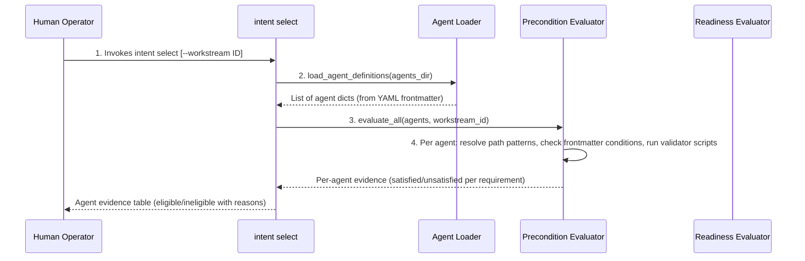

**Key Points**:

- **Precondition-based**: Each agent declares `inputs.required` in its YAML frontmatter. The evaluator resolves each requirement's `path_pattern` against the filesystem, optionally filtering by workstream scope and checking frontmatter conditions or validator scripts.
- **Engine is read-only**: The eligibility engine reads agent definitions and the repository. It returns immutable evidence. It does not write state, acquire locks, or produce side effects.
- **Workstream scoping**: When `--workstream` is passed, candidates are filtered by the `scope` field in their frontmatter (matching the workstream ID or `"global"`). Files without a scope declaration are included.
- **Readiness derivation**: `derive_readiness()` accepts evaluation results and produces `AgentReadiness` dataclasses with `eligible`, `unsatisfied`, and `warnings` fields.

## 6.3 Test Gate Presence

Factory ensures test gates exist; the project decides what runs inside them. Testing is project-owned infrastructure declared in `docs/testing.yaml`. Factory's guardrails and eligibility preconditions read that declaration. Factory does not own test execution, framework detection, or structured test output.

### 6.3.1 Sequence: Precondition Evaluation with Test Gate

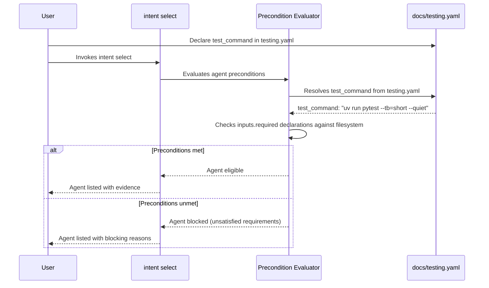

### 6.3.2 Sequence: Agent Uses Charter-Declared Test Command

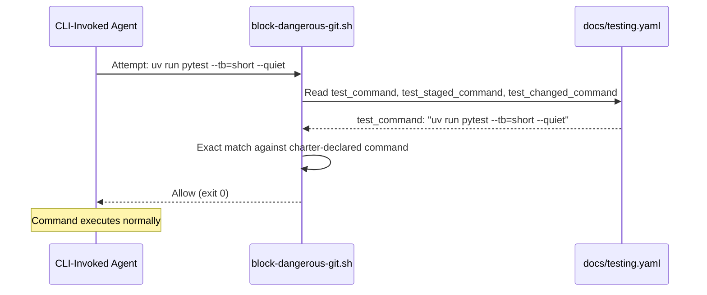

### 6.3.3 Sequence: Agent Blocked from Bare Test Command

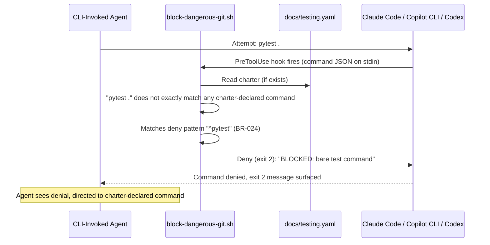

**Key Points**:

- **Preventive**: Command blocked *before* execution (PreToolUse hook, not post-facto)
- **Exact match only**: Charter-declared commands are allowlisted with exact-string matching; no prefix matching (BR-024)
- **Three native-hook CLIs**: Claude Code, Copilot CLI, and Codex invoke the shared shell guardrail; Pi enforces the same deny list through its project-local extension
- **No charter means no agent test commands**: When `testing.yaml` does not exist, no agent test commands are allowlisted; bare test commands remain blocked
- **Deny patterns (BR-024)**: The canonical list is maintained in `.agent-factory/factory/config/hooks/block-dangerous-git.sh`; representative entries include `pytest`, package-manager test scripts, `jest`, `vitest`, `go test`, `cargo test`, and Python/uv pytest invocations

## 6.4 Semantic Gate Loop

Derived from dynamic view `SemanticGateLoop` in [`architecture.dsl`](../spec/architecture.dsl).

The semantic gate loop runs after each developer-agent commit, before merge. The implementation-agent dispatcher owns execution. The developer agent never runs the gates; it only receives gate reports when a fix iteration is needed. See [ADR-0012](../adr/0012-dispatcher-owned-semantic-gate-loop.md).

### 6.4.1 Sequence: Gate Pass (All Gates Succeed)

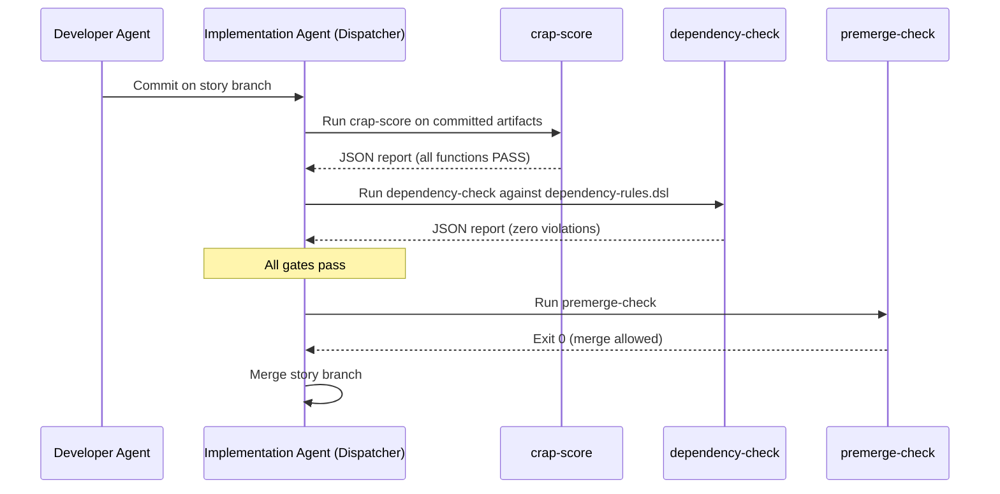

### 6.4.2 Sequence: Gate Failure with Fix Iteration

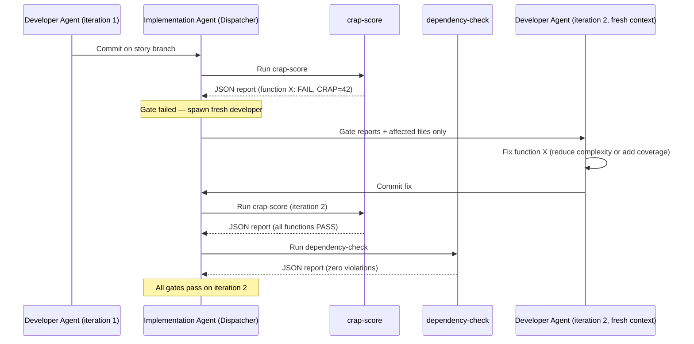

**Key Points:**

- Each fix iteration spawns a fresh developer agent. No context contamination from prior gate output.
- Maximum three fix iterations per tier (configurable in `house-rules.md`). After the cap, the story escalates or is marked blocked.
- The gates run in sequence and all must pass before `premerge-check`. `dependency-check` runs after every story. The story's gate list, or the `gates` section of `docs/testing.yaml`, picks `crap-score` and the project's mutation command. `test-design-verify` runs when the story has a Test Design or a Prior Tests section. The test-strategy agent owns these test guardrails and their thresholds; the implementation agent runs them ([5.2.3](05_building_block_view.md#523-semantic-quality-gates-crap-score-mutation-analysis-dependency-check)).
- Gate reports are written to `.current-work/<gate-name>/<story-id>.json` for traceability.

### 6.4.3 Sequence: Module-Graph Check (Architecture Routing)

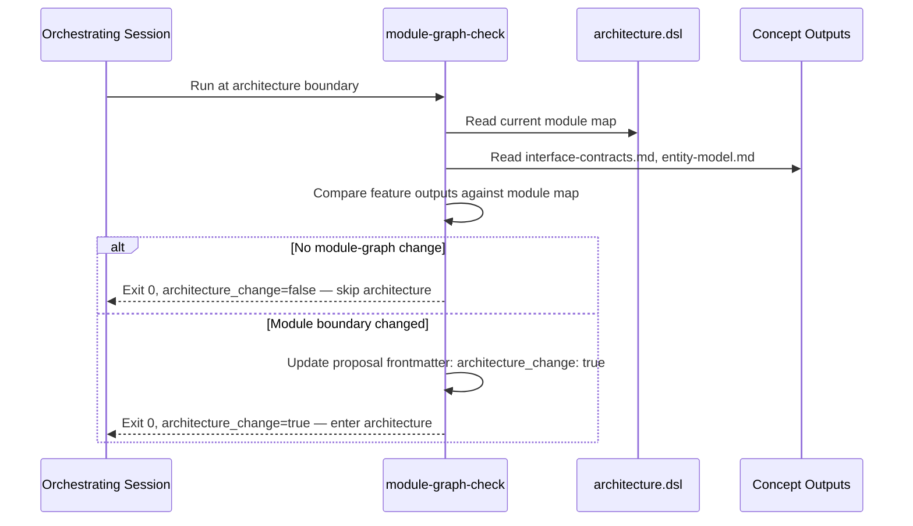

**Key Points:**

- Runs once per feature, at the architecture boundary. Not per story, not per commit.
- Tests module-graph topology only: new modules, changed public interfaces, inverted dependency directions. A new entity in an existing module does not trigger the architecture check.
- The orchestrating session owns the check. It is not a hook or a dispatcher gate.

## 6.5 Agent Context Validation

The concern-oriented agent context (`docs/agent-context.md`) is a single markdown file that replaced the four-file YAML model in 0.9.0. The team maintains the file directly; `update-context` is retired. See [section 8.11](08_crosscutting_concepts.md#811-agent-context-as-cross-cutting-concern).

### 6.5.1 Sequence: concern-lint Validates Agent Context

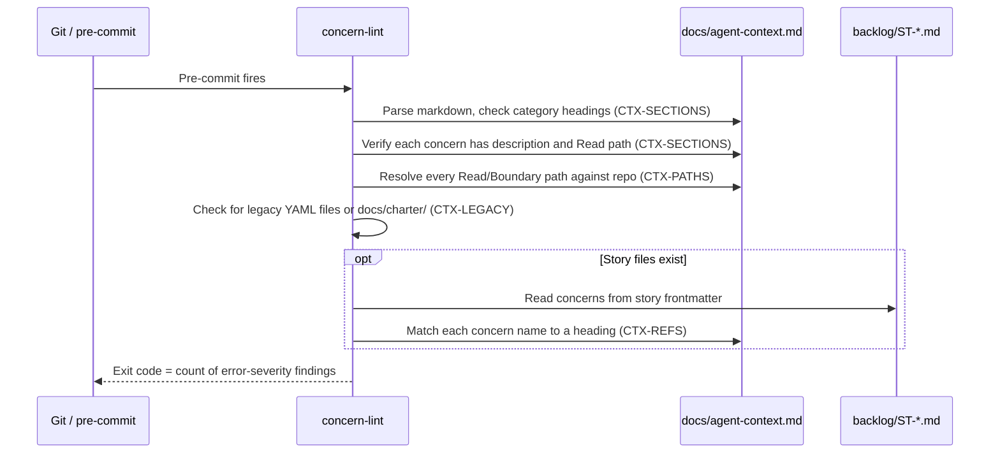

**Key Points:**

- All `CTX-*` findings are errors. A single finding fails the gate.
- The three required categories are `## Always (cross-cutting)`, `## Technical concerns`, and `## Domain concerns`.
- `docs/testing.yaml` is the only accepted test-configuration path and is not validated by `concern-lint`.
- `CTX-LEGACY` rejects mixed formats: the concern-oriented file must not coexist with YAML agent-context files or a `docs/charter/` directory.

## 6.6 Local Usage Query

Derived from dynamic view `UsageQuery` in
[`architecture.dsl`](../spec/architecture.dsl).

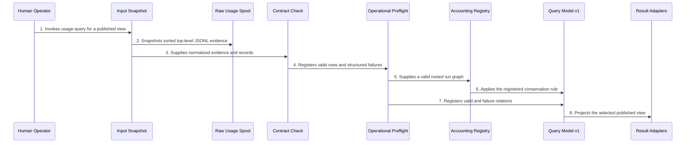

The query snapshots its input once. Every selected line becomes either a valid
row or a structured failure. `capture_health` remains queryable when failures
exist; all other stable views refuse partial output. Empty input is valid and
returns each view's declared typed empty result.

## 6.7 Explicit Parquet Export

Derived from dynamic view `UsageParquetExport` in
[`architecture.dsl`](../spec/architecture.dsl).

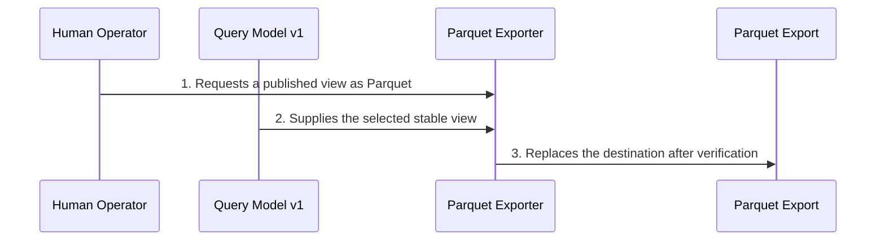

The exporter writes a temporary sibling, verifies logical rows and schema, and
records query-model and input-set provenance before replacement. Any failure
leaves an existing destination unchanged. No scheduled refresh exists.

## 6.8 OpenCode Permission Enforcement

Derived from dynamic view `OpenCodePermissionEnforcement` in [`architecture.dsl`](../spec/architecture.dsl).

The Factory plugin enforces permissions and step boundaries for every tool invocation in an OpenCode session. The permission enforcer evaluates ordered allow, ask, and deny rules. Explicit denials are final and cannot be broadened by the plugin's permission hook.

### 6.8.1 Sequence: Plugin Evaluates a Tool Invocation

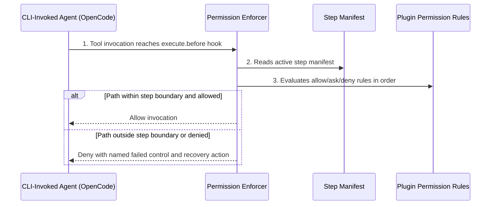

**Key Points:**

- The plugin reads `.current-work/current-step.yml` to determine the active step boundary.
- Reads outside declared inputs are denied before tool execution.
- Writes outside declared outputs are denied before tool execution.
- Shell commands matching denied Git patterns are denied before execution.
- Review agents whose definitions declare no write outputs receive read-only tool sets. The Tool Restrictor removes write tools from the agent's available set.
- Permission hooks may narrow an OpenCode decision but never broaden a configured denial.

## 6.9 OpenCode Worktree Isolation

Derived from dynamic view `OpenCodeWorktreeIsolation` in [`architecture.dsl`](../spec/architecture.dsl).

The plugin isolates each dispatched child session in a Factory-managed worktree. The worktree strategy delegates branch and path creation to Factory scripts so that the Factory's naming, base, path, and verification rules remain authoritative.

### 6.9.1 Sequence: Plugin Isolates a Child Session

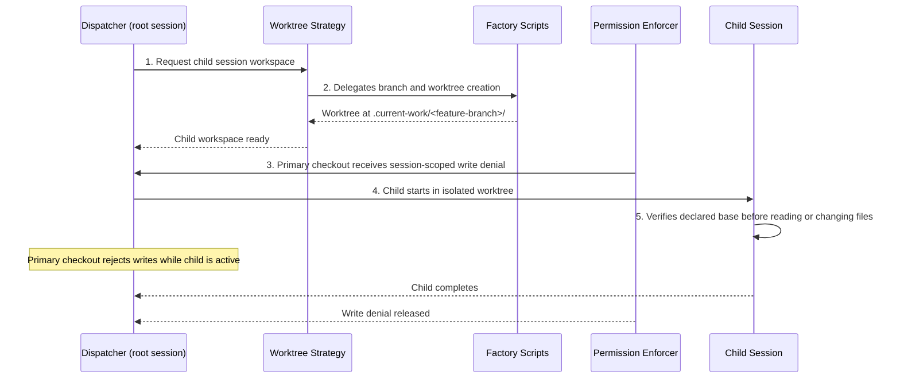

**Key Points:**

- Each child receives its own Factory branch and Git worktree under `.current-work/<feature-branch>/`.
- Each child verifies its declared base commit before reading or changing files.
- The primary checkout rejects writes through a session-scoped write denial while any child is active.
- Worktree creation failure fails closed: the dispatch is denied with a named recovery action.
- The Factory's naming, base, path, and verification rules remain authoritative. OpenCode tracks the resulting location and starts each child session there.

## 6.10 Value-First Onboarding

The value-first onboarding journey guides a newcomer from diagnosis to one safe result before asking for advanced configuration. Seven runtime sequences cover the key interactions: installation, release build, first-session insight, the first-task sandbox lifecycle, the update transaction, and the layout migration inside an update with its rollback.

### 6.10.1 Sequence: Newcomer Installs a Verified Factory Release

Derived from dynamic view `OnboardingInstallation` in [`architecture.dsl`](../spec/architecture.dsl).

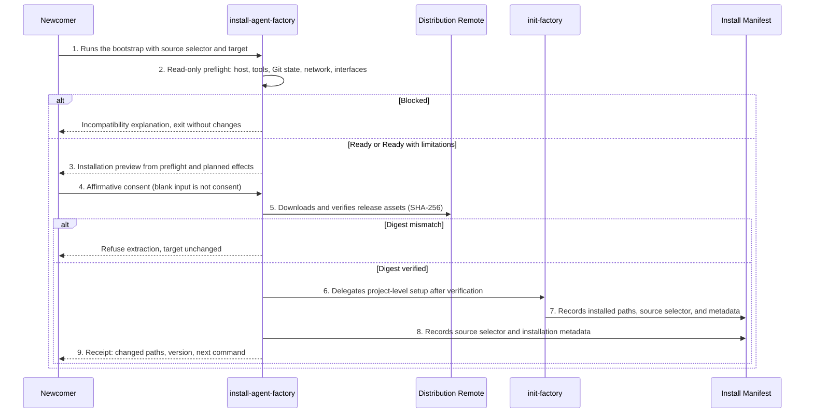

**Key Points:**

- Preflight is read-only. No software is installed, no files are edited, and no configuration is changed during diagnosis.
- The installation preview derives from preflight results and the source selector. No install manifest exists before first installation.
- The installation preview precedes download. No remote assets are fetched until the newcomer gives affirmative consent. This satisfies the consent-before-mutation rule.
- Each prerequisite fix requires separate affirmative consent, shows its scope and reversal, and passes verification before the next fix. Blank input stops the sequence.
- The bootstrap delegates to `init-factory` for the actual file operations. See [ADR-0022](../adr/0022-layered-installation-bootstrap-wraps-init-factory.md) (superseded by [ADR-0023](../adr/0023-update-transaction-with-approval-staging-and-rollback.md); the layered first-install design is preserved).
- The receipt names one exact command that opens the first Factory session.

### 6.10.2 Sequence: Release Maintainer Builds Reproducible Assets

Derived from dynamic view `ReleaseBuild` in [`architecture.dsl`](../spec/architecture.dsl).

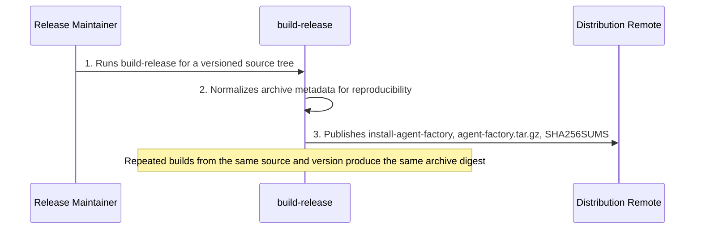

### 6.10.3 Sequence: First Session Delivers Project Insight

Derived from dynamic view `FirstSessionInsight` in [`architecture.dsl`](../spec/architecture.dsl).

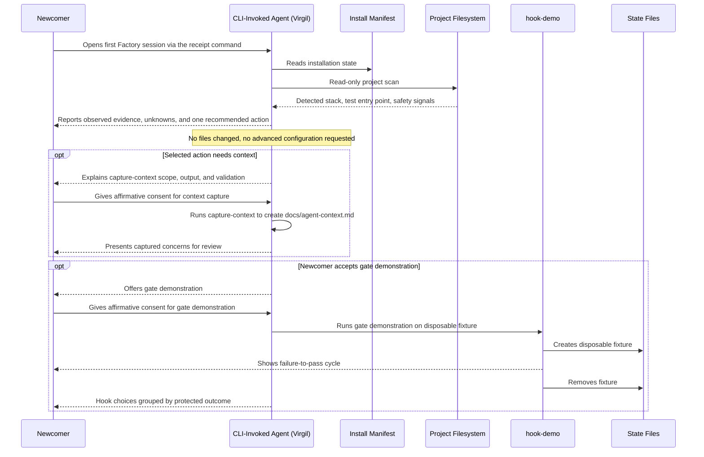

**Component ownership:**

| Behavior                       | Owner                                                                                                                                       |
| ------------------------------ | ------------------------------------------------------------------------------------------------------------------------------------------- |
| Read-only project insight      | Virgil reads the install manifest and scans the project filesystem without side effects                                                     |
| Deferred configuration routing | Virgil delays model-tier, hook, and context decisions until the selected action requires them                                               |
| Context capture                | `capture-context` skill creates `docs/agent-context.md` after the newcomer gives affirmative consent; Virgil presents captured concerns     |
| Gate demonstration             | `hook-demo` (Distribution) creates a disposable fixture, runs a real gate, and removes the fixture after newcomer gives affirmative consent |

**Key Points:**

- The first session reads installation state and scans the project, then reports what the Factory found, what remains unknown, and one recommended action without changing project files.
- Model-tier selection, hook decisions, and extended context capture wait until the chosen action requires them.
- Before context capture, onboarding explains the scan, the output (`docs/agent-context.md`), validation (`concern-lint`), and defines `concern` as a routing topic. Context capture requires affirmative consent before scanning. The capture invocation follows consent, and the captured concerns are presented for review.
- The gate demonstration requires affirmative consent before running. It uses a disposable fixture and leaves the target project unchanged.

### 6.10.4 Sequence: First Task Runs in an Isolated Sandbox

The shared execution paths are derived from dynamic views `FirstTaskLifecycle`
and `FirstTaskLifecycleNoHead` in [`architecture.dsl`](../spec/architecture.dsl). The
first-task state machine owns the mutually exclusive discard, reference
retention, and production-handoff branches.

The first-task sandbox lifecycle follows the state machine at [`state-machines.md`](../spec/state-machines.md#first-task-sandbox-lifecycle) and the contract at [`interface-contracts.md`](../spec/interface-contracts.md#first-task-sandbox).

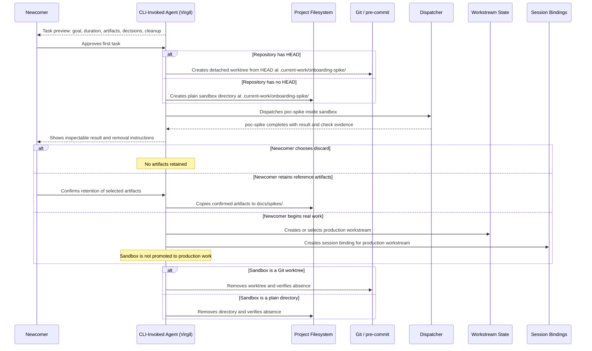

**Component ownership:**

| Behavior                        | Owner                                                                                                                         |
| ------------------------------- | ----------------------------------------------------------------------------------------------------------------------------- |
| First-task preview and approval | Virgil presents goal, duration, artifacts, decisions, and cleanup; blank or declined approval creates no sandbox              |
| Sandbox creation                | Virgil creates a detached worktree via Git (HEAD exists) or a plain sandbox directory under `.current-work/` (no HEAD)        |
| Task execution and checking     | Dispatcher resolves and dispatches `poc-spike` playbook inside the sandbox                                                    |
| Discard and cleanup             | Virgil removes the sandbox via Git (worktree) or filesystem and verifies the sandbox path no longer exists                    |
| Reference-artifact retention    | Newcomer confirms retention of selected artifacts; Virgil copies confirmed artifacts to `docs/spikes/` before sandbox removal |
| Production-workstream handoff   | Virgil creates or selects a workstream identity and binds the session to it; the sandbox is never promoted                    |

**Key Points:**

- The sandbox creates no branch or commit. Uncommitted active-working-tree changes are absent from the sandbox.
- When the repository has no HEAD, Virgil creates a plain directory instead of a Git worktree. This is not a Git operation.
- The `poc-spike` workflow runs only inside the sandbox. Its result is directly inspectable by the newcomer.
- Retention requires separate consent per artifact. The newcomer confirms before Virgil copies. Retained files are reference copies, not production state.
- Production handoff creates a normal workstream through the existing workstream creation path. The sandbox does not become production work.
- The ready-host budget is an inspectable result within ten minutes and five decisions after installation approval.

### 6.10.5 Sequence: Project Maintainer Updates an Installation

Derived from dynamic views `UpdateTransaction` and `UpdateTransactionCheck` in [`architecture.dsl`](../spec/architecture.dsl).

The update transaction follows [ADR-0023](../adr/0023-update-transaction-with-approval-staging-and-rollback.md), which supersedes ADR-0010 and ADR-0022 for the update path while preserving the layered first-install design.

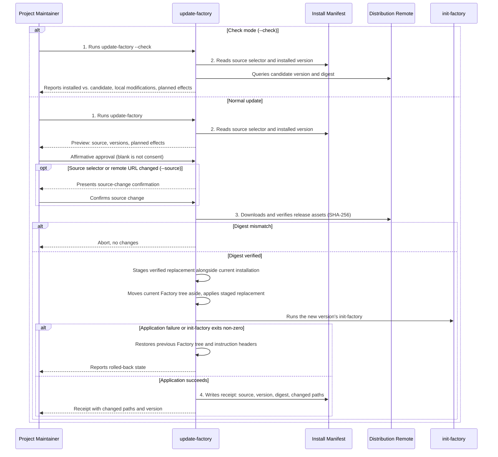

**Key Points:**

- Check mode is read-only. It reports the same information as the approval preview without downloading or mutating.
- Modified Factory-owned files stop the update before staging. The user may select the existing preservation flow to proceed.
- A different source selector or remote URL requires a separate `--source` option and its own confirmation step. No automatic fallback crosses the source boundary.
- The previous Factory tree is moved aside, not deleted, before application. Rollback restores it if application fails.
- `update-factory` owns the full transaction. After application, it runs the new version's `init-factory`, and a non-zero exit of `init-factory` triggers the rollback ([ADR-0026](../adr/0026-layout-migration-runs-inside-the-factory-update.md)).

### 6.10.6 Sequence: Update Moves the Project into the Core Artifact Layout

Derived from dynamic view `UpdateLayoutMigration` in [`architecture.dsl`](../spec/architecture.dsl).

An update from a factory version before the layout release moves the project's files into the core artifact layout described in [8.16](08_crosscutting_concepts.md#816-where-specification-artifacts-live). The developer approves the update, not the move, and declining the update means no update.

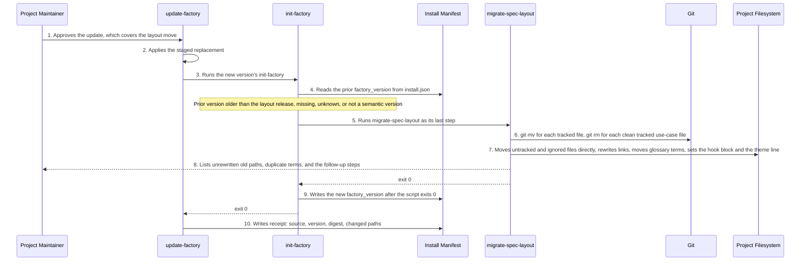

**Key Points:**

- The version test compares versions by Semantic Versioning 2.0.0 precedence, so `1.4.0` is older than `1.10.0` and `1.4.0-rc` is older than `1.4.0`. The layout release is `1.4.0`, the constant `LAYOUT_RELEASE` of `init-factory` (CAL-G02).
- Only a project without `install.json` is a first install. `init-factory` moves nothing there, lists each old path it finds, and names `migrate-spec-layout` as a command the developer can run.
- No git state blocks the script. Tracked files move with `git mv`, also with uncommitted changes. Untracked and ignored files move with a plain file move. A file of the removal set that is untracked, ignored, or tracked with uncommitted changes stays in place, and the script lists it for the developer to delete. The script never runs `git rm -f`.
- A later run of `init-factory` at the same version moves nothing. On a project without old paths, the script prints nothing and exits 0.
- The script commits nothing. It stages the new glossary and chapter 12. The developer reviews the moves with `git status` and commits them.
- After `init-factory`, `update-factory` brings the factory hook block to the new template. After a layout migration it writes the block without a question; every other update asks first (DEC-17).
- The two follow-up steps run later, in a session with the developer present: `capture-context --fold-context-map` folds `CONTEXT-MAP.md` and routing-only `CONTEXT.md` files into domain concerns of `docs/agent-context.md`, and `domain-modeling` cleans up the duplicate terms.

### 6.10.7 Sequence: Failed Layout Migration Rolls Back the Update

Derived from dynamic view `UpdateLayoutMigrationRollback` in [`architecture.dsl`](../spec/architecture.dsl).

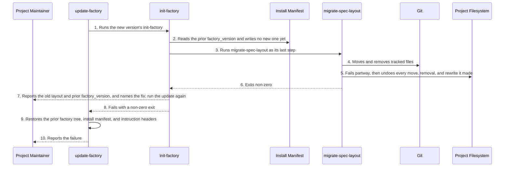

**Key Points:**

- The script's own undo restores the project's files: moves, removals, link rewrites, `docs/spec/glossary.md` and chapter 12, the removed `## Language` sections, the hook block, and the `theme` line. `git status` then shows no change against the state before the run.
- `install.json` keeps the prior `factory_version`, because `init-factory` writes the new version only after the script exits 0. So the next update retries the migration.
- `update-factory` restores the factory tree, the install manifest, and the instruction headers. The project keeps its old layout and its old factory version, so its scripts and hooks match its layout.
- The layout release supports only an installed `update-factory` `v1.1.0-rc` or later, the first release with this rollback. A project on an older release updates to 1.3.x first, as the release notes say ([ADR-0026](../adr/0026-layout-migration-runs-inside-the-factory-update.md)).

## 6.11 Specification Handoff Between Producers

Derived from dynamic view `SpecificationHandoff` in [`architecture.dsl`](../spec/architecture.dsl).

The specification has three producers, and each hands off to the next in its handoff text. `run-step` still counts an agent as eligible when the files of its required inputs exist, so the declared inputs set the order. [8.17](08_crosscutting_concepts.md#817-artifact-ownership-one-producer-one-declared-review) names the owner of each file.

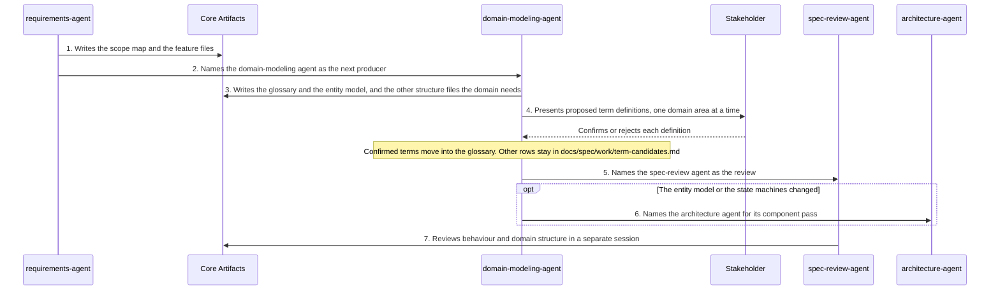

**Key Points:**

- The domain-modeling agent always writes `glossary.md` and `entity-model.md`, even when the glossary holds no term yet. The spec-review agent requires both, so its review can always run.
- The architecture agent requires only a feature file or the scope map, so it can build the baseline before the domain structure exists. `run-step` does not start it again when the domain structure changes. The handoff in step 6 does.
- An unattended run leaves its term definitions at `proposed`. The spec review files a finding for each of them. The [Term Candidate Lifecycle](../spec/state-machines.md#term-candidate-lifecycle) holds the statuses.
- The test-strategy agent can become eligible while the spec review still runs. The user then chooses the order. A contract that the review changes needs a revised QA strategy.

## 6.12 Spec Feedback and Wave Close

Derived from dynamic view `SpecFeedbackWaveClose` in [`architecture.dsl`](../spec/architecture.dsl).

The developer agent and the implementation agent edit no specification file. A drift that a story reveals goes to the artifact's owner as a row of the story's spec-feedback report. The wave closes only when the owners and their reviews have handled every row, and the next wave starts only after the close. So the specification lags the code by one wave at most. [ADR-0029](../adr/0029-per-story-drift-reports-block-the-wave-close.md) records the decision.

Take ST-0318. The developer agent finds that the migration script must refuse a repository with uncommitted changes, and `validation-rules.md` has no such rule.

```mermaid
sequenceDiagram
    participant IA as implementation-agent
    participant DA as developer-agent
    participant WO as Working Output
    participant DMA as domain-modeling-agent
    participant CA as Core Artifacts
    participant SRA as spec-review-agent
    participant D as dispatch
    participant CL as Core List
    participant SF as State Files

    IA->>DA: 1. Dispatches the story
    DA->>WO: 2. Writes an open row: artifact, drift, evidence, owner
    Note over IA: The story passes its gates
    IA->>D: 3. Runs dispatch merge-story for the story
    IA->>DMA: 4. Dispatches the row's owner on the invocation branch, one session at a time
    DMA->>CA: 5. Changes the artifact
    DMA->>WO: 6. Sets the row to fixed and commits it with the artifact change
    IA->>SRA: 7. Dispatches the owner's reviewer on the invocation branch
    SRA->>CA: 8. Reviews the change
    alt The change matches the code and the accepted requirements
        SRA->>WO: 9. Sets the row to confirmed and commits the status
    else The code breaks an accepted requirement
        SRA->>WO: 9. Sets the row to rejected, files a BUG finding with the developer agent as owner, and commits the status
    end
    Note over IA: The next merge-story of the wave waits until these sessions have committed
    IA->>D: 10. Runs dispatch close-wave
    D->>WO: 11. Reads the spec-feedback reports of the wave's stories
    D->>CL: 12. Reads the core list under its Factory root
    alt A report or the core list cannot be read
        D-->>IA: Fails and names the file
    else A row is open, or fixed on a core or seam artifact
        D-->>IA: Fails and names the report, the artifact, and the status
    else Every row is confirmed, rejected, or fixed on another artifact
        D->>SF: 13. Records the closed wave in the dispatch ledger
    end
    IA->>D: 14. Runs dispatch prepare-wave for the next wave
    D->>SF: 15. Reads the closed wave from the dispatch ledger
    alt The previous wave is not recorded as closed
        D-->>IA: Refuses and names close-wave
    end
```

**Key Points:**

- Each story has its own report, `docs/spec/work/spec-feedback-<story-id>.md`, because the developer agents of a wave run in parallel. A story without a report counts as a story without rows.
- A row carries the columns Artifact, Drift, Evidence, Owner, and Status. The [Report Row Lifecycle](../spec/state-machines.md#report-row-lifecycle) holds the four statuses, and [BR-061](../spec/validation-rules.md#ownership-and-drift-reports-core-artifact-ownership-br-056br-066) names who sets each one.
- A row about an artifact without a declared review, such as a QA strategy or an ADR, closes at `fixed`. `close-wave` reads the core list to tell the two kinds of row apart.
- `close-wave` fails closed. A report with wrong column headers, a row with a status outside `open`, `fixed`, `confirmed`, and `rejected`, or a missing core list each fails, and the message names the file. A missing report still counts as a story without rows.
- `close-wave` reads `rulebooks/core-artifacts.yaml` under the Factory root it runs from, as `index-lint` resolves its root. That is `packages/factory/` in this repository and `.agent-factory/factory/` in an installed project.
- Owner and reviewer sessions run one at a time on the invocation branch, because two owners of one wave may change the same core file. Each session commits its core-file change and its row status together. The next `merge-story` waits until the sessions of the merged story have committed, so no story merges onto a half-changed core file.
- `prepare-wave N` refuses while the ledger does not record wave N-1 as closed, and its message names `close-wave`. So a failed close stops the next wave.
- A drift row on the glossary has two reviewers, as the core list declares. The stakeholder confirms each term through the term candidates before the domain-modeling agent writes it, and the spec-review agent then sets the row's status.
- When the reviewer is the stakeholder, the agent that ran the session with the stakeholder sets the status.
- After a story merges, the implementation agent also dispatches the test-strategy agent for each open `QA` finding it owns. `close-wave` does not wait for `QA` findings.
- In manual mode there are no waves. The human closes a story only when its report passes the same check.
- The reconciliation agent uses the same row shape and statuses in `docs/reviews/reconciliation-<date>.md`, one report per run. It edits no core file. The orchestrator of the `documentation-update` playbook brings its rows back to the owners ([6.13](#613-reconciliation-backfeed)).

## 6.13 Reconciliation Backfeed

Derived from dynamic view `ReconciliationBackfeed` in [`architecture.dsl`](../spec/architecture.dsl).

A reconciliation run finds drift after implementation, outside any wave. So no implementation agent picks up its rows. The orchestrator of the `documentation-update` playbook does instead. The orchestrator is the session that runs the playbook. After the run, its backfeed step brings each row back to the artifact's owner and then to the owner's reviewer. [ADR-0030](../adr/0030-reconciliation-rows-return-through-the-documentation-update-playbook.md) records the decision.

Take the run of 2026-11-03. The code adds a component that the slice view of `docs/spec/architecture.dsl` does not show. The report `docs/reviews/reconciliation-2026-11-03.md` gets an `open` row with the architecture agent as owner.

```mermaid
sequenceDiagram
    participant O as CLI-Invoked Agent (orchestrator)
    participant RA as reconciliation-agent
    participant CA as Core Artifacts
    participant CL as Core List
    participant WO as Working Output
    participant AA as architecture-agent
    participant ARA as architecture-review-agent
    participant SH as Stakeholder

    O->>RA: 1. Dispatches the reconciliation run
    RA->>CA: 2. Reads the core to compare it with the code
    RA->>WO: 3. Writes the run's report, one open row per new drift with the artifact's owner
    O->>WO: 4. Reads every reconciliation report, not only the new one
    O->>CL: 5. Reads the core list to tell rows on core artifacts from the others
    loop Each open row, one session at a time
        O->>AA: 6. Dispatches the owner of an open row, naming the row and the report and no skill
        AA->>CA: 7. Changes architecture.dsl with the skill its own definition names for it
        AA->>WO: 8. Sets the row to fixed in the same commit as the change
    end
    loop Each fixed row on an artifact of the core list
        opt reviewed_by names an agent
            O->>ARA: 9. Dispatches the reviewer that reviewed_by names, one session at a time
            ARA->>CA: 10. Reviews the change
            alt The change matches the code and the accepted requirements
                ARA->>WO: 11. Sets the row to confirmed
            else The code breaks an accepted requirement
                ARA->>WO: 11. Sets the row to rejected and files a BUG finding with the developer agent as owner
            end
        end
        opt reviewed_by names the stakeholder
            O->>SH: 12. Presents the fix, after any agent reviewer confirmed it
            O->>WO: 13. Sets the row to confirmed or rejected as the stakeholder decides
        end
    end
    O->>WO: 14. Checks the DONE list: no row of any report is open, or fixed on a core artifact
    alt A row is open, or fixed on a core artifact
        WO-->>O: The playbook stays open and names the row
    else Every row is handled
        WO-->>O: The playbook is done
    end
```

**Key Points:**

- The owner, the skill, and the reviewer each come from one place. The row names the owner. The owner's agent definition names the skill for the artifact, so the dispatch names only the row and the report. The architecture agent, for example, chooses between `maintain-architecture` and `model-structurizr-slice`. The owner's output declaration names the reviewer in `reviewed_by:`. The core list keeps its four fields.
- The backfeed step reads every reconciliation report, not only the new one. So a session that stopped after the owner's fix leaves a `fixed` row, and the next backfeed step dispatches its reviewer.
- A row stays in the report that first wrote it, and only its status changes. A later run checks the row against the code but writes no row for the same drift. It writes a new row only when the drift of a closed row appears again: a `confirmed` row, or a `fixed` row outside the core list. A row that still waits needs no record, because the backfeed step picks it up.
- When `reviewed_by:` names an agent and `stakeholder`, the agent reviews first. The stakeholder sees the fix only after the agent confirmed it. For the stakeholder, the orchestrator sets the status itself, as for a fixed row on `docs/agent-context.md` with Virgil as owner.
- The orchestrator reads the core list, as `dispatch close-wave` does, to tell a row on a core artifact from the others. A `fixed` row on an artifact outside the core list, such as an ADR, closes at `fixed`, because the artifact has no declared review (DEC-35).
- The owner and the reviewer commit on the branch that holds the reconciliation report, normally the feature branch before its merge into `dev`. So the fixes reach `dev` with the code they describe.
- Only the playbook's DONE list waits for the rows. No script reads the reconciliation reports. So an unhandled row blocks neither `premerge-check`, nor `dispatch close-wave`, nor the next reconciliation run.
- [BR-067](../spec/validation-rules.md#ownership-and-drift-reports-core-artifact-ownership-br-056br-066) holds the rule, and the [Report Row Lifecycle](../spec/state-machines.md#report-row-lifecycle) holds the statuses.

## 6.14 Other Runtime Scenarios (Summary)

Full sequences for these flows are in their respective use cases:

- **Agent dispatch (interactive vs. background)** -- `UC-04`

## 6.15 ID Claim with a Stale Lease

Derived from dynamic view `IdClaimStaleLeaseRetry` in [`architecture.dsl`](../spec/architecture.dsl).

Two sessions claim at the same moment. The planning agent runs `next-id ST`
for a new story, and a code review in another clone runs `next-id FAGAN`. Both
read the claim commit with `ST=1012` and `FAGAN=1003`. The review pushes
first, so the planning agent's push meets a stale lease. The one ref holds
every prefix, so claims of different prefixes collide too.

```mermaid
sequenceDiagram
    participant CA as CLI-Invoked Agent
    participant NI as next-id
    participant CP as Counter Port
    participant GA as Git-Ref Adapter
    participant PR as Project Git Remote

    CA->>NI: 1. Runs next-id ST from create-backlog-stories
    NI->>CP: 2. Calls claim ST on the URL of origin
    GA->>PR: 3. Fetches refs/ids/counters into a throwaway bare repository and reads ST=1012
    GA->>PR: 4. Pushes a claim commit with ST=1013 under the lease on the old SHA
    PR-->>GA: stale lease, because another caller claimed FAGAN-1004 first
    Note over GA: Waits a random 0.1 to 1 second
    GA->>PR: 5. Fetches again and reads ST=1012 and FAGAN=1004
    GA->>PR: 6. Pushes a claim commit with ST=1013 under the lease on the new SHA
    PR-->>GA: accepted
    GA->>CP: 7. Returns 1013 and deletes the throwaway repository
    NI->>CA: 8. Prints ST-1013 and exits 0
```

**Key Points:**

- The adapter reads the claim commit again after every stale lease, so the
  next try sees the number that the other caller took.
- Only the two git messages for a stale lease, `stale info` and
  `cannot lock ref … is at <sha> but expected <sha>`, lead to a retry.
  `next-id` runs git with `LC_ALL=C`, so git prints them in English. Any other
  refusal ends the claim after one push with git's message.
- After ten stale leases in a row, `next-id` exits non-zero and names the
  prefix and the last number it tried. It prints no ID.
- The claim leaves no ref and no object in the clone, because it runs in a
  throwaway repository that `next-id` deletes at exit.
- The [Claim Lifecycle](../spec/state-machines.md#claim-lifecycle) holds the
  states, and BR-071 and BR-072 in
  [validation-rules.md](../spec/validation-rules.md#counter-ids-next-id-br-068br-078)
  hold the rules.

## 6.16 Move of a Local Counter to Origin

Derived from dynamic view `IdMoveToOrigin` in [`architecture.dsl`](../spec/architecture.dsl).

A project started without `origin`, so its Local Counter holds `ST=0012`. The
human then adds `origin`. At the next session start, VIRGIL sees that
`agent-factory.counterRemote` is set and that `origin` exists, and it offers
the move. The User confirms
([ADR-0033](../adr/0033-the-projects-own-repository-holds-the-counter-until-origin-exists.md)).

```mermaid
sequenceDiagram
    participant VI as virgil
    participant NI as next-id
    participant CP as Counter Port
    participant GA as Git-Ref Adapter
    participant LC as Local Counter
    participant PR as Project Git Remote

    VI->>NI: 1. Runs next-id --move-to-origin at the session start, after the User confirms the move
    NI->>LC: 2. Reads agent-factory.counterRemote, the path of the main repository
    NI->>CP: 3. Calls move to the URL of origin
    GA->>LC: 4. Fetches refs/ids/counters and reads the claim commit C with ST=0012
    GA->>LC: 5. Replaces refs/ids/counters with the marker commit moved=<origin>, whose parent is C, under the lease on C
    LC-->>GA: accepted
    GA->>PR: 6. Pushes C to refs/ids/counters with --force-with-lease=refs/ids/counters:
    PR-->>GA: accepted, because origin holds no counter
    GA->>CP: 7. Returns moved
    NI->>LC: 8. Removes agent-factory.counterRemote and exits 0
    NI-->>VI: reports that the counter is on origin
```

**Key Points:**

- The marker goes in before the push. A claim from another worktree that
  lands before step 5 makes the lease on `C` stale, so the move starts again
  at step 4 and carries the new number to `origin`. A claim after step 5 reads
  the marker and fails (BR-103).
- When `origin` already holds a counter, the create-only lease in step 6
  refuses the push. The adapter puts `C` back on the Local Counter under a
  lease on the marker, the setting stays, and `next-id` exits non-zero and
  names both counters. VIRGIL reports the collision (BR-102, BR-106).
- A claim or a `--plan-seed` that reads the marker names `origin` as the
  holder of the counter and never mentions `--seed`, so a local clone gets no
  advice to start a second counter (BR-097).
- The marker has `C` as its parent, so `C` stays reachable in the main
  repository when the move stops before the push (DEC-14).

### 6.16.1 Interrupted Move

Derived from dynamic view `IdMoveToOriginResume` in [`architecture.dsl`](../spec/architecture.dsl).

The move of 6.16 stops after step 5, for example because the shell kills
`next-id` while git waits for credentials. The Local Counter holds the
marker, `origin` holds no counter, and `agent-factory.counterRemote` is still
set. Every claim now reads the marker and fails. At the next session start,
VIRGIL sees the setting and `origin` and offers the move again.

```mermaid
sequenceDiagram
    participant VI as virgil
    participant NI as next-id
    participant CP as Counter Port
    participant GA as Git-Ref Adapter
    participant LC as Local Counter
    participant PR as Project Git Remote

    VI->>NI: 1. Runs next-id --move-to-origin again at the next session start, after the User confirms the move
    NI->>LC: 2. Reads agent-factory.counterRemote, which the stopped move left set
    NI->>CP: 3. Calls move to the URL of origin
    GA->>LC: 4. Fetches refs/ids/counters, reads the marker commit moved=<origin>, and takes C with ST=0012 from its parent
    GA->>PR: 5. Pushes C to refs/ids/counters with --force-with-lease=refs/ids/counters:
    PR-->>GA: accepted, because origin holds no counter
    GA->>CP: 6. Returns moved
    NI->>LC: 7. Removes agent-factory.counterRemote and exits 0
    NI-->>VI: reports that the counter is on origin
```

**Key Points:**

- The second run finds the marker at its read, so it sets no new marker. It
  goes on at the push with the `C` of the marker's parent.
- When `origin` already holds `C`, the earlier push went through before the
  stop. The move then skips the push, keeps the marker, removes the setting,
  and never puts `C` back, so the Local Counter never comes back beside the
  counter on `origin`.
- When `origin` holds a claim commit other than `C`, the move cannot tell
  whether that counter grew from `C`, because a claim commit has no parent.
  So it treats the case as a collision, names both counters, and changes
  nothing. The Local Counter keeps the marker and the setting stays, so no
  claim lands on `C` again. A counter that someone else seeded ends the same
  way.
- No step needs a new seed, so no claimed number goes out twice.
- The [Move Lifecycle](../spec/state-machines.md#move-lifecycle) holds the
  states, and BR-102 and BR-103 in
  [validation-rules.md](../spec/validation-rules.md#next-id---move-to-origin)
  hold the rules.

## Referenced from

- [05_building_block_view.md section 5.2.1](05_building_block_view.md#521-project-owned-test-gates-via-charter-declaration)
- [05_building_block_view.md section 5.2.3](05_building_block_view.md#523-semantic-quality-gates-crap-score-mutation-analysis-dependency-check)
- [08_crosscutting_concepts.md section 8.1](08_crosscutting_concepts.md#81-agentic-creation-deterministic-validation)
- [09_architecture_decisions.md](09_architecture_decisions.md)
